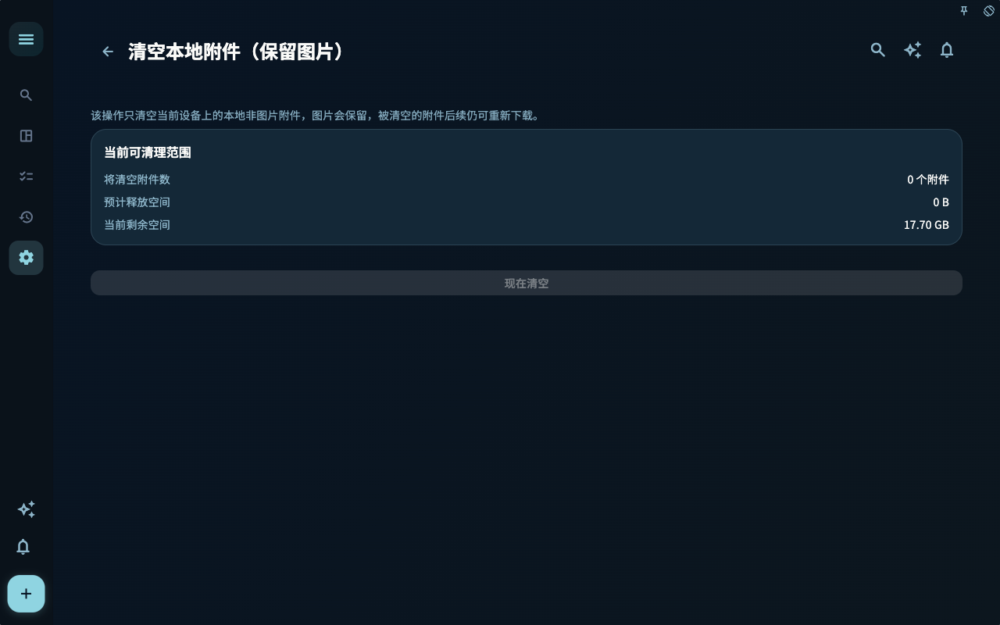

数据安全不是一个按钮能解决的事。Granoflow 里至少有四件不同的事：本地保存、云端同步、本地备份和附件清理。

## 一个真实场景

换设备时看同步和恢复；重装前看本地备份；磁盘空间紧张时看附件；担心账号问题时先看恢复信息。

## 三个入口处理三类风险

数据管理页适合处理备份、导入、卡组和附件缓存。它是你准备迁移、恢复或清理前应该先看的地方。

本地备份进度出现时，先等流程结束。备份还在进行中就关闭应用或清理文件，反而会让后续恢复更麻烦。

附件清理只处理占空间的文件，不等于删除任务本身。清理前先确认这些图片、PDF 或媒体文件是否还需要在记录里打开。

## 怎么判断下一步

| 你遇到的情况 | 先看什么 | 下一步 |
| --- | --- | --- |
| 不知道该从哪里开始 | 当前页面标题和主要入口 | 只选择和当前目标有关的一项 |
| 操作后结果不对 | 状态、空提示、访问记录或同步进度 | 回到上一层，按顺序排查 |
| 担心影响数据 | 备份、同步、账号或权限说明 | 先停下，确认范围后再继续 |

## 边界

先分清你要防的是哪类风险：丢设备、换设备、同步中断、还是本地空间不足。

## 下一步

读完这一节后，回到你正在处理的任务，只选一个最小动作继续：记录一条输入、检查一个状态、或打开相关设置完成一次确认。
