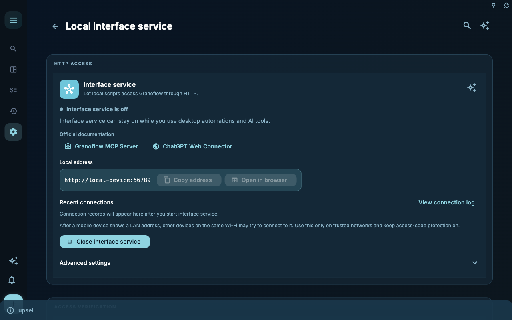
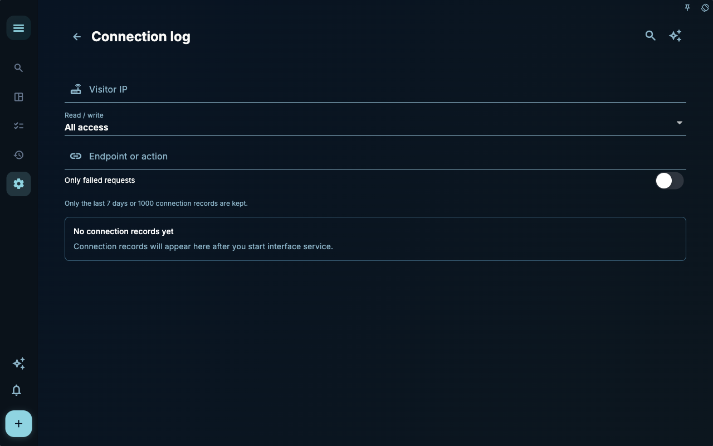

Desktop capabilities connect the app to command line and local tools; confirm entry points and access records first.

## How to use this page
1. Start from the outcome you want, not from memorizing button names.
2. Use the screenshots to confirm the page, state, and entry point.
3. After each step, check the visible feedback before moving on.

## Screenshots

Use this image to confirm the entry point, main state, and where you can continue.

Use this image to confirm the entry point, main state, and where you can continue.

## Boundary
Screenshots only prove the visible state for the current macOS, dark, landscape, seeded manual setup. Account, subscription, sync, AI, and external-tool pages can differ by permission and device state.

## Next

[Recover when something looks wrong](../recover-when-stuck/)
