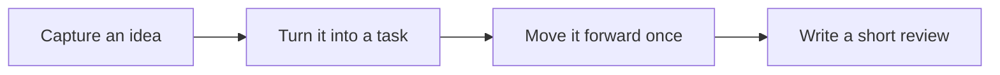

Read this page as a quick first pass through Granoflow. The point is not to memorize every feature name; it is to see how one idea becomes a task, gets moved forward, and leaves a small review behind.

::::tip[Start with one small loop]
Run one small loop first. Settings, projects, and deeper review habits can come later.

If you are just opening Granoflow for the first time, use the table below to decide where to begin, then let the page state guide the next step.
::::

## Think of it as

Think of Granoflow as a desk with a few clean trays. First put an idea down, then decide which tray it belongs in and what the next small action should be.

## The flow at a glance

Once you see the order, the app feels less like a set of separate pages and more like one path you can walk through.

## A real scenario

The first time you open Granoflow, find the Inbox, Tasks, Projects, and Review areas. Do not rush to configure every setting.

## Try it once

| Step | Action | What you should see |
| --- | --- | --- |
| 1 | Open the entry related to this quick start | You are on the relevant page |
| 2 | Pick one small action you can handle today | A list, status, or editor gives you something concrete to work with |
| 3 | Finish that step and return to the list | The status, record, or next entry point changes |
| 4 | Write one sentence of review or judgment | Later, you can see why you made that choice |

## What the pages show

| Page | What it means | How to decide next |
| --- | --- | --- |
| Inbox | Temporary ideas can stay here before you choose a project or date. | Pick out the items worth moving forward and turn them into tasks. |
| Task list | This is where decided next actions live. | Check whether the task has a clear action, date, or project connection. |
| Project page | Projects hold work that takes repeated effort over time. | If something is not a one-step task for today, consider putting it in a project. |

- Temporary ideas can stay here before you choose a project or date.
- Pick out the items worth moving forward and turn them into tasks.
- If your current question is not about the Inbox, use the table above to move to the page that fits better.

- This is where decided next actions live.
- Check whether the task has a clear action, date, or project connection.
- If your current question is not about tasks, use the table above to move to the page that fits better.

- Projects hold work that takes repeated effort over time.
- If something is not a one-step task for today, consider putting it in a project.
- If your current question is not about projects, use the table above to move to the page that fits better.

## Reusable judgment

Finishing one small loop matters more than understanding every concept first.

## How to use it

To start quickly, do three things: add one task, connect it to a project only if that helps, and write one or two review sentences in the evening. You do not need a complete system before you begin.

### Step 1: Write down one task

Open Granoflow, press **+**, and write the clearest thing currently on your mind.

Do not judge its importance yet, and do not hurry to decide which project it belongs to. The first step is simply to capture it. The new task can stay in the Inbox until you have time to organize it.

### Step 2 (optional): Connect it to a project

If the task belongs to a larger direction, such as “finish the thesis” or “prepare to move,” connect it to the matching project from the task details.

This step is optional. You can leave the task in the Inbox and organize it later when the project structure actually helps.

### Step 3: Do a short evening review

Before the day ends, open Granoflow, look at what was completed and what is still open, then write one or two sentences in the daily review:

- What you did today
- The one thing you most want to move forward tomorrow

You do not need a long summary, a score, or another daily pressure. The review is only there to connect today, tomorrow, and the longer direction you care about.

---

**At this point, you have started using Granoflow.** Read the rest of the manual as needed; there is no need to finish it in order.

## Common misunderstandings

| Misunderstanding | Better interpretation |
| --- | --- |
| “Start in 5 Minutes” means I must configure everything at once | Finish the current step first; add the rest gradually |
| Every entry on the page must be used immediately | Use only the entry that matches your current task |
| If I have not organized everything, I have failed | If the next step is clearer, the tool is already doing useful work |

::::note[Your goal still decides]
Granoflow can lay out information, status, and next steps. Whether to continue, change settings, delete something, or restore data still depends on the page you are on and the real goal in front of you.
::::

## Next step

Start with the Tasks chapter and run one minimal loop.
