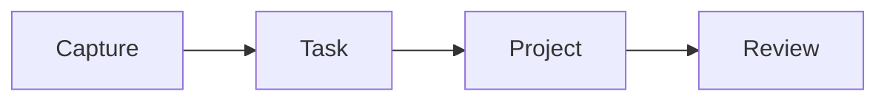
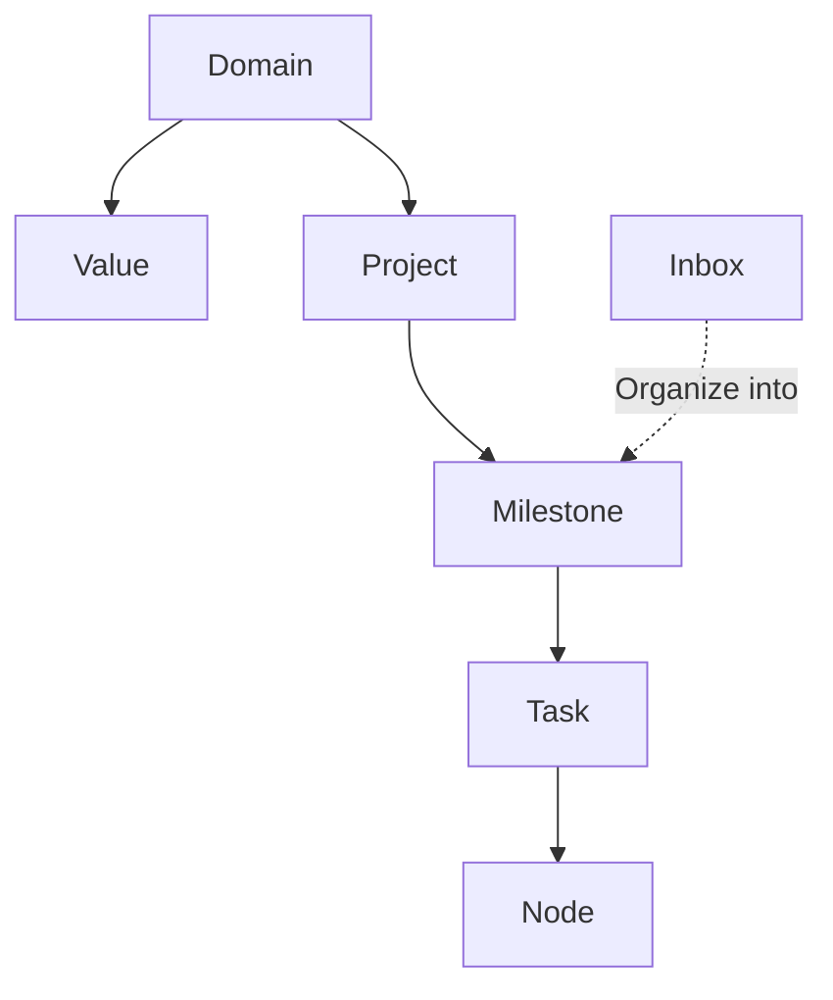

Use this page when a word in Granoflow feels unclear. It explains what the term means, where it appears, and how it connects to the rest of the workflow.

::::tip[Use this as a map]
You do not need to memorize the whole glossary. When a page mentions a term you do not recognize, come here, read the short definition, then return to the task you were doing.
::::

## Think of it as

Think of this page as a map legend. It does not replace the map itself, but it makes the symbols easier to read.

## The structure at a glance

Most terms in Granoflow fit somewhere along this path: capture something, shape it into work, move it forward, then review what happened.

## A real scenario

If you see “milestone,” “domain,” or “sync key” and are not sure what it means, check the term here before changing data or settings.

## Quick index

| What you want to understand | Where it usually appears | How to use it next |
| --- | --- | --- |
| A core concept | Sidebar, page title, detail panel, or settings area | Learn what the term controls before changing it |
| Current state | Lists, badges, switches, logs, or helper text | Decide whether you need to keep acting |
| Limits and boundaries | Notes, cautions, and reference tables | Avoid treating reference information as a promise that every action is automatic |

## Reusable judgment

When a term is confusing, ask two questions: what object does it describe, and what decision does it help me make?

## How the concepts connect

Domains contain values and projects. Projects contain milestones. Milestones contain tasks. Tasks can contain nodes. Inbox tasks can be organized into projects or milestones when you decide where they belong.

---

### Life structure

### Domain

A domain is a broad area of life, such as work, health, family, or study.

It is not a task folder. Think of it as a region on a map: projects can belong to a domain, and reviews can show where your attention has been going.

### Value

A value is a standard you want to keep returning to inside a domain, such as “do work that has real impact.”

It is not a task, cannot be completed, and does not check itself off. Its job is to remind you during review whether recent work still matches the standard you set.

### Project

A project is a container for a goal that takes ongoing effort, such as moving house, finishing a thesis, or building version 2 of an app.

Tasks can belong to projects and milestones. When you organize a task into a project, you usually choose a specific milestone as well. A project or milestone only explains where the task belongs; it does not by itself move an undated task out of the Inbox. Projects can be archived or completed, and if active tasks remain, Granoflow asks how to handle them first.

### Milestone

A milestone is a stage inside a project, such as first draft complete, testing passed, or launch.

Milestones help long projects feel less endless. A milestone can contain tasks, and it should not be closed until the tasks under it are handled.

### Task

A task is the basic action unit in Granoflow: the concrete thing you intend to do.

A task can have a title, due date, reminder, tag, project, milestone, and description. Task states include pending, in progress, completed, archived, and trash. When a task is completed, Granoflow records a completion time. If you mark it incomplete again, that completion time is cleared.

### Node

A node is a sub-step inside a task.

For example, a task called “submit tax return” might contain nodes such as collect receipts, fill in the form, and submit. When all nodes are complete, the parent task can complete automatically. If you add a new unfinished node, the parent task returns to a pending state.

### Inbox

The Inbox is a temporary place for tasks you have captured but have not fully arranged.

Tasks without a date, whose state is pending or in progress, can appear in the Inbox. Project and milestone are only ownership; an undated task can still remain in the Inbox. Once you give it a date, complete it, archive it, or delete it, it leaves the Inbox.

---

### Working rhythm

### Planning

Planning means turning a vague idea into a clearer task, usually by adding a date, project, milestone, or more precise next action.

You can plan from quick add, the Inbox, or task details. Shortcuts such as `#`, `@`, and `~` can help while typing, but data is only written after you confirm the change.

### Execution

Execution means doing the task itself.

You can pair this with focus timing, pinned tasks, or background music. When a task is completed, Granoflow first closes related focus sessions, then records the completion time so review data stays coherent.

### Completion

Completion means the task is done and has a completion time.

Daily Review counts tasks by the day they were actually completed, not by their due date. A new day starts at midnight; tasks completed after midnight belong to the new day’s review.

### Archive

Archive means the item is sealed away from the current work views while the record remains available for later lookup.

Projects, milestones, and tasks can all be archived. If active tasks remain inside, Granoflow asks how to handle them before archiving.

### Daily Review

Daily Review shows what was actually completed on a specific day.

It uses completion time rather than due date. If nothing was completed that day, the page stays quiet instead of filling the screen with empty charts.

### Reflection

Reflection means looking back over a longer period of effort, progress, and state.

Weekly review and monthly detail views are for this kind of reflection. The question is not only “how many tasks were completed,” but whether the work is still moving in a direction that matters.

---

### AI assistance

### AI assistant

An AI assistant is an external AI tool you choose, such as ChatGPT, Codex, Claude, Gemini, or DeepSeek.

Granoflow does not hide a black-box AI that silently changes your data. It prepares prompts, copies them to the clipboard, and opens the AI tool you choose.

### Prompt

A prompt is the instruction text Granoflow gives to an external AI tool.

It tells the AI what to ask, what to organize, and what output format to use. You can edit prompt templates, but Granoflow prevents empty or broken templates from being saved.

### Clipboard return

Clipboard return is the process of copying an external AI result back into Granoflow.

AI replies are not written into your tasks automatically. After you copy the result back, Granoflow reads the format and asks for confirmation. Only after you approve it does the content get imported. Content you already rejected or imported should not keep opening prompts.

---

### Data and security

### Local-first

Local-first means Granoflow keeps core data on your device first, so the app can work without relying on a server for everyday use.

You can capture tasks, organize work, and review offline. Data enters the encryption flow only when it leaves the device, such as during backup or cloud sync.

### Cloud sync

Cloud sync aligns local data with cloud data so different devices can show the same content.

Before syncing, Granoflow checks account, membership, and encryption-key state. If something does not match, it pauses and asks you to confirm instead of silently overwriting data.

### End-to-end encryption (E2EE)

End-to-end encryption means data is encrypted before it leaves your device, and the server stores ciphertext.

Granoflow servers cannot read your task content. Local search and daily use prioritize speed; encrypted backup and cloud upload happen when data leaves the device.

### Key

A key is the credential that unlocks encrypted backups and cloud data. It is **not your login password**.

Keys matter. The “data key” shown when creating a backup and the “cloud sync password” used on a new device both protect encrypted data, although they appear in different workflows. If you lose the key, old backups or the matching encrypted cloud data cannot be unlocked. Granoflow reminds you to save it, but the server cannot recover it for you.

### Backup and restore

A backup exports all device data into an encrypted `.flow.grano` file.

Restore brings that backup into the current device and requires the key used when the backup was created. If attachments were not fully downloaded at backup time, the backup may not contain complete attachments.

### App lock

App lock adds local verification when you open the app, such as Face ID, fingerprint, or PIN.

It reduces the chance that someone with brief access to your device can read your content. It is not complete protection if the device itself is compromised.

---

### Account and benefits

### Account

An account is used for login, sync, subscription recognition, and account recovery.

The main login method is currently an email verification code. You can use local features without logging in, but cloud sync guides you to sign in first.

### Membership and benefits

Membership, including Pro or Angel membership, means the account has paid benefits.

Benefits are confirmed by the server, not guessed by the app. They affect cloud sync, storage quota, attachment re-download, and related features. If a subscription was purchased under another account, the current account does not automatically receive those benefits.

---

### Interface and devices

### Desktop vs mobile

Desktop, meaning Windows, macOS, and Linux, is better for longer organizing sessions, project management, and review.

Mobile, meaning iOS and Android, is better for quick capture and notes on the go.

### System tray

On desktop, closing the window may only hide Granoflow in the system tray while it keeps running in the background.

In that state, focus timing is not interrupted. To fully quit, choose Quit from the tray menu.

### Sidebar mode

On desktop, Granoflow can be narrowed into a side window at the edge of the screen.

This lets you keep another app open while still checking or completing tasks.

## Common misunderstandings

| Misunderstanding | Better interpretation |
| --- | --- |
| I need to understand every concept before starting | Start with the concept that affects your current task |
| A term is the same as a folder or tag | Check what data object it describes before using it that way |
| Reference pages decide what I should do | They explain boundaries; your current goal still decides the next action |

::::note[Your goal still decides]
Granoflow can make information, status, and next steps clearer. Whether to continue, change settings, delete something, or restore data still depends on your current page and real goal.
::::

## Next step

Start with the Tasks chapter and run one minimal loop.
