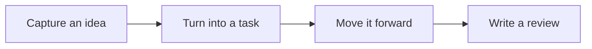
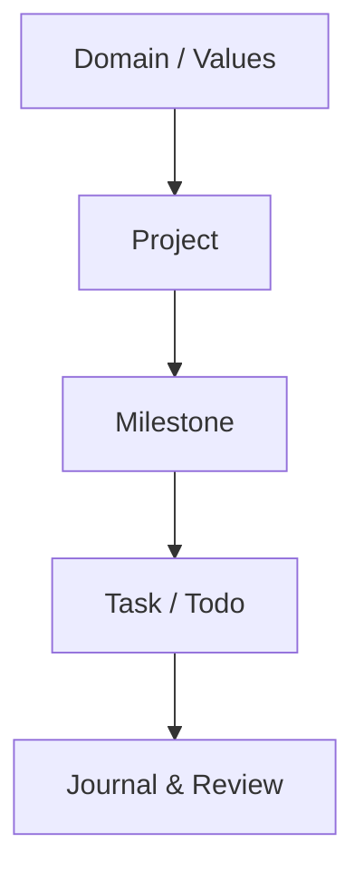

When reading "What is GranoFlow?", you can first understand it by placing it back into the "Getting Started" line. The key is not to memorize feature names, but to clarify what problems it solves and what to decide next.

::::tip[First, grasp the main thread]
First, run through a small loop, then slowly understand more settings.

If you are dealing with similar issues, first read the judgment table below; when actually operating, combine it with the lists, statuses, and tips on the page to decide your next step.
::::

## Think of it as what

Think of it as sticky notes on a workbench: first put down your ideas, then decide which one to pick up today.

## Understanding the Process at a Glance

First, think of the flow as a straight line: after understanding the order of these steps, go to the corresponding pages to handle the specific actions.

## A Real-Life Scenario

When you first open Granoflow, start by finding the Inbox, Tasks, Projects, and Reviews. Don’t rush to configure all the settings.

## Decide Before You Act

| If you want to... | What to look for on the page | What to do next |
| --- | --- | --- |
| Go to a page related to 'What is GranoFlow?' | Sidebar entry, page title, and main area | First understand what the current list or settings area is conveying |
| Change a setting or status | On-screen hints, button text, current list | After making the change, simply observe one result |
| The result differs from expectation | Empty state, error message, access logs, or sync status | Go back one level and follow a troubleshooting sequence |

## Reusable Judgment

It's more important to first complete a small feedback loop than to understand all the concepts.

## Specific Usage and Boundaries

GranoFlow is a local-first personal planning application. You can start using it as a simple Todo list: jot down tasks, schedule them, and check them off when done. Later, you can link tasks to projects, milestones, values, and reviews to see if what you do each day is truly moving important goals forward.

### Tasks Are Just an Entry Point

The simplest way to use it: when something comes to mind, add a new task in GranoFlow. You don't need to organize everything from the start.

When you have time, you can decide which project the task belongs to, which milestone it relates to, and when to handle it. In GranoFlow, tasks are not an isolated checklist — they are an entry point that helps you place daily activities back into the bigger structure of your life.

### More Than Just a Todo List

Common todo tools usually answer only one question: What do I need to do today?

GranoFlow helps you see one layer deeper: Which project do these tasks belong to? Which milestone is the project moving toward? Do these things relate to the directions you care about?

Below are the common relationships in GranoFlow:

This way, even if you only completed a few things in a week, you can look back and see: Did they just keep you busy, or did they actually move a project forward a little?

### Review Is Not a Check-In Streak

GranoFlow is also a reflection tool. Daily reviews and weekly value records are not meant to create pressure for consecutive check-ins, nor to frame pausing as failure.

You can use it to record what happened, what you were thinking at the time, and how you plan to adjust next. The focus of review is to see the facts clearly, not to blame yourself.

### Keep a private planning space

GranoFlow follows a local-first product approach. Core records stay on your device; synchronization, backup, and encryption each have clear boundaries.

AI-assisted review can help you organize your thoughts, but it is only a helper. Whether to adopt suggestions, how to adjust, and what to do next is still up to you.

::::note[Just getting started?]
The first time you open GranoFlow, just remember one thing: tap **+** to add a new task. Other features can be explored when you actually need them.
::::

## Common Misunderstandings

| Misunderstanding | More reliable understanding |
| --- | --- |
| "What is GranoFlow?" needs to be fully configured at once | First complete the current step, then gradually add more later |
| All entries on the page must be used immediately | Only deal with the entries related to your current task |
| Not getting organized right away means failure | As long as the next step is clearer, it is already useful |

::::note[Decide to return to your goal]
Granoflow can lay out information, status, and the next step clearly; whether to continue, change settings, delete or restore data still depends on your current page and real goals.
::::

## Next Steps

You can start from the Tasks chapter and first run through a minimal closed loop.
