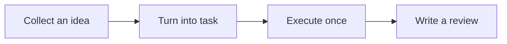

When reading "What GranoFlow Is Not", you can place it back into the "Getting Started" thread for context. The point is not to memorize feature names, but to understand what problems it solves and how to decide the next step.

::::tip[Grasp the Main Thread]
First run through a small loop, then gradually understand more settings.

If you are dealing with a similar issue, first read the decision table below; when actually operating, combine it with the lists, statuses, and hints on the page to decide the next step.
::::

## Think of It First As

Think of it as sticky notes on a workbench: first put down your ideas, then decide which one to pick up today.

## Quick Overview of the Workflow

First, view the workflow as a sequence: after understanding the order of these steps, go to the corresponding pages to handle specific operations.

## A Real-Life Scenario

When first opening GranoFlow, find the inbox, tasks, projects, and reviews without rushing to configure all settings.

## Judge Before Operating

| If you now want to... | What to look for on the page | What to do next |
| --- | --- | --- |
| Enter the page related to "What GranoFlow is not" | Sidebar entry, page title, and main area | First understand what the current list or settings area is expressing |
| Change a setting or status | Page hints, button text, current list | After changing, observe only one result |
| Result differs from expectation | Empty state, error prompts, access logs, or sync status | Go back one level and follow the troubleshooting order |

## Reusable Judgments

It's more important to complete a small loop first than to understand all concepts first.

## Specific Usage and Boundaries

If you want to know whether GranoFlow is right for you, first remember one thing: It is not a tool that forces you to complete tasks every day, nor an AI that makes decisions for you; it simply helps you organize tasks, projects, and reviews more structurally.

### Not a Check-in App

GranoFlow does not have the concept of "continuous check-ins."

Many check-in apps require you to complete something every day. 30 consecutive days feels like a win; missing a day makes it seem like all previous efforts were wasted. When life gets chaotic—illness, travel, unexpected events—this design easily makes you feel like "I failed again."

GranoFlow does not view reviews this way. It doesn't ask "Did you check in today?" Instead, it helps you see clearly: what you've been focusing on, what you've done, and what thoughts you've had. Interruptions are normal—just pick it up again later.

### Not a Habit-Building Game

GranoFlow won’t give you badges, leaderboards, or streak counts, and it won’t use game mechanics to push you into opening it every day.

If you’re used to motivating yourself with points, rewards, or rankings, this app may feel quiet, even a little boring. That’s not a missing feature—it’s a design choice. GranoFlow wants to help you build a stable focus rhythm, not create another source of pressure.

### Not an AI Tool That Makes Decisions for You

The AI features in GranoFlow can help you organize review notes and generate prompts, but it won’t take control of your life.

It will not:

- Silently modify your task records
- Decide which project is most important for you
- Set your values for you

All major changes require your confirmation. AI is an assistant, not a boss.

### Not an Enterprise Management Tool

GranoFlow is for personal use, not for teams, managers, or HR to monitor productivity.

Only you can see your tasks and reviews. This is a product boundary, not a missing admin panel.

### Basically free to use

GranoFlow's core features can be used for free indefinitely, including tasks, projects, milestones, and daily reviews. They have no quantity limits and do not require you to subscribe first.

Payment is mainly used to unlock cloud sync and a few personalization features. If you only use it on one device, you can completely avoid paying.

::::tip[Buy or not?]
Try it for free for a while. When you actually face the need to sync between your phone and computer, then consider paying.
::::

## Common Misunderstandings

| Easy to misunderstand | More stable understanding |
| --- | --- |
| "What GranoFlow is not" needs to be configured all at once | Complete the current step first, then gradually add more later |
| All entries on the page must be used immediately | Only handle entries related to your current task |
| Not organizing immediately means failure | As long as the next step is clearer, it's already useful |

::::note[Decide to return to your goal]
GranoFlow can clearly lay out information, status, and next steps; whether to continue, change settings, delete or restore data still depends on your current page and actual goals.
::::

## Next Steps

You can start with the Tasks chapter to first run through a minimal closed loop.
