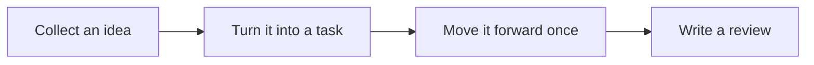

When reading "Who GranoFlow Is For," you can first place it back into the "Getting Started" line of thinking. The focus is not on memorizing feature names, but on understanding what problems it solves and what to decide next.

::::tip[Grasp the Main Thread First]
First run through a small closed loop, then gradually understand more settings.

If you are dealing with similar issues, first read the decision table below; when actually operating, combine it with the lists, statuses, and prompts on the page to decide the next step.
::::

## Think of It as Something Else First

Think of it as sticky notes on a workbench: first put down your ideas, then decide which one to pick up today.

## Understanding the Workflow at a Glance

Think of the workflow as a straight line: after understanding the order of these steps, go to the corresponding pages to handle the specific actions.

## A Real-World Scenario

When you first open GranoFlow, start by finding the inbox, tasks, projects, and reviews — no need to rush into configuring all the settings.

## Decide Before You Act

| If you want to... | What to look for on the page | What to do next |
| --- | --- | --- |
| Go to a page related to "Who GranoFlow is for" | Sidebar entry, page title, and main area | First figure out what the current list or settings area is telling you |
| Change a setting or status | Page hints, button text, current list | After making the change, observe only one result |
| See an outcome different from what you expected | Empty state, error messages, access logs, or sync status | Go back to the previous level and follow the troubleshooting order |

## Reusable Judgments

It's more important to complete a small loop first than to understand all concepts.

## Specific Usage and Boundaries

If your tasks are not isolated trivialities but belong to a project, phase, or long-term goal, GranoFlow is for you. It doesn’t just help you remember “what to do today”; it helps you see which bigger objective these tasks are actually moving forward.

In short: **GranoFlow is for people whose tasks serve a larger purpose**.

If you just need a shopping list, a temporary reminder, or a few scattered items, your phone’s built-in notes or a simple checklist tool might suffice. GranoFlow is better suited for situations where you have multiple projects, each with phases and goals, and you want to quickly pick up where you left off: “What should I be pushing forward now?”

### Project-Based Workers

If you are an independent developer, designer, researcher, creator, entrepreneur, or someone who frequently juggles multiple workstreams, GranoFlow is a good fit.

The challenge in this kind of work is usually not “whether there are tasks,” but that with too many tasks it becomes hard to judge which one matters more. Ordinary to‑do lists get longer and longer, until you’re left with nothing but a pile of pending items.

GranoFlow lets you place tasks under projects and milestones. That way, you don’t just see a task name — you also see which project it belongs to and which phase goal it serves. When you come back after an interruption, it’s much easier to get back on track.

### People Who Are Building Over the Long Term

If you're preparing for exams, switching careers, learning a language, practicing a skill, writing a book, or doing anything that requires sustained effort over time, GranoFlow is also for you.

The nature of these activities is: doing a little today may not show any change, but after weeks or months of consistency, the accumulation becomes visible. The problem is that it's easy to lose your sense of direction midway.

GranoFlow's review feature helps you pause regularly to check: have you actually been building momentum during this period? Are you still on the right track? You don't need to treat it as a scoring tool – it's more like a reminder to lift your head and look at the road ahead.

### People Who Are Frequently Interrupted

If you're often interrupted by meetings, family, clients, or unexpected issues, GranoFlow can help.

For many people, the hardest part after being interrupted isn't restarting work – it's forgetting "where was I?" and "why does this matter?" If everything is just sitting in a plain to‑do list, getting back into flow takes much more effort.

GranoFlow organizes tasks using projects and milestones. Even if you're away for a week, when you come back you can still see the relationship between tasks and goals without having to piece everything together from scratch.

### People who value reflection and review

If you already have a habit of regular reviews, GranoFlow can serve as a clearer container for recording.

Daily review isn't just about checking off tasks. You can use it to record what you did today, how you felt, and what issues you discovered. Over time, it helps you understand what you've actually been working on during that period, rather than just seeing a list of completed or uncompleted items.

::::note[When a plain Todo is enough]
If you mainly just record things like "buy milk" or "remember to pick up packages," a simple checklist tool might be more lightweight. GranoFlow is more valuable when tasks are backed by projects, phases, goals, or review needs.
::::

## Common misconceptions

| Misconception | More accurate understanding |
| --- | --- |
| "Who is GranoFlow for" needs to be configured all at once | Complete the current step first, then gradually add more later |
| All entries on the page must be used immediately | Only handle entries related to your current task |
| Not organizing it immediately is failure | As long as the next step is clearer, it's already useful |

::::note[Decisions still come back to your goals]
Granoflow can lay out information, status, and next steps clearly; whether to continue, change settings, delete, or restore data still depends on your current page and actual goals.
::::

## Next Steps

Next, you can start from the task chapter and first run through a minimal closed loop.
