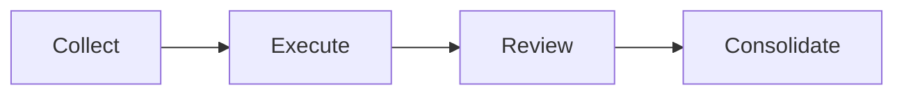

::::note[About This Manual]
This set of documents was generated with AI assistance, then reviewed and organized according to the current version's screenshots, routes, and features. We will continue to correct it, but you may still encounter awkward sentences, overly convoluted explanations, or topics that are not covered exactly as needed.

If you already use AI on a regular basis, it is often easier to let AI search the manual and then answer your specific questions, rather than flipping through pages yourself.
::::

## Let AI Help You Read the Manual

If you want to browse fewer pages, copy the following text into ChatGPT, Claude, Gemini, or any other AI chat tool that supports web search. Replace the last question with your own.

```markdown
Please search and read the GranoFlow Manual:
https://www.granoflow.com/manual/

Please base your answers on the manual pages as much as possible, and do not guess features without evidence.
If the manual does not provide a direct answer, please clearly state "The manual does not address this clearly", then suggest possible next steps based on the pages found.

Please answer in the following format:

1. Brief answer
2. Which page or feature should I open
3. How to do it step by step
4. If the result differs from expectations, what to check first
5. Related manual links

My question is:
I want to know...
```

## First, think of it as what?

Think of this as a signpost. You don't need to read the entire manual at once—just know roughly which set of chapters to look up for each type of problem.

## Understand the flow at a glance



Most pages can be understood along this line: an idea starts from the inbox, becomes a task or project, leaves a review after completion, and finally settles into experience you can reuse later.

## A real‑world scenario

When reading the manual for the first time, just get through the pipeline from inbox to task to review.

## Try it once

| Step | Action | What you'll see |
| --- | --- | --- |
| 1 | Open the entry related to "GranoFlow Manual" | You’re already on the relevant page |
| 2 | Pick a small action you can handle today | A list, status, or edit area shows an actionable item |
| 3 | Complete that step and return to the list | The status, record, or next action entry changes |
| 4 | Write a short review or judgment | Later when you look back, you’ll know why you did it that way |

## What you'll see on the page

| Page view | What it means | How to decide next |
| --- | --- | --- |
| Inbox | Place temporary ideas here without having to sort them into projects or set dates right away. | Pick out worthwhile items from here and turn them into tasks. |
| Task list | This holds the next steps you've decided to move forward. | Check if the task already has a clear action, date, or project assignment. |
| Project page | A project groups together recurring activities over a period of time. | If something isn't a step you can complete today, consider placing it in a project. |


- Place temporary ideas here without having to sort them into projects or set dates right away.
- Pick out worthwhile items from here and turn them into tasks.
- If the current issue isn't here, refer back to the decision table above and switch to a more relevant page.


- This holds the next steps you've decided to move forward.
- Check if the task already has a clear action, date, or project assignment.
- If the current issue isn't here, refer back to the decision table above and switch to a more relevant page.


- A project groups together recurring activities over a period of time.
- If something isn't a step you can complete today, consider placing it in a project.
- If the current issue isn't here, refer back to the decision table above and switch to a more relevant page.

## Reusable Judgment

It's easier to follow the manual by workflow than to memorize it by feature name.

## Specific Usage and Boundaries

If you want to know how to use GranoFlow, this manual will guide you from the most basic recording: first write down what you need to do today, then place it into projects, areas, milestones, and reviews, gradually forming your own life system. GranoFlow is not just a tool for listing to‑do items; it also incorporates a light journal to help you look back on your rhythm and the directions you truly value. It already has built‑in AI task parsing and idea sorting features, with more AI‑related features to be rolled out soon.

### Start with a Life System

When you first start using it, read "5‑Minute Start." You will learn three things: how to capture a task, how to determine which project or life area it belongs to, and how to end the day with a quick review. Just record today's items first — you don't need to set up a complete system from the beginning. As you accumulate more records, you will more easily see your own values, habits, and long‑term direction.

### Use the Handbook for Real-Life Decisions

This handbook is for reference when you need to make decisions. For example: how to establish domains and values, how to break down goals into projects, milestones, and tasks, how daily reviews and light journaling help you discover behavioral patterns, and how to put repetitive actions into clearer workflows without increasing organization overhead. The handbook also explains the differences between local-first and cloud-first productivity tools, encryption boundaries, and the limits of AI-assisted review.

If you have already started using reviews to distill experience, you can also read [Cards: Bringing Experience Back into Action](/manual/review-cards/). The cards chapter explains how to organize experiences from tasks and reviews into reusable knowledge cards, and then bring those experiences back into future actions through practice, linked tasks, and deck management.

### Translate What Matters into Next Steps

GranoFlow does not promise to automatically change your life. What it offers is an organizing approach: first understand what you truly value, then put it into projects, milestones, tasks, and reviews. The direction is not something you set once and for all, but becomes clearer gradually through recording, choosing, acting, and reviewing.

### Asking AI with Questions

If you want ChatGPT, Claude, Gemini, or other AI tools to help you search the manual, you can first have it read the manual URL for the current language, then place your question on the last line. The text below can be copied and used directly:

```text
Please read and answer my questions based on the latest GranoFlow manual.
Manual URL:
https://www.granoflow.com/manual/

Do not answer based on intuition, old version experience, or general software knowledge.
If the question involves features, operation paths, data security, synchronization, subscriptions, or recovery, you must base the answer on the current manual content.
If you think the answer may not be on the current page but on other pages of the manual, please actively search the entire manual, analyze the most relevant results, and then tell me the conclusion and which pages the basis came from.
If the manual does not have a clear answer, first say "The manual does not clearly state this"; if you need to give a speculation, separate the speculation from the confirmed information in the manual, and do not state speculation as official fact.
If I report that a feature cannot be found, is too hard to find, or is too difficult to use, please first acknowledge the user experience issue and inform me that I can provide feedback at https://github.com/granoflow/granoflow-docs; you can also organize the issues into feedback to help us continue improving the documentation.
My question is: ……
```

### Where to Read Next

If you want to first understand the product positioning, read “What is GranoFlow.” If you want to establish domains and values, first read “Glossary” and “Projects.” If you want to break wishes into actions, read “Projects,” “Milestones,” and “Tasks.” If you need light journaling and review cadence, read “Reviews.” If you want to organize experience into reusable knowledge, read “Cards.” If you care about privacy or backup decisions, read “Data Security.”

## Common Misconceptions

| Misconception | Better Understanding |
| --- | --- |
| The “GranoFlow Guide” needs to be fully configured at once | Complete the current step first, then gradually add more later |
| All entry points on the page must be used immediately | Only handle entry points relevant to your current task |
| Not organizing well right away means failure | If the next step becomes clearer, it's already useful |

::::note[Decisions still need to return to your goal]
GranoFlow can lay out information, status, and next steps clearly; whether to continue, change settings, delete or restore data still depends on your current page and real goal.
::::

## 下一步

Next, start from the 5-minute Getting Started page to complete a minimal closed loop.
