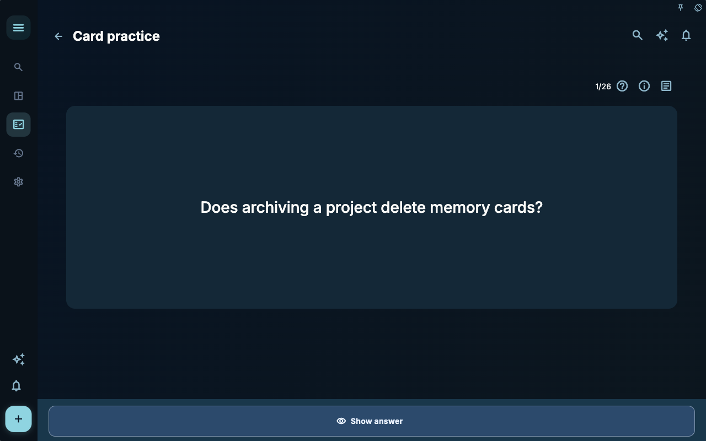
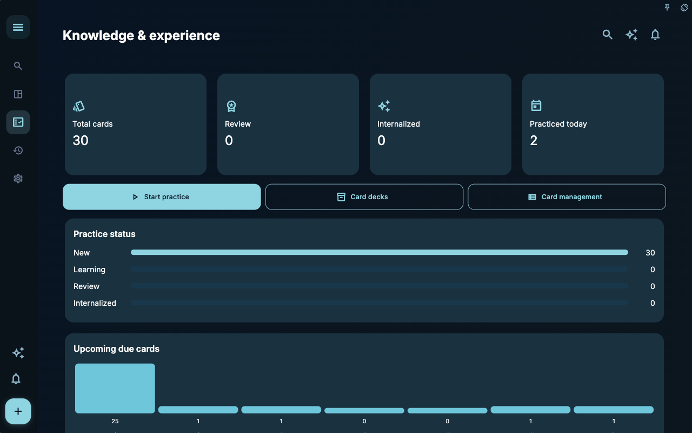
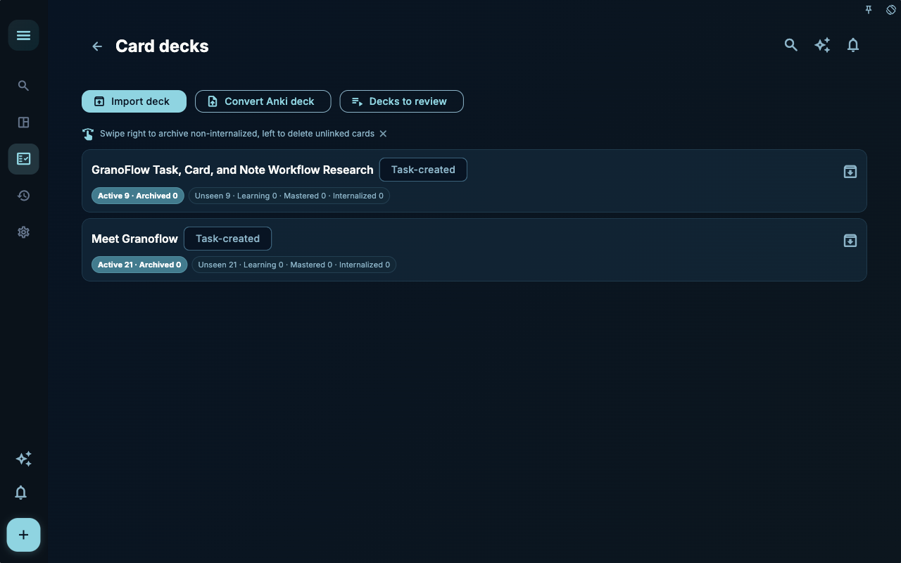
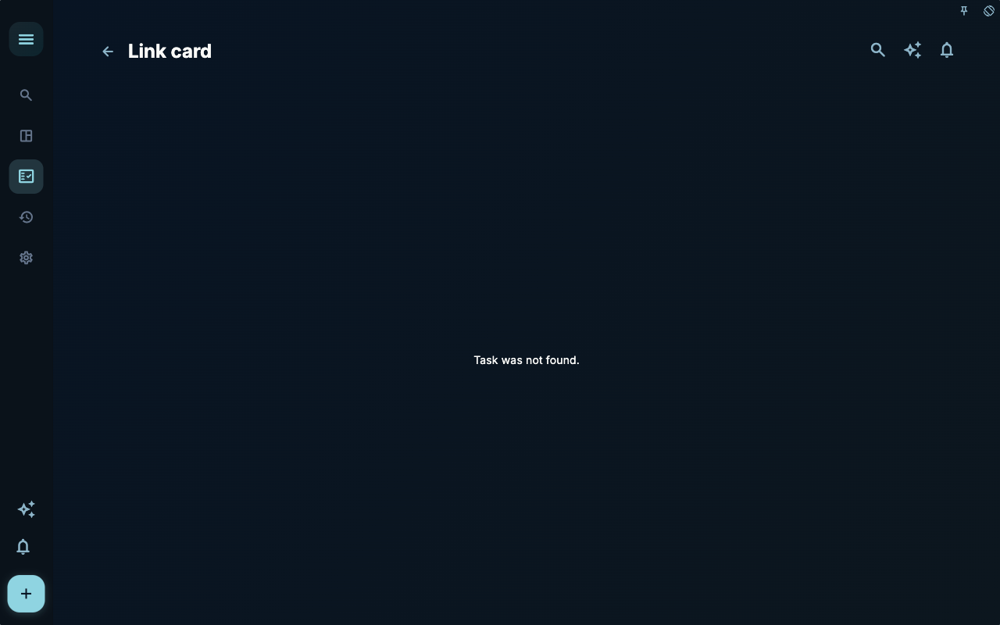
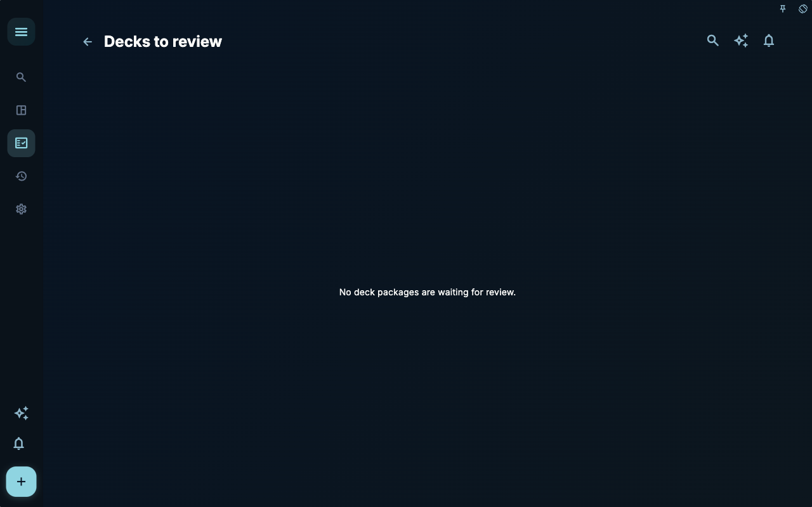
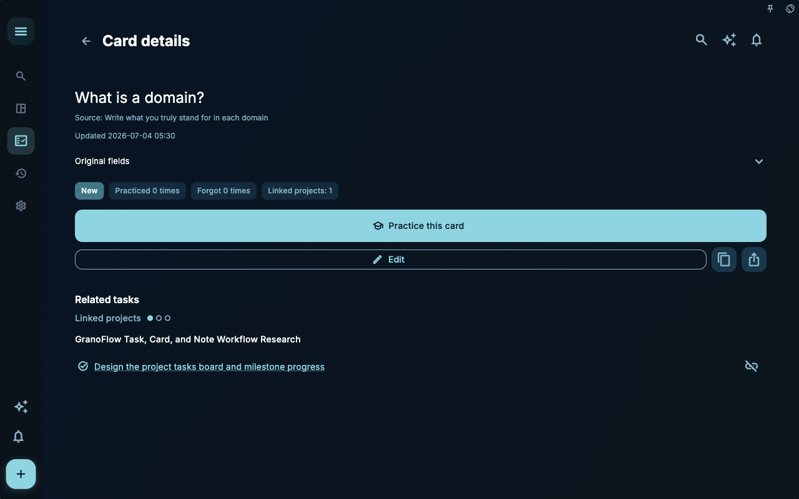

Read the question, reveal the answer, then score by real familiarity; decks and stats support review.

The card practice page uses the fixed seed card “What is a domain?” so every locale points to the localized version of the same card.

## How to use this page
1. Start from the outcome you want, not from memorizing button names.
2. Use the screenshots to confirm the page, state, and entry point.
3. After each step, check the visible feedback before moving on.

## Screenshots

Use this image to confirm the entry point, main state, and where you can continue.

Use this image to confirm the entry point, main state, and where you can continue.

Use this image to confirm the entry point, main state, and where you can continue.

Use this image to confirm the entry point, main state, and where you can continue.

Use this image to confirm the entry point, main state, and where you can continue.

Use this image to confirm the entry point, main state, and where you can continue.

Use this image to confirm the entry point, main state, and where you can continue.

Use this image to confirm the entry point, main state, and where you can continue.

Use this image to confirm the entry point, main state, and where you can continue.

Use this image to confirm the entry point, main state, and where you can continue.

Use this image to confirm the entry point, main state, and where you can continue.

Use this image to confirm the entry point, main state, and where you can continue.

Use this image to confirm the entry point, main state, and where you can continue.

Use this image to confirm the entry point, main state, and where you can continue.

Use this image to confirm the entry point, main state, and where you can continue.

Use this image to confirm the entry point, main state, and where you can continue.

## Boundary
Screenshots only prove the visible state for the current macOS, dark, landscape, seeded manual setup. Account, subscription, sync, AI, and external-tool pages can differ by permission and device state.

## Next

[Tune rules and prompts](../personalize-flow/)
