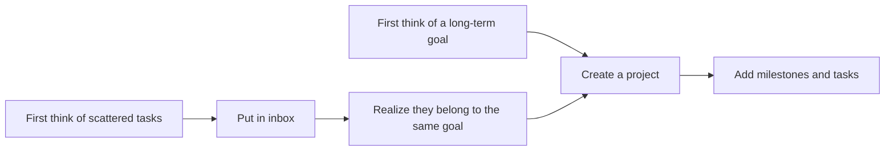

Creating a project isn't about making things more formal—it's about giving a group of related tasks a stable home. Instead of asking yourself "should I create a project?", a more helpful question is: "Will this thing come back to me repeatedly, requiring me to remember its context and progress?"

If the answer is yes, create a project. Start by capturing the goal; milestones and tasks can be added later.

## First, decide whether to create one

| Scenario | Recommendation | Example |
| --- | --- | --- |
| One-time action | Create a task directly | Pay water bill today, reply to an email |
| An ongoing goal | Create a project | Prepare a course launch, move house, write a thesis |
| Just an idea, not clearly thought out | Put it in the inbox first | "Maybe I should organize my portfolio" |
| Already have related tasks scattered around | Create a project, then collect them | Put release, testing, and copy tasks into the same project |

The key isn't how nice the project name looks—it's whether it reduces your mental effort when you come back to it next time.

## Creation entry point and required fields

Go to the Projects page, click **+** in the top right corner, fill in the project name and a brief description, then create it.

You'll typically see these fields when creating:

| Field | How to fill it in | Notes |
| --- | --- | --- |
| Name | Write the goal you want to achieve | "Finish my thesis" is clearer than just "Thesis" |
| Description | Record background, scope, constraints, or delivery notes | Leave it blank if you're not sure |
| Area | Choose which long‑term direction it belongs to | Good for separating work, study, health, etc. |

::::tip[Write the project name as an action phrase]
"Launch first version of the course", "Finish moving prep", "Organize 2026 portfolio" all make the next step easier than just "Course", "Moving", "Portfolio". The project name doesn't need to be literary—it just needs to be instantly clear to future you.
::::

## Create an empty project first, or collect tasks first?

Either order works.

If you already know it's a project—like "prepare a launch"—it's easier to create the project first. Then when you see related tasks, you can file them directly into it.

If you're just thinking of things one by one—like "buy cardboard boxes", "ask the property manager", "look up moving companies"—it's fine to put them in the inbox first. When you realize they all belong to "moving house", create the project and connect the tasks to it.

Both paths end up in the same place: a project holds the goal, and tasks do the actual work.

## What to do after creating a project

Once the project is created, you don't need to make it perfect right away. Usually this order is enough:

| Next step | When to do it | What you get |
| --- | --- | --- |
| Add milestones | When the goal has clear phases | The project is no longer just a long list of tasks |
| Connect existing tasks | When tasks are already scattered in the inbox or task list | Related items come back under the same project |
| Create new tasks inside the project | When you already know the next action | New tasks automatically get the project context |

If you're not sure what to do next, it's fine to close the project for now. An empty project isn't a failure—it just holds a spot for a goal.

## Common misconceptions

| Misconception | Better understanding |
| --- | --- |
| You must write the full plan when creating a project | You can start rough and refine later |
| The description must be very formal | The description just needs to help you recall the context later |
| Choosing an area is the same as setting priority | An area is just a category; priority still depends on tasks and dates |

## Next steps

If the project already has clear phases, continue to "Manage milestones". If you have tasks scattered elsewhere, go straight to "Connect tasks to a project".
