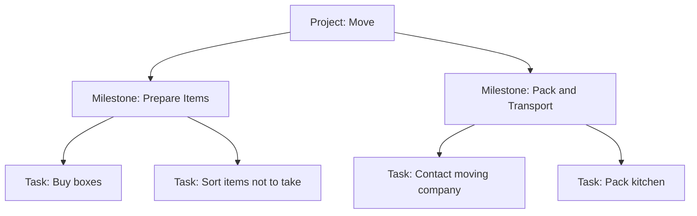

Many people start by thinking of a project as a “bigger task.” That mental model works for a while, but you soon run into a problem: a project usually isn’t something you do once and finish—it’s something you work on repeatedly over days, weeks, or even longer.

In GranoFlow, a steadier way to think about it is: tasks answer “what exactly do I do today?” and projects answer “what goal are these tasks working toward together?” Milestones sit in between, helping you break a long effort into stages where you can judge progress.

## A Real‑World Scenario

Imagine you’re preparing for a move. “Buy boxes,” “pack the kitchen,” and “contact a moving company” are tasks because they can be executed concretely. “Move” itself is better as a project, because it lasts over time and generates a set of related tasks.

Once you put those tasks into the same project, you don’t have to rely on your memory to hunt them down. Every time you come back, you first check which stage of the project you’re in, then decide what to move forward today.

## Projects, Milestones, and Tasks

The point of this relationship diagram isn’t that more layers are better—it’s that different concerns belong in different places: goals in projects, stages in milestones, and actual doable actions as tasks.

## How Projects and Domains Relate

Projects don’t exist in isolation. Many projects are backed by a longer‑term direction—like learning, work, health, family, or a personal creation. The domain page is a good place to hold that long‑term direction; a project then holds a segment of work that moves toward it.

Think of domains as sections of a garden and projects as the areas you’re actively tending. A domain doesn’t require big moves every day, but it reminds you what direction this set of projects is really taking care of.

| If you’re wondering… | Best placed in |
| --- | --- |
| What long‑term direction do I want to keep tending? | Domain |
| What’s a near‑term goal under that direction? | Project |
| What’s the next step I can take today? | Task |

## When to Create a Project

| Your situation | Better approach | Why |
| --- | --- | --- |
| Only one or two steps, finishable today or tomorrow | Create a task directly | A project makes simple things heavy |
| Three or more related tasks, lasting more than a week | Create a project | You need a place to hold context and progress |
| Several distinct stages, like prepare, execute, review | Add milestones inside the project | Stages help you decide what to do next |
| Just a horizontal grouping of similar tasks | Use tags or other views | Projects are better for holding a goal |

::::tip[A handy rule of thumb]
If every time you see this thing you have to re‑recall the background, it’s probably worth making a project. If you can tell the next step just from the task title, leaving it as a task is usually enough.
::::

## What Projects Can and Can’t Replace

Projects can group related tasks, break them into stages with milestones, and show overall progress. They’re good for things you keep pushing forward.

But a project won’t decide for you which day to do what. Whether a task shows up in Today’s view or the calendar still depends on dates. Cross‑project horizontal grouping is still usually handled by tags. And what you accomplished each day still comes back to the review.

| Common misunderstanding | Better understanding |
| --- | --- |
| More projects means more organization | Too many projects also become another inbox |
| Every long‑term idea must be a project immediately | Wait until it generates clear tasks, then create it |
| Once I create a project, tasks will be scheduled automatically | Projects handle belonging; dates still go on tasks |

## Next Steps

Now that you understand the project container, you can continue with “Create a Project.” That page covers where to create one, how to name it, and whether to start with an empty project or collect tasks first.
