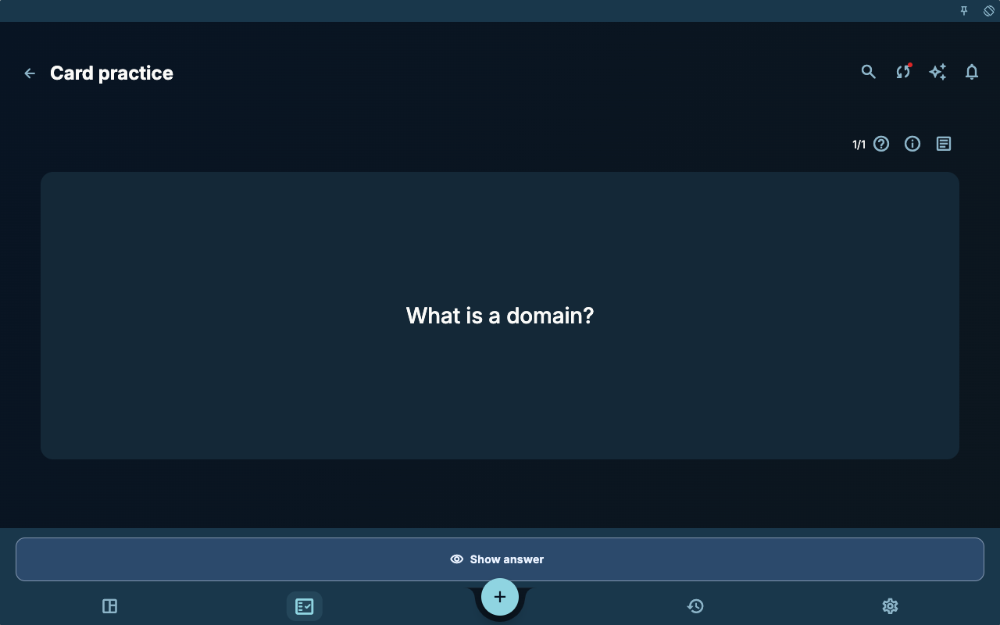
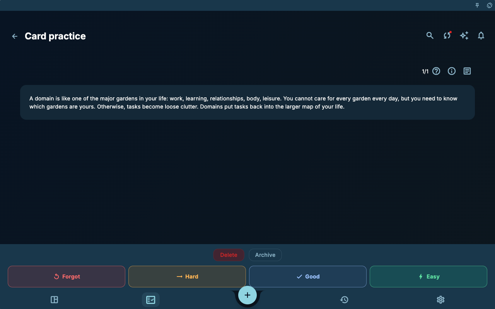
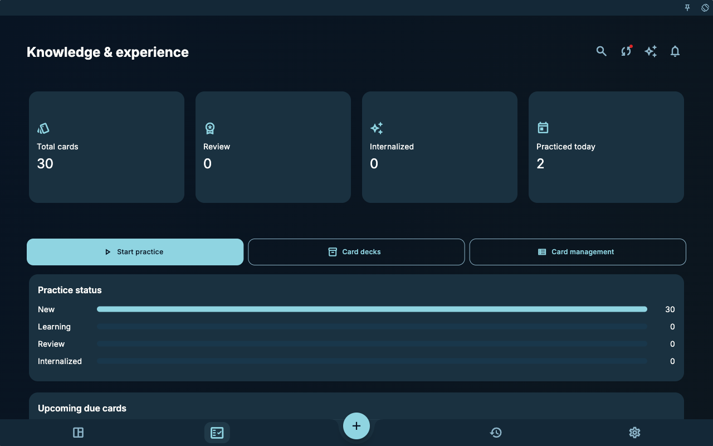
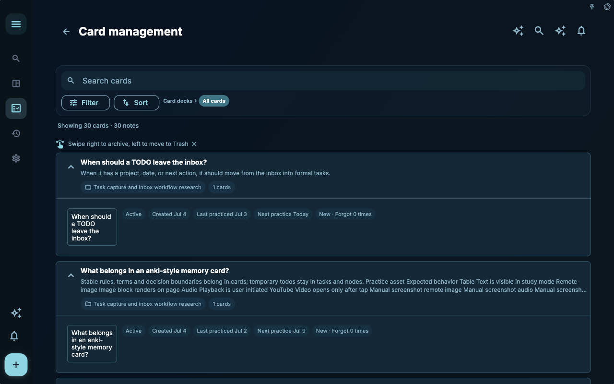
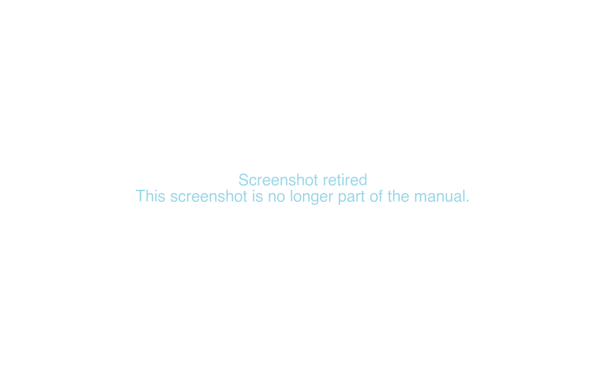

Review cards help you bring experience back into future work. They are not about memorizing every sentence. They make a useful question, decision, or reminder easier to recall later.

## Complete One Card Practice

This sample card asks “What is a domain?” A domain is a long-running area of life or work that you care for, such as work, study, relationships, body, or rest.

1. Open the card practice page and read only the question.
2. Try to answer in your own words.
3. Select **Show answer**.

The page then changes to answer state.

Choose the rating that matches this attempt: Forget, Hard, Good, or Easy. Honest feedback is more useful than a polished record.

## Statistics and Management

Use statistics for overall state, deck list for groups, card management for a specific card, and the note panel when you need source context.
