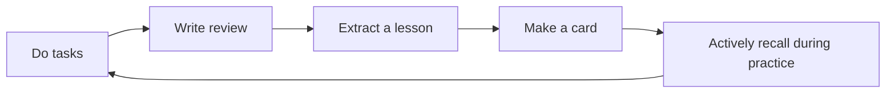

Cards are not for collecting quotes. They are more like small reminders: something you learned from a real experience, and the next time you face a similar situation, take a moment to think about it.

If you only remember one principle: **Cards should grow out of real actions, and then return to real actions.**

::::tip[Experience Worth Turning into Cards]
If a single sentence can help you avoid detours next time, it’s worth making into a card. For example, "Before entering a project page, check if the task has a clear next step" is more suitable for practice than "Be more organized."
::::

## It Doesn’t Solve a Memory Problem

Many tools treat cards as a place to “memorize material.” In Granoflow, cards are more about “reusing judgment.” You are not trying to remember a definition, but to recall a proven method faster when you start a task, organize a project, or write a review.

Think of it like a sticky note in the kitchen: not a full recipe book, just the small reminders you actually forget – and forgetting them would affect the outcome.

## Where does a card come from

The most important step in this process is the middle one: condensing the experience into a reusable sentence. Don't just copy the entire review into the card. Keep the full text in the review, and leave only the judgment you need to recall before your next action in the card.

## Read the prompt first, then the answer

At the start of the exercise, the page only displays the question. This is designed to make you search for the answer in your mind first, rather than just glancing at the explanation and considering it read. For example, the question "What is a domain?" in the image is not meant for you to memorize the definition, but to first think: which domain does your current task belong to — work, study, relationships, health, or leisure?

## Answers Should Bring Insights Back to Life

After revealing the answer, feedback buttons appear at the bottom of the page. You can choose "Forgot," "Struggled," "Recalled," or "Easy" based on how well you remembered just now. This isn't a test score—it's just telling GranoFlow whether this card should show up sooner next time or if it can wait a bit longer.

In the image, the card explains "domain" using the metaphor of several gardens. This metaphor is useful because it helps you return to real‑world choices: which garden are you tending to today? Is there a garden that has been completely neglected?

## Statistics Page Shows Trends, Not Vanity Numbers

The statistics page shows total cards, mastered, internalized, practiced today, and the distribution of different learning states. Don't try to make the numbers look pretty. A more practical way to look at it is:

| What You See | How to Interpret It | Next Step |
| --- | --- | --- |
| Many not yet learned | A lot of experience hasn't entered practice yet | Start with today's most relevant cards |
| Few practiced today | You just haven't started yet, not a failure | One short practice session is enough |
| Few mastered | Experience hasn't stabilized yet | Don't rush to add too many new cards |
| More internalized | Some reminders are becoming more natural | Go back to your task and see if you're actually applying them |

## What content is suitable for adding to cards

| Content | Suitable for a card? | Reason |
| --- | --- | --- |
| “Before starting a task, write down the next action” | Yes | Can be used directly before the next task |
| “This week’s work was exhausting” | Not really | More like a reflection on the original text, lacks reusable judgment |
| “When a project is delayed, first break it down into the smallest deliverable” | Yes | Helps decision-making in similar scenarios |
| “Not in a good mood today” | Not really | Better left in a diary or review, don’t turn it into an exercise |
| “If sync fails, first check whether the current device is logged into the same account” | Yes | It’s a clear troubleshooting reminder |

## Don’t make your card library too full

More cards don’t necessarily mean more usefulness. What truly matters are the cards you’re willing to revisit and revise repeatedly. After each review, pick at most one or two pieces of experience with the highest reuse value.

A simple criterion is: **If you encounter a similar task next week, would you want yourself to recall this sentence first?** If the answer is yes, turn it into a card; if you just think the sentence “seems okay”, leave it in your review for now.

## Next Steps

- To turn experiences in tasks into cards, read [Creating and Linking Cards](./create-and-link/).
- To learn how to use the practice button and statuses, read [Practice, Mastery, and Internalization](./study-and-internalize/).
- To import, export, or organize decks, read [Decks, Importing, and Exporting](./decks-import-export/).
