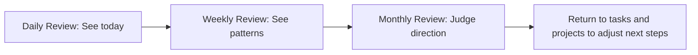

Reviews are often misunderstood as "scoring the past." In Granoflow, a better way to think of them is: organizing what has happened into clues you can use next time.

At the end of a day, you need to know what happened today; at the end of a week, you need to see which patterns keep recurring; at the end of a month, you care more about where your time actually flowed. Daily, weekly, and monthly reviews are these three distances.

::::tip[First, try a different perspective]
Don't rush to complete a review. First ask yourself: Do I need to see clearly today, this week, or this month?
::::

## The division of the three reviews

This line isn't asking you to write long entries every day. It simply reminds you that as the time range expands, the focus of the review changes.

| What you want to know now | Best to open | What to focus on |
| --- | --- | --- |
| What actually got done today | Daily review | Completed tasks, time spent, today's notes |
| Where you’ve been stuck in recent days | Weekly review | Task distribution over the week, recurring blockers, handy practices |
| Whether you’ve put your energy into important directions this month | Monthly review | Date distribution, project progress, things that repeatedly consumed time |

## From One Day to One Week

Weekly review is ideal for looking at several days together. For example, if you notice a project keeps getting pushed to the weekend, the problem may not be “slacking off on a particular day” but rather that the project lacks a steady entry point during the week.

In the image, the left side lists time periods over the year by week, while the right side shows the current week’s range, completed tasks, time invested, flow time, and project progress. When reading this chart, there is no need to recount each day; what’s more worth noticing is which projects showed clear progress this week and which remained only in the plan.

::::note[Flow time is manually recorded]
The weekly review accumulates the flow time manually entered each day. It is not automatically derived from task duration, nor is it a judgment of your state.
::::

## From a Week to a Month

A monthly review is more like a calendar. It is not suited for questioning why a particular day was empty, but rather for seeing whether your attention has consistently stayed on the same set of important things throughout the month.

In the image, you can see the monthly calendar and the day's task cards. The value of the monthly perspective lies in acknowledging trade-offs: a month is long enough to show which goals were truly revisited and which were only occasionally remembered.

## A Real-World Scenario

Suppose you are conducting a "Granoflow task, card, and note usage study." Today you only completed two small tasks, which doesn't seem like much. The daily review will tell you that these two tasks happened today; the weekly review will tell you whether this study has been progressing steadily this week; the monthly review will remind you whether this type of study still occupies an important place throughout the month.

The judgment here is not "did I do well or not," but "how to arrange the next steps more realistically." If a certain direction only appears occasionally in the monthly calendar over a long period, you may need to break it down into smaller tasks, or acknowledge that it is not a priority for now.

## How to Choose an Entry Point

| Scenario | Suggested Entry Point | Next Steps |
| --- | --- | --- |
| Just finished a batch of tasks and want to write a few words | Daily Review | First check completed tasks, then write today's record |
| Want to know which arrangements were effective in the past week | Weekly Review | Review project progress and recurring task types |
| Want to reallocate long-term energy | Monthly Review | See which dates, projects, and cards appear repeatedly |
| Just want to adjust how AI writes diary or weekly notes | Settings page | Go change the corresponding prompts, no need to stay on the review page |

## What Review Is Not

- Not a check-in system: no streak tracking, and it won't invalidate tasks.
- Not a performance report: no one is grading you.
- Not a to-do list: it processes what has already happened, and doesn't add your next batch of tasks.

::::note[Boundaries]
Granoflow can organize tasks, records, and time ranges; it does not judge your life situation, nor does it decide for you whether a goal is worth continuing. The real trade-offs still come back to your projects, tasks, and current arrangements.
::::

## Next Steps

If you want to handle today's events first, continue reading [Daily Review](./daily-review). If you already have some records and want to know how to find them later, read [Records and History](./journal-records).
