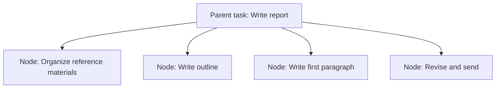

Some tasks aren’t something you don’t want to do — the title is just so broad that you don’t know where to start when you look at it. For example, “Write the entire report” can make you freeze; “Organize reference materials,” “Write an outline,” and “Write the first paragraph of the body” are much easier to begin.

In GranoFlow, breaking down a task means splitting a big task into nodes. A node is not a new project or an independent goal — it’s just a small step within that task.

## Which Tasks Need Breaking Down

| Task Title | Problem | Break Into Next Step |
| --- | --- | --- |
| Write a report | Too large, don’t know what to do first | Organize reference materials |
| Prepare a release | Scope too broad | List pre-release checklist items |
| Learn a new tool | Unclear outcome | Run through the first example |
| Organize files | Hard to tell when it’s done | Move this week’s files into one folder |

A good node should be directly actionable. It doesn’t have to be tiny, but ideally you know exactly how to start as soon as you sit down.

## Relationship Between a Node and Its Parent Task

The parent task answers “what is this whole thing about,” and the node answers “what do I do next.” When a node is completed, the parent task’s progress updates; only after all nodes are completed should the parent task be marked as done.

If you add a new incomplete node to a parent task that was already completed, the parent task may return to “to-do.” This isn’t an error — it’s a reminder that this task now has another unfinished step.

## How to Break Down a Task

Open the task details, find the steps or nodes area, and add the first child step. Start with just one or two steps you can take soon — you don’t have to think through all the steps at once.

| Action | When to Use | Result |
| --- | --- | --- |
| Add a node | Task is too large and needs a next step | Task becomes easier to start |
| Check off a node | A step is done | Parent task progress updates |
| Reorder | Steps are in the wrong order | Execution sequence becomes clearer |
| Promote or indent | Step hierarchy is wrong | Structure better matches reality |
| Delete a node | The step is no longer needed | Node removed; handle child nodes first if any |

On desktop, the drag handle on the left side of a node lets you reorder or change its hierarchy. When keyboard focus is on the node list, use `Alt+↑` / `Alt+↓` to move up/down, and `Alt+←` / `Alt+→` to promote or indent.

::::tip[Don't nest too deep]
Two levels is usually enough. If you need more than two levels and still can’t explain it clearly, it probably shouldn’t be just a task — consider splitting it into projects, milestones, or several independent tasks.
::::

## Break Into Nodes, or Create Milestones?

| Better suited for nodes | Better suited for milestones |
| --- | --- |
| Can be completed in hours to days | Will span weeks or longer |
| Steps are tightly interdependent | Phases are relatively independent |
| Serves only one task | Needs to coordinate multiple tasks |
| Goal is still the same thing | Each phase has its own deliverable |

Simple test: a node answers “what do I do next,” a milestone answers “what stage of the project are we in.”

## Next Steps

Once you’ve broken a task down into smaller pieces, go back to the task details and start executing. If those steps have grown into a longer-term goal, head over to the projects section and use projects and milestones to manage them.
