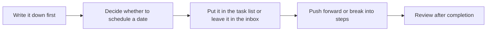

In GranoFlow, a task doesn’t have to be a complete file written all at once. A better approach is: first jot down what you need to do, then decide whether to assign a date, put it into a project, break it into steps, or leave a review after completion.

Many task tools force you to fill in a lot of fields from the start. GranoFlow’s task system is more like a workbench: spread out your sticky notes, keep today’s tasks within reach, leave traces after completion, and put away what’s not needed.

## Task List Holds Ongoing Work

The task list is best for viewing tasks you’ve decided to move forward with. Here you’ll see tasks grouped by timeframe, such as Today, Tomorrow, This Week, This Month, or Later.

What this image really shows isn’t the number of buttons, but the state of tasks once they’re in the list: they’re no longer just ideas, but have dates, order, or a next step. From here you can click into a task to fill in more fields, or start focusing or completing it directly.

## From Idea to Completion

You don't have to go through this line all at once. Often, you only need to complete the first step: write it down.

## How to Divide Tasks, Projects, and Areas

| Question you're asking | Better placed in | Example |
| --- | --- | --- |
| What exactly to do now | Task | Draft Chapter 3, Contact moving company |
| Which stage goal does this set of tasks serve | Milestone | Recording completed, Launch check passed |
| Which goal to advance in this period | Project | Publish course, Finish moving |
| Which long-term direction does this goal belong to | Area | Study, Work, Health |

Not every task needs to be linked upward. For small things that can be done directly, writing them as tasks is enough; for goals that will last a while and generate multiple tasks, put them into projects.

## Why only plan today and tomorrow in detail

GranoFlow doesn't encourage you to fill every future day with plans. The future will change, and tasks will change too; scheduling next week and next month too finely often just moves the maintenance cost of the plan to today.

So the task list makes today and tomorrow more specific: today you decide what to do right now, tomorrow you leave a clear but not heavy next step. Tasks further ahead can be placed in this week, this month, next month, or later, and then finely planned when the time gets closer.

::::tip[First make the task actionable]
A good task usually answers two questions: What do I do next? What change can I see after it's done? If the title is still just 'paper', 'moving', 'review', change it into an action first.
::::

## Task Statuses

| Status | When to use | Result |
| --- | --- | --- |
| To Do | Not started | Stays in the corresponding view awaiting processing |
| In Progress | Currently working on | Can become the current task |
| Completed | Already done | Records completion time, can enter review |
| Archived | No need to focus on for now | Keeps record but doesn't take up the current list |
| Trash | Deleted but not emptied | Still possible to restore |

In the task details, click 'Focus', and this task will become the currently active task and start a focus session. If another task is already in focus, GranoFlow will remind you to handle that task first, preventing you from treating two things as the current priority at the same time.

## Getting Started for the First Time

Click **+**, write down the one thing you most want to move forward today, then save. Don't rush to create projects, add tags, or break it down into steps.

When you find that this task needs ongoing attention, then add it to a project; when you find the task is too large, then break it into subtasks; when you complete it, then leave a review. The value of a task system is not to have everything neatly organized from the start, but to make the next step easier to pick up.

## Next Steps

If you just want to jot it down for now, continue to "Inbox". If you already know what to do, continue to "Creating and Editing Tasks".
