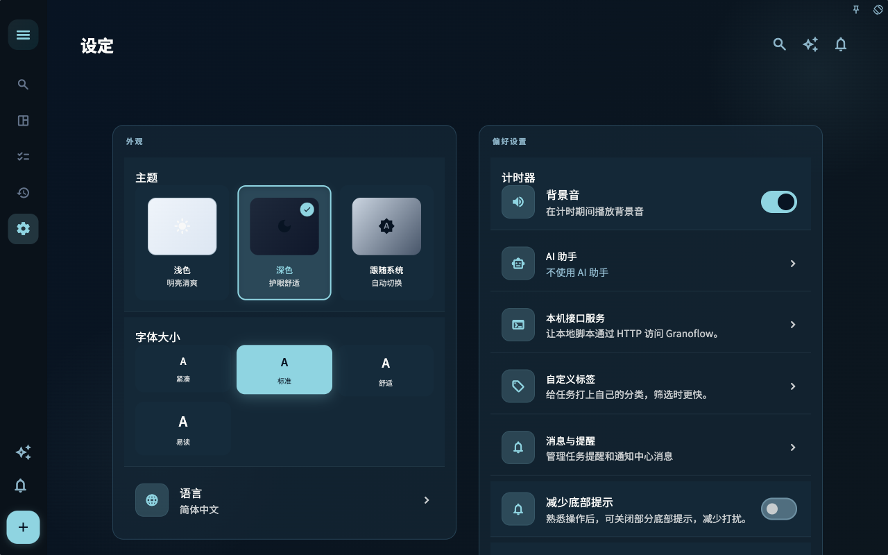
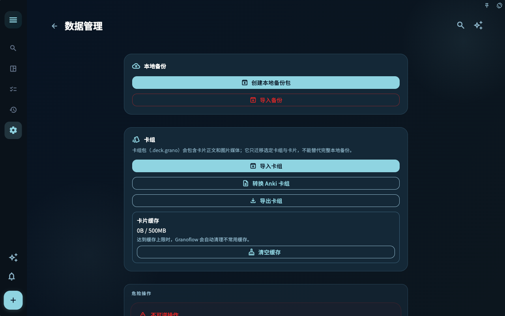

FAQ 适合在你已经遇到具体问题时快速查答案。它不是从头学习 Granoflow 的路线图。

## 一个真实场景

如果你只是想知道“为什么手机上看不到桌面端的新任务”，先看同步和账号；如果想系统理解工作流，回到开始使用和任务章节。

## 常见问题通常从这三处开始

设置总览适合先找入口。账号、数据、AI、通知和桌面连接问题，都可以从这里分流。

数据管理适合处理备份、导入、附件和卡组。只要问题涉及迁移、恢复或空间占用，就先看这里。

同步进度适合判断多设备数据是否还在路上。新设备看不到内容时，先别急着重建数据，先看同步是否完成。

## 怎么判断下一步

| 你遇到的情况 | 先看什么 | 下一步 |
| --- | --- | --- |
| 不知道该从哪里开始 | 当前页面标题和主要入口 | 只选择和当前目标有关的一项 |
| 操作后结果不对 | 状态、空提示、访问记录或同步进度 | 回到上一层，按顺序排查 |
| 担心影响数据 | 备份、同步、账号或权限说明 | 先停下，确认范围后再继续 |

## 边界

常见问题的答案通常指向一个更具体页面。找到方向后，再进入对应章节处理。

## 常见判断

| 问题 | 先看哪里 | 常见下一步 |
| --- | --- | --- |
| 新设备看不到数据 | 账号与同步 | 确认账号一致，再看同步状态 |
| 会员没有出现 | 订阅与恢复购买 | 确认购买平台和当前账号 |
| AI 建议不准确 | AI 辅助设置 | 缩小输入范围，确认后再写入 |
| CLI 连不上 | 桌面端和访问日志 | 先验证本机接口可用 |
| 附件占空间 | 数据管理 | 清理前确认是否还需要打开 |

## 下一步

读完这一节后，回到你正在处理的任务，只选一个最小动作继续：记录一条输入、检查一个状态、或打开相关设置完成一次确认。
