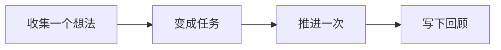
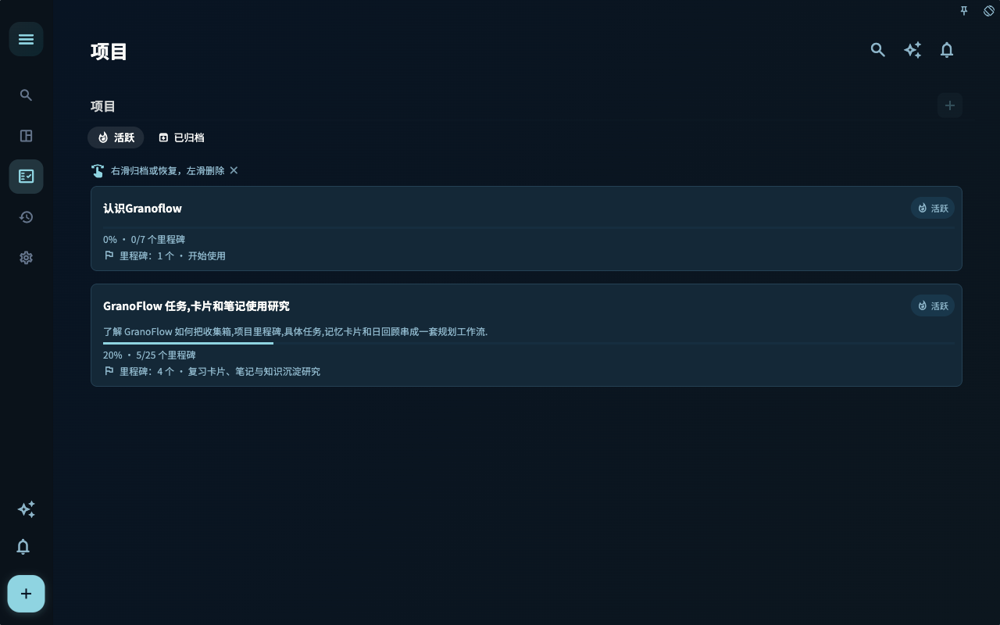

阅读「5 分钟开始」时，可以先把它放回「开始使用」这条线里理解。重点不是背功能名，而是弄清它适合解决什么问题、下一步该怎么判断。

::::tip[先抓住主线]
先跑通一个小闭环，再慢慢理解更多设置。

如果你正在处理类似问题，先读下面的判断表；真正操作时，再结合页面里的列表、状态和提示来判断下一步。
::::

## 先把它想成什么

把它想成工作台上的便签：先把想法放下来，再决定今天拿起哪一张。

## 一眼看懂流程

先把流程看成一条线：理解这些步骤的顺序后，再到对应页面处理具体操作。

## 一个真实场景

第一次打开 Granoflow 时，先找到收集箱、任务、项目和回顾，不急着配置所有设置。

## 跟着做一次

| 步骤 | 动作 | 你会看到 |
| --- | --- | --- |
| 1 | 打开和「5 分钟开始」相关的入口 | 你已经来到相关页面 |
| 2 | 选择一个今天能处理的小动作 | 列表、状态或编辑区出现可操作对象 |
| 3 | 完成这一步并回到列表 | 状态、记录或下一步入口发生变化 |
| 4 | 写下一句回顾或判断 | 以后回看时能知道当时为什么这么做 |

## 页面里会看到什么

| 页面画面 | 它说明什么 | 接下来怎么判断 |
| --- | --- | --- |
| 收集箱 | 临时想法先放在这里，不必一开始就分项目、定日期。 | 从这里挑出值得推进的内容，再把它变成任务。 |
| 任务列表 | 这里承接已经决定要推进的下一步。 | 看任务是否已经有清楚动作、日期或项目归属。 |
| 项目页面 | 项目把一段时间内反复推进的事情放在一起。 | 如果一件事不是今天能完成的一步，就考虑放进项目。 |

- 临时想法先放在这里，不必一开始就分项目、定日期。
- 从这里挑出值得推进的内容，再把它变成任务。
- 当前问题不在这里时，回到上面的判断表，换到更贴近的页面。

- 这里承接已经决定要推进的下一步。
- 看任务是否已经有清楚动作、日期或项目归属。
- 当前问题不在这里时，回到上面的判断表，换到更贴近的页面。

- 项目把一段时间内反复推进的事情放在一起。
- 如果一件事不是今天能完成的一步，就考虑放进项目。
- 当前问题不在这里时，回到上面的判断表，换到更贴近的页面。

## 可复用判断

先完成一个小闭环，比先理解所有概念更重要。

## 具体用法和边界

想最快开始用 GranoFlow，就先做三件事：新增一个任务，需要时把它连接到项目，晚上用一两句话回顾今天。不需要先搭好完整系统。

### 第一步：先写下一个任务

打开 GranoFlow，点 **+**，写下现在脑中最清楚的一件事。

先不用判断它重不重要，也不用急着决定它属于哪个项目。第一步只是把事情记下来。新任务会先进入收集箱，之后你有时间时再整理。

### 第二步（可选）：需要时连接到项目

如果这件事属于一个更大的方向，比如“完成论文”或“准备搬家”，可以在任务详情里把它连接到对应项目。

这一步不是必须的。你可以先把任务留在收集箱，等项目结构真的有帮助时再整理。

### 第三步：晚上做一次小回顾

一天结束前，打开 GranoFlow，看一眼今天完成了什么、还有什么没完成，然后在日回顾里写一两句话：

- 今天做了什么
- 明天最想推进哪一件事

不用写长篇总结，不用给自己打分，也不用把它变成每天必须完成的压力。它只是帮你把今天、明天和长期目标轻轻连起来。

---

**到这里，你已经开始使用 GranoFlow 了。** 后面的文档可以按需要再看，不必按顺序读完。

## 常见误解

| 容易误解 | 更稳的理解 |
| --- | --- |
| 「5 分钟开始」需要一次配置完 | 先完成当前这一步，后续再逐步补充 |
| 页面里所有入口都要立刻用上 | 只处理和你当前任务有关的入口 |
| 没有马上整理好就是失败 | 只要下一步更清楚，就已经有用 |

::::note[决定仍要回到你的目标]
Granoflow 可以把信息、状态和下一步摆清楚；要不要继续、是否改设置、是否删除或恢复数据，仍要看你当前页面和真实目标。
::::

## 下一步

下一步可以从任务章节开始，先跑通一个最小闭环。
