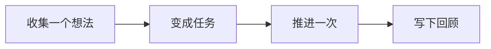
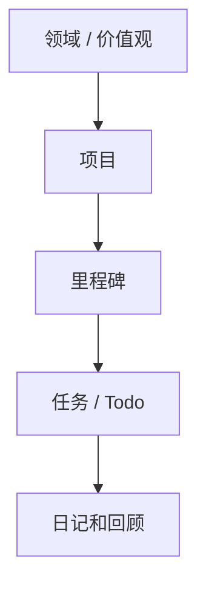

阅读「GranoFlow 是什么？」时，可以先把它放回「开始使用」这条线里理解。重点不是背功能名，而是弄清它适合解决什么问题、下一步该怎么判断。

::::tip[先抓住主线]
先跑通一个小闭环，再慢慢理解更多设置。

如果你正在处理类似问题，先读下面的判断表；真正操作时，再结合页面里的列表、状态和提示来判断下一步。
::::

## 先把它想成什么

把它想成工作台上的便签：先把想法放下来，再决定今天拿起哪一张。

## 一眼看懂流程

先把流程看成一条线：理解这些步骤的顺序后，再到对应页面处理具体操作。

## 一个真实场景

第一次打开 Granoflow 时，先找到收集箱、任务、项目和回顾，不急着配置所有设置。

## 操作前先判断

| 如果你现在想... | 页面里通常看什么 | 接下来做什么 |
| --- | --- | --- |
| 进入「GranoFlow 是什么？」相关页面 | 侧边栏入口、页面标题和主区域 | 先弄清当前列表或设置区在表达什么 |
| 改一个设置或状态 | 页面提示、按钮文字、当前列表 | 改完只观察一个结果 |
| 结果和预期不同 | 空状态、错误提示、访问记录或同步状态 | 回到上一层，按排查顺序处理 |

## 可复用判断

先完成一个小闭环，比先理解所有概念更重要。

## 具体用法和边界

GranoFlow 是一个本地优先的个人规划应用。你可以先把它当 Todo 用：记下任务、安排时间、完成后勾掉；之后再把任务连到项目、里程碑、价值观和回顾里，看自己每天做的事是否真的在推进重要目标。

### 任务只是入口

最简单的用法是：想到一件事，就在 GranoFlow 里新增一个任务。你不需要一开始就把所有内容整理完。

等你有时间时，可以再决定这个任务属于哪个项目、和哪个里程碑有关、什么时候处理。任务在 GranoFlow 里不是孤立清单，而是一个入口，帮助你把日常事情放回更大的生活结构中。

### 不只是 Todo 清单

普通 Todo 工具通常只回答一个问题：今天要做什么？

GranoFlow 还会帮你多看一层：这些任务属于哪个项目？项目在推进哪个里程碑？这些事和你在意的方向有没有关系？

下面是 GranoFlow 里常见的关系：

这样，即使一周只完成了几件事，你也可以回头看：它们只是让你变忙，还是确实让某个项目往前走了一点。

### 回顾不等于打卡

GranoFlow 也是复盘工具。日回顾和每周价值观记录不是为了制造连续打卡压力，也不是为了把暂停说成失败。

你可以用它记录发生了什么、当时怎么想、下一步准备怎么调整。回顾的重点是看清事实，而不是责备自己。

### 保留私人的规划空间

GranoFlow 采用本地优先产品思路。核心记录先在设备上；同步、备份和加密各有明确边界。

AI 辅助回顾可以帮你整理思考，但它只是辅助。要不要采纳、怎么调整、下一步做什么，仍然由你决定。

::::note[刚开始用？]
第一次打开 GranoFlow，只需要记住一件事：点 **+** 可以新增任务。其他功能可以等真正需要时再探索。
::::

## 常见误解

| 容易误解 | 更稳的理解 |
| --- | --- |
| 「GranoFlow 是什么？」需要一次配置完 | 先完成当前这一步，后续再逐步补充 |
| 页面里所有入口都要立刻用上 | 只处理和你当前任务有关的入口 |
| 没有马上整理好就是失败 | 只要下一步更清楚，就已经有用 |

::::note[决定仍要回到你的目标]
Granoflow 可以把信息、状态和下一步摆清楚；要不要继续、是否改设置、是否删除或恢复数据，仍要看你当前页面和真实目标。
::::

## 下一步

下一步可以从任务章节开始，先跑通一个最小闭环。
