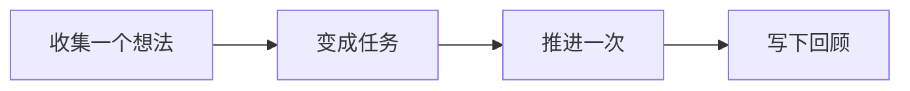

阅读「GranoFlow 不是什么」时，可以先把它放回「开始使用」这条线里理解。重点不是背功能名，而是弄清它适合解决什么问题、下一步该怎么判断。

::::tip[先抓住主线]
先跑通一个小闭环，再慢慢理解更多设置。

如果你正在处理类似问题，先读下面的判断表；真正操作时，再结合页面里的列表、状态和提示来判断下一步。
::::

## 先把它想成什么

把它想成工作台上的便签：先把想法放下来，再决定今天拿起哪一张。

## 一眼看懂流程

先把流程看成一条线：理解这些步骤的顺序后，再到对应页面处理具体操作。

## 一个真实场景

第一次打开 Granoflow 时，先找到收集箱、任务、项目和回顾，不急着配置所有设置。

## 操作前先判断

| 如果你现在想... | 页面里通常看什么 | 接下来做什么 |
| --- | --- | --- |
| 进入「GranoFlow 不是什么」相关页面 | 侧边栏入口、页面标题和主区域 | 先弄清当前列表或设置区在表达什么 |
| 改一个设置或状态 | 页面提示、按钮文字、当前列表 | 改完只观察一个结果 |
| 结果和预期不同 | 空状态、错误提示、访问记录或同步状态 | 回到上一层，按排查顺序处理 |

## 可复用判断

先完成一个小闭环，比先理解所有概念更重要。

## 具体用法和边界

如果你想知道 GranoFlow 适不适合你，先记住一句话：它不是逼你每天完成任务的工具，也不是替你做决定的 AI；它只是帮你把任务、项目和回顾整理得更有结构。

### 不是打卡 app

GranoFlow 没有「连续打卡」这个东西。

很多打卡 app 会让你每天都必须完成一件事。连续 30 天，就像赢了；断了一天，就像前面都白做了。生活一乱，比如生病、出差、临时有事，这种设计很容易让人觉得「我又失败了」。

GranoFlow 不这样看待回顾。它不问「你今天打卡了吗」，而是帮你看清楚：这段时间你在关注什么、做了什么、有什么想法。中断很正常，之后继续用就可以。

### 不是习惯养成游戏

GranoFlow 不会给你徽章、排行榜或连续天数数字，也不会用游戏机制催你每天打开它。

如果你习惯靠积分、奖励或排名来推动自己，这个 app 可能会显得很安静，甚至有点无聊。这不是漏做了什么，而是设计选择。GranoFlow 想帮你建立稳定的专注节奏，不想再制造一种新的压力。

### 不是 AI 代替你做决定的工具

GranoFlow 里的 AI 功能可以帮你整理回顾笔记、生成提示词，但它不会替你掌控生活。

它不会：

- 静默修改你的任务记录
- 替你决定哪个项目最重要
- 替你设定价值观

重要改动都需要你自己确认。AI 是助手，不是老板。

### 不是企业管理工具

GranoFlow 是给个人用的，不是给团队、领导或 HR 用来监控效率的。

你的任务和回顾只有你能看。这是产品边界，不是缺少一个管理后台。

### 基本可以免费使用

GranoFlow 的核心功能可以长期免费用，包括任务、项目、里程碑和日回顾。它们没有数量限制，也不要求你先订阅。

付费主要用于解锁云端同步和少数个性化功能。如果你只在一台设备上使用，完全可以不付费。

::::tip[买还是不买？]
先免费用一段时间。等你真的遇到「我想在手机和电脑上同步」这个需求时，再考虑付费就可以。
::::

## 常见误解

| 容易误解 | 更稳的理解 |
| --- | --- |
| 「GranoFlow 不是什么」需要一次配置完 | 先完成当前这一步，后续再逐步补充 |
| 页面里所有入口都要立刻用上 | 只处理和你当前任务有关的入口 |
| 没有马上整理好就是失败 | 只要下一步更清楚，就已经有用 |

::::note[决定仍要回到你的目标]
Granoflow 可以把信息、状态和下一步摆清楚；要不要继续、是否改设置、是否删除或恢复数据，仍要看你当前页面和真实目标。
::::

## 下一步

下一步可以从任务章节开始，先跑通一个最小闭环。
