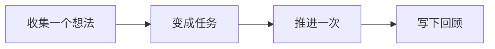

阅读「GranoFlow 适合谁」时，可以先把它放回「开始使用」这条线里理解。重点不是背功能名，而是弄清它适合解决什么问题、下一步该怎么判断。

::::tip[先抓住主线]
先跑通一个小闭环，再慢慢理解更多设置。

如果你正在处理类似问题，先读下面的判断表；真正操作时，再结合页面里的列表、状态和提示来判断下一步。
::::

## 先把它想成什么

把它想成工作台上的便签：先把想法放下来，再决定今天拿起哪一张。

## 一眼看懂流程

先把流程看成一条线：理解这些步骤的顺序后，再到对应页面处理具体操作。

## 一个真实场景

第一次打开 Granoflow 时，先找到收集箱、任务、项目和回顾，不急着配置所有设置。

## 操作前先判断

| 如果你现在想... | 页面里通常看什么 | 接下来做什么 |
| --- | --- | --- |
| 进入「GranoFlow 适合谁」相关页面 | 侧边栏入口、页面标题和主区域 | 先弄清当前列表或设置区在表达什么 |
| 改一个设置或状态 | 页面提示、按钮文字、当前列表 | 改完只观察一个结果 |
| 结果和预期不同 | 空状态、错误提示、访问记录或同步状态 | 回到上一层，按排查顺序处理 |

## 可复用判断

先完成一个小闭环，比先理解所有概念更重要。

## 具体用法和边界

如果你的任务不是孤立的小事，而是属于某个项目、阶段或长期目标，GranoFlow 就适合你。它不是只帮你记住“今天要做什么”，而是帮你看清这些任务到底在推进哪件更重要的事。

一句话版本：**GranoFlow 适合那些“任务背后有更大目标”的人**。

如果你只是想记一个购物清单、临时提醒或几件零散小事，手机自带的备忘录或普通清单工具可能已经够用。GranoFlow 更适合这样的情况：你手上有多个项目，每个项目都有阶段和目标，你希望下次打开时能快速想起来“我现在应该继续推进什么”。

### 项目型工作者

如果你是独立开发者、设计师、研究者、创作者、创业者，或者经常同时处理几条工作线，GranoFlow 会比较合适。

这类工作的难点通常不是“有没有任务”，而是任务太多之后，很难判断哪件事更重要。普通 Todo 清单会越写越长，最后只剩下一堆待办事项。

GranoFlow 让你把任务放到项目和里程碑下面。这样你看到的不只是一个任务名称，也能看到它属于哪个项目、正在服务哪个阶段目标。中断后再回来，也更容易接上。

### 正在长期积累的人

如果你正在备考、转行、学语言、练技能、写书，或者做任何需要长期投入的事，GranoFlow 也适合你。

这类事情的特点是：今天做一点，可能看不出变化；但持续几周、几个月之后，才会看到积累。问题是，人很容易在中间失去方向感。

GranoFlow 的回顾功能可以帮你定期停下来看看：这段时间有没有真的在积累？方向有没有偏？你不需要把它当成打分工具，它更像是一个提醒你抬头看路的地方。

### 容易被打断的人

如果你经常被会议、家庭、客户、临时问题打断，GranoFlow 会有帮助。

很多人被打断之后，最麻烦的不是重新开始工作，而是想不起来“我刚才做到哪了”“这件事为什么重要”。如果所有内容都只放在一个普通清单里，恢复状态会更费力。

GranoFlow 用项目和里程碑把任务组织起来。即使你中断了一周，再打开时也能看到任务和目标之间的关系，不需要从头整理一遍。

### 重视回顾和复盘的人

如果你已经有定期复盘的习惯，GranoFlow 可以作为一个更清楚的记录容器。

日回顾不只是用来划掉任务。你可以用它记录今天做了什么、有什么感受、发现了什么问题。时间久了，它能帮助你理解自己这段时间到底在推进什么，而不是只看到一串完成或未完成的清单。

::::note[什么时候普通 Todo 就够了]
如果你主要只是记录“买牛奶”“记得取快递”这类事项，一个简单的清单工具可能更轻便。GranoFlow 在任务背后有项目、阶段、目标或回顾需求时，才更能发挥价值。
::::

## 常见误解

| 容易误解 | 更稳的理解 |
| --- | --- |
| 「GranoFlow 适合谁」需要一次配置完 | 先完成当前这一步，后续再逐步补充 |
| 页面里所有入口都要立刻用上 | 只处理和你当前任务有关的入口 |
| 没有马上整理好就是失败 | 只要下一步更清楚，就已经有用 |

::::note[决定仍要回到你的目标]
Granoflow 可以把信息、状态和下一步摆清楚；要不要继续、是否改设置、是否删除或恢复数据，仍要看你当前页面和真实目标。
::::

## 下一步

下一步可以从任务章节开始，先跑通一个最小闭环。
