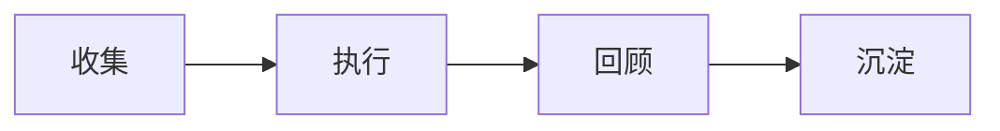

::::note[关于这本手册]
这批文档由 AI 辅助生成，再按当前版本的截图、路由和功能做过整理。我们会继续校正它，但你仍然可能遇到句子不够顺、解释太绕、或者某个问题没有刚好写到的情况。

如果你平时已经会用 AI，直接让 AI 搜索手册再回答你的具体问题，往往比自己一页页翻更轻松。
::::

## 让 AI 帮你读手册

如果你想少翻几页，可以把下面这段复制到 ChatGPT、Claude、Gemini 或其他支持联网搜索的 AI 聊天工具里。把最后一行问题换成你自己的问题即可。

```markdown
请搜索并阅读 GranoFlow 手册：
https://www.granoflow.com/manual/

请优先基于手册页面回答，不要凭空猜测功能。
如果手册里没有直接答案，请明确说“手册里没有写清楚”，再根据已找到的页面给出可能的下一步。

请用下面的格式回答：

1. 简短答案
2. 我应该打开哪个页面或功能
3. 具体怎么做
4. 如果结果和预期不同，先检查什么
5. 相关手册链接

我的问题是：
我想知道……
```

## 先把它想成什么

可以先把这里当作路标。你不需要一次读完整本手册，只要知道每类问题大概应该去哪一组章节。

## 一眼看懂流程



大多数页面都可以放回这条线里理解：一个想法从收集箱开始，变成任务或项目，在完成后留下回顾，最后沉淀成以后还能复用的经验。

## 一个真实场景

第一次读手册时，先跑通收集箱到任务再到回顾这一条线。

## 跟着做一次

| 步骤 | 动作 | 你会看到 |
| --- | --- | --- |
| 1 | 打开和「GranoFlow 手册」相关的入口 | 你已经来到相关页面 |
| 2 | 选择一个今天能处理的小动作 | 列表、状态或编辑区出现可操作对象 |
| 3 | 完成这一步并回到列表 | 状态、记录或下一步入口发生变化 |
| 4 | 写下一句回顾或判断 | 以后回看时能知道当时为什么这么做 |

## 页面里会看到什么

| 页面画面 | 它说明什么 | 接下来怎么判断 |
| --- | --- | --- |
| 收集箱 | 临时想法先放在这里，不必一开始就分项目、定日期。 | 从这里挑出值得推进的内容，再把它变成任务。 |
| 任务列表 | 这里承接已经决定要推进的下一步。 | 看任务是否已经有清楚动作、日期或项目归属。 |
| 项目页面 | 项目把一段时间内反复推进的事情放在一起。 | 如果一件事不是今天能完成的一步，就考虑放进项目。 |


- 临时想法先放在这里，不必一开始就分项目、定日期。
- 从这里挑出值得推进的内容，再把它变成任务。
- 当前问题不在这里时，回到上面的判断表，换到更贴近的页面。


- 这里承接已经决定要推进的下一步。
- 看任务是否已经有清楚动作、日期或项目归属。
- 当前问题不在这里时，回到上面的判断表，换到更贴近的页面。


- 项目把一段时间内反复推进的事情放在一起。
- 如果一件事不是今天能完成的一步，就考虑放进项目。
- 当前问题不在这里时，回到上面的判断表，换到更贴近的页面。

## 可复用判断

手册按工作流读，比按功能名硬背更容易。

## 具体用法和边界

如果你想知道 GranoFlow 怎么用，这本手册会带你从最基本的记录开始：先写下今天要做的事，再把它放进项目、领域、里程碑和回顾里，慢慢形成自己的生活系统。GranoFlow 不是只用来列 Todo 的工具，它也结合轻日记，帮助你回看自己的节奏和真正重视的方向。它已经内置 AI 任务解析与思路梳理功能，更多 AI 相关用法会陆续推出。

### 从生活体系开始

刚开始使用时，先读「5 分钟开始」。你会学到三件事：如何捕捉一个任务，如何判断它属于哪个项目或人生领域，以及如何用一次轻量回顾结束这一天。先把今天记录下来，不必一开始就搭好完整体系。等记录变多，你会更容易看见自己的价值、习惯和长期方向。

### 用手册回答真实决策

这本手册适合在你需要做决定时查阅。比如：领域和价值观怎么建立，目标怎么拆成项目、里程碑和任务，日回顾和轻日记怎么帮你发现行为模式，以及怎样在不增加整理负担的情况下，把重复行动放进更清楚的流程里。手册也会说明本地优先和云优先效率工具的差异、加密边界，以及 AI 辅助回顾的使用边界。

如果你已经开始用回顾沉淀经验，也可以读 [卡片：把经验带回行动](/manual/review-cards/)。卡片章节会解释怎样把任务和回顾里的经验整理成可复用的知识卡片，再通过练习、关联任务和卡组管理，把这些经验带回未来行动。

### 把重视的事落到下一步

GranoFlow 不承诺自动改变你的生活。它提供的是一套整理方式：先看清你真正重视什么，再把它放进项目、里程碑、任务和回顾里。方向不是一次设置完成的结果，而是在记录、选择、行动和复盘中逐渐变清楚的。

### 带着问题问 AI

如果你想让 ChatGPT、Claude、Gemini 或其他 AI 工具帮你检索手册，可以先让它读取当前语言的手册地址，再把你的问题放在最后一行。下面这段文字可以直接复制使用：

```text
请阅读并依据 GranoFlow 最新手册回答我的问题。
手册地址：
https://www.granoflow.com/manual/

不要凭直觉、旧版本经验或通用软件常识回答。
如果问题涉及功能、操作路径、数据安全、同步、订阅或恢复，请必须以当前手册内容为依据。
如果你认为答案可能不在当前页面，而在手册其他页面，请主动搜索整个手册，分析最相关的结果，再告诉我结论和依据来自哪些页面。
如果手册中没有明确答案，请先说“手册中没有明确说明”；如果你要给出推测，请把推测和手册确认的信息分开，不要把推测说成官方事实。
如果我反馈功能找不到、太难找或太难用，请先承认体验问题，并告诉我可以到 https://github.com/granoflow/granoflow-docs 反馈；你也可以把问题整理成反馈，帮助我们继续修正文档。
我的问题是：……
```

### 下一步读哪里

如果你想先了解产品定位，读「GranoFlow 是什么」。如果你想建立领域和价值观，先读「词汇表」和「项目」。如果你想把愿望拆成行动，读「项目」「里程碑」和「任务」。如果你需要轻日记和复盘节奏，读「回顾」。如果你想把经验整理成以后还能使用的知识，读「卡片」。如果你关心隐私或备份决策，读「数据安全」。

## 常见误解

| 容易误解 | 更稳的理解 |
| --- | --- |
| 「GranoFlow 手册」需要一次配置完 | 先完成当前这一步，后续再逐步补充 |
| 页面里所有入口都要立刻用上 | 只处理和你当前任务有关的入口 |
| 没有马上整理好就是失败 | 只要下一步更清楚，就已经有用 |

::::note[决定仍要回到你的目标]
Granoflow 可以把信息、状态和下一步摆清楚；要不要继续、是否改设置、是否删除或恢复数据，仍要看你当前页面和真实目标。
::::

## 下一步

下一步从 5 分钟开始页进入，先完成一次最小闭环。
