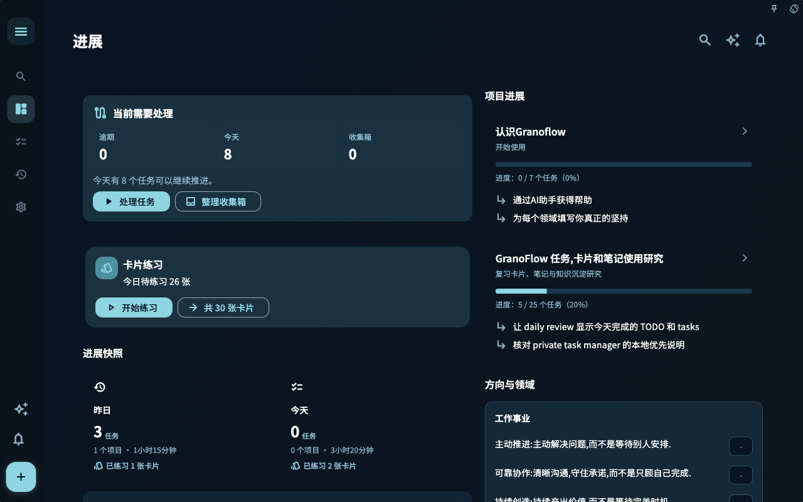
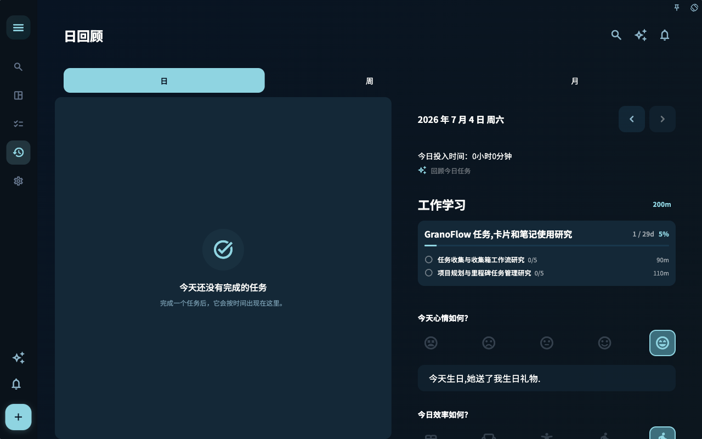

进展页不是用来给自己打分的。它更像一面镜子：最近哪些事真的推进了，哪些事只是停在计划里。

## 一个真实场景

如果你看到任务完成很多，但项目仍停住，说明你可能做了很多零碎动作，却没有把它们放回长期目标。

## 从数字读出下一步

统计页先给你一个整体状态：完成了多少、练习了多少、哪些趋势正在变化。它适合用来发现偏差，而不是用来评价自己。

统计入口页把不同类型的进展放到一起。你可以从这里选择看任务、卡片或回顾相关的信息，不需要一次把所有数字都解释完。

成就页面更适合看阶段性的完成感。真正有用的不是“有多少成就”，而是它能否提醒你：哪些行动已经稳定出现，哪些还需要回到任务里调整。

## 怎么判断下一步

| 你遇到的情况 | 先看什么 | 下一步 |
| --- | --- | --- |
| 不知道该从哪里开始 | 当前页面标题和主要入口 | 只选择和当前目标有关的一项 |
| 操作后结果不对 | 状态、空提示、访问记录或同步进度 | 回到上一层，按顺序排查 |
| 担心影响数据 | 备份、同步、账号或权限说明 | 先停下，确认范围后再继续 |

## 边界

看进展时，先找一个会影响下一步的信号。只要它能帮你调整今天的任务，就已经够用了。

## 下一步

读完这一节后，回到你正在处理的任务，只选一个最小动作继续：记录一条输入、检查一个状态、或打开相关设置完成一次确认。
