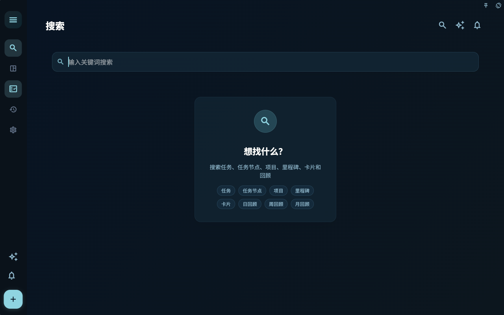
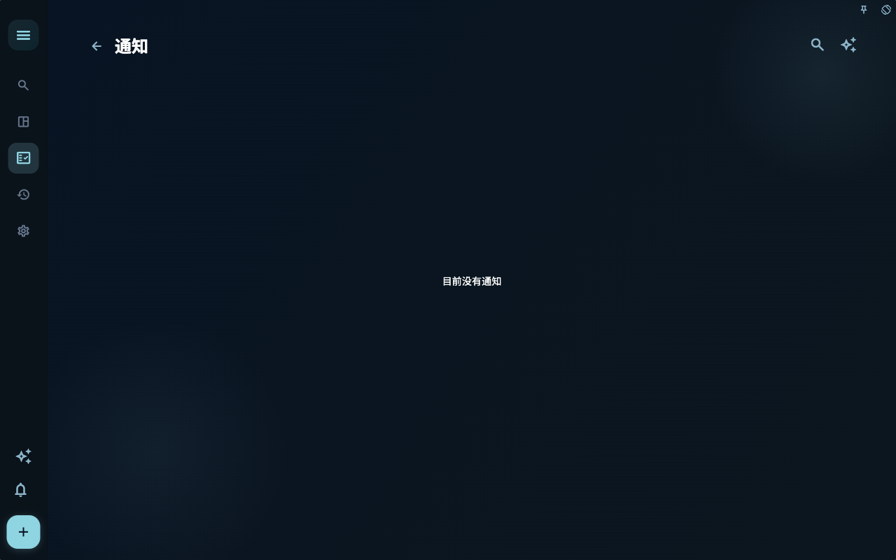

界面不是一排功能按钮，而是一张工作地图。你不需要先记住每个入口的名字，只要知道自己现在是在收集、查找、调整，还是回看进展。

## 一个真实场景

把侧边栏想成书桌边的几个抽屉：临时想法放收集箱，要找旧记录用搜索，要改规则进设置，要看提醒去通知，想知道最近做得怎么样看进展。

## 先分清三类入口

设置页适合处理规则、账号、数据、AI 和本地接口。它不是每天都要打开的地方；当你发现某个行为“不像自己想要的那样工作”时，再来这里找对应开关或入口。

搜索页适合找已经存在的内容。它解决的是“我记得写过，但不知道在哪”的问题，而不是替你整理新输入。

通知中心则用来查看提醒和未处理提示。看到通知时，重点不是把数字清零，而是判断它是否指向一个真实下一步。

## 怎么判断下一步

| 你遇到的情况 | 先看什么 | 下一步 |
| --- | --- | --- |
| 不知道该从哪里开始 | 当前页面标题和主要入口 | 只选择和当前目标有关的一项 |
| 操作后结果不对 | 状态、空提示、访问记录或同步进度 | 回到上一层，按顺序排查 |
| 担心影响数据 | 备份、同步、账号或权限说明 | 先停下，确认范围后再继续 |

## 边界

如果你刚打开 Granoflow，先不用急着配置完整系统。先把当前任务放进去，再按需要进入搜索、通知或设置。

## 下一步

读完这一节后，回到你正在处理的任务，只选一个最小动作继续：记录一条输入、检查一个状态、或打开相关设置完成一次确认。
