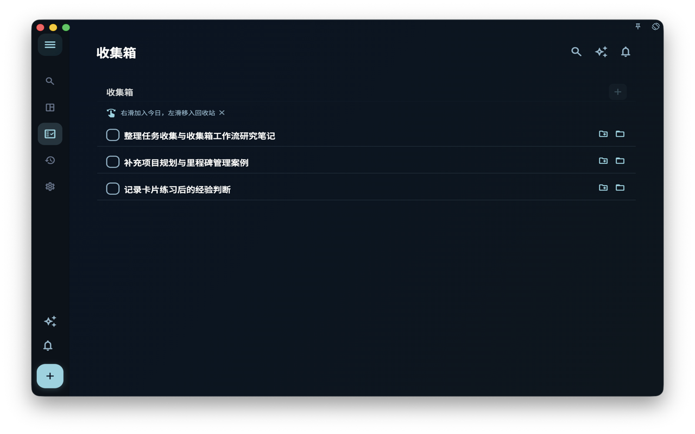

快速添加的价值不是让你多建任务，而是先把脑子里的输入放到一个不会丢的地方。真正的整理发生在后面：它要留在收集箱、进入任务列表，还是被拆成下一步。

## 一个真实场景

比如你正在写论文，突然想到“检查参考文献格式”。先快速添加，等手头工作停下来，再补项目、日期或下一步。

## 从收集到整理

收集箱适合先接住还没想清楚的输入。图里的任务还没有被彻底安排好，所以你要做的是整理它，而不是立刻把所有字段填满。

任务列表承接已经可以执行的下一步。一个输入从收集箱来到这里，通常意味着它已经有了更清楚的动作、日期、项目或优先级。

## 怎么判断下一步

| 你遇到的情况 | 先看什么 | 下一步 |
| --- | --- | --- |
| 不知道该从哪里开始 | 当前页面标题和主要入口 | 只选择和当前目标有关的一项 |
| 操作后结果不对 | 状态、空提示、访问记录或同步进度 | 回到上一层，按顺序排查 |
| 担心影响数据 | 备份、同步、账号或权限说明 | 先停下，确认范围后再继续 |

## 边界

快速添加后，不要马上把所有字段填满。先让想法落地，再在收集箱里把它变清楚。

## 下一步

读完这一节后，回到你正在处理的任务，只选一个最小动作继续：记录一条输入、检查一个状态、或打开相关设置完成一次确认。
