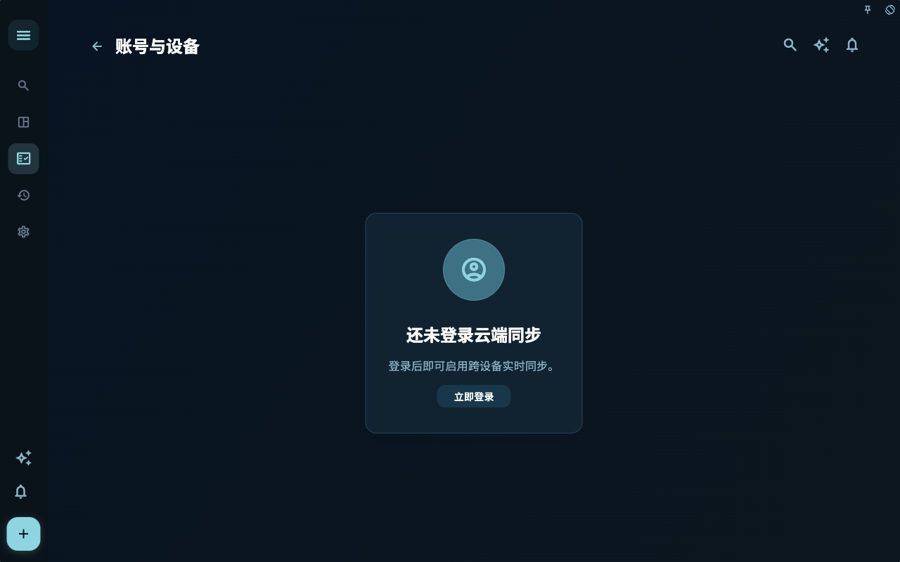

账号和数据入口决定的是“我的资料在哪里、谁能恢复、怎样迁移”。这类设置不要等到换设备或出问题时才第一次看。

## 一个真实场景

如果你准备换电脑，先看账号状态、同步状态和本地备份；如果只是整理卡组，不要把卡组导出当成完整备份。

## 先分清账号和数据

账号页面回答的是“当前是谁在使用”。换设备、恢复会员或排查同步前，先确认这里的账号身份。

数据管理回答的是“资料怎么备份、导入、清理或迁移”。如果你只是要整理任务，不必来这里；如果你要换设备、导出卡组或清理附件，它才是主入口。

## 怎么判断下一步

| 你遇到的情况 | 先看什么 | 下一步 |
| --- | --- | --- |
| 不知道该从哪里开始 | 当前页面标题和主要入口 | 只选择和当前目标有关的一项 |
| 操作后结果不对 | 状态、空提示、访问记录或同步进度 | 回到上一层，按顺序排查 |
| 担心影响数据 | 备份、同步、账号或权限说明 | 先停下，确认范围后再继续 |

## 边界

账号、同步和备份各管一件事。先分清目标，再选择入口。

## 下一步

读完这一节后，回到你正在处理的任务，只选一个最小动作继续：记录一条输入、检查一个状态、或打开相关设置完成一次确认。
