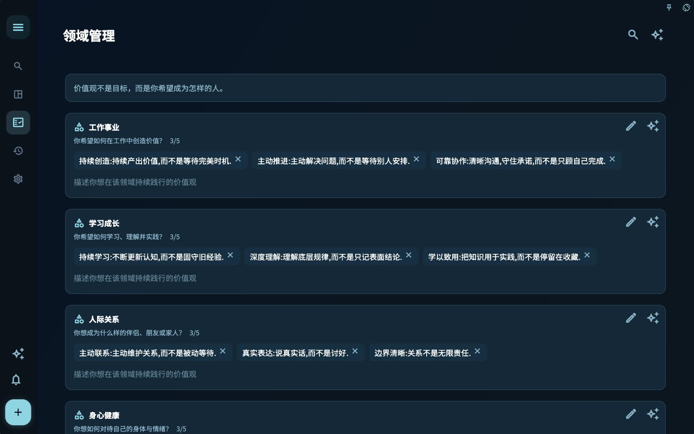

投入不是一直用力，而是目标、难度和反馈能接得上。Granoflow 通过领域、项目和任务把这三件事放到可见位置。

## 一个真实场景

如果任务太碎，你看不到方向；如果目标太大，你不知道今天做什么。项目和任务之间的连接就是为了减少这种断裂。

## 从方向到行动的三层结构

领域页面让你先看到生活和工作的几个大方向。它回答的是“我现在主要在照顾哪一块”。

项目页面承接一段时间的持续投入。它把长期方向变成可以阶段性推进的容器。

任务列表把项目和领域落到今天。这里最重要的是下一步是否明确，而不是数量是否足够多。

## 怎么判断下一步

| 你遇到的情况 | 先看什么 | 下一步 |
| --- | --- | --- |
| 不知道该从哪里开始 | 当前页面标题和主要入口 | 只选择和当前目标有关的一项 |
| 操作后结果不对 | 状态、空提示、访问记录或同步进度 | 回到上一层，按顺序排查 |
| 担心影响数据 | 备份、同步、账号或权限说明 | 先停下，确认范围后再继续 |

## 边界

先让目标清楚一点，再让任务小一点，最后用反馈调整节奏。

## 下一步

读完这一节后，回到你正在处理的任务，只选一个最小动作继续：记录一条输入、检查一个状态、或打开相关设置完成一次确认。
