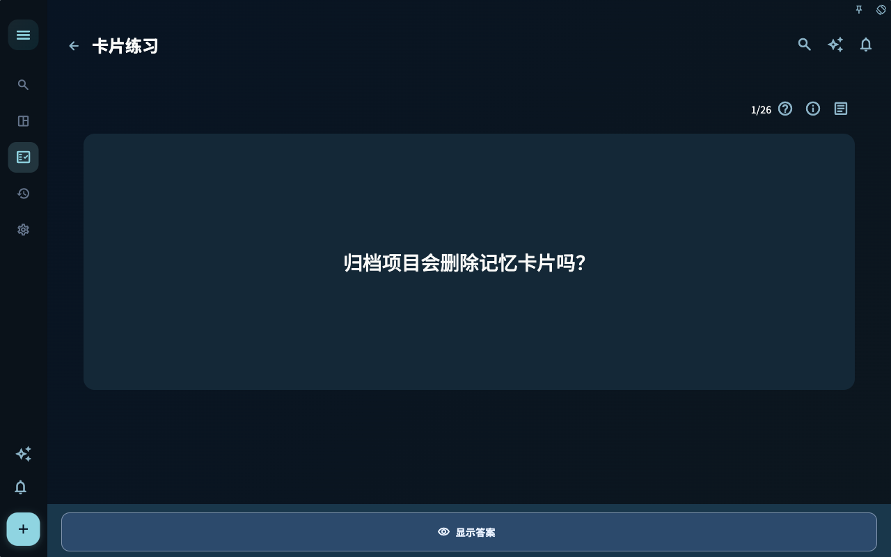
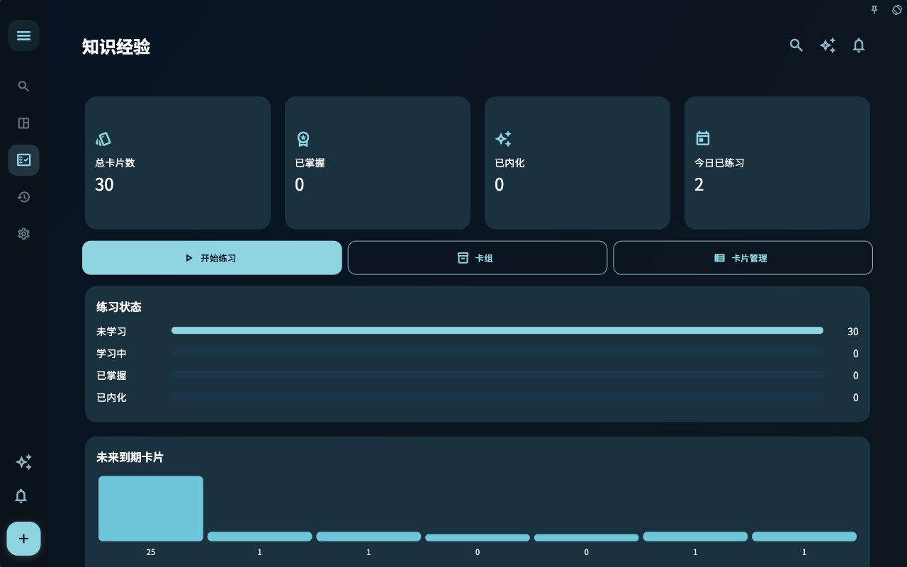
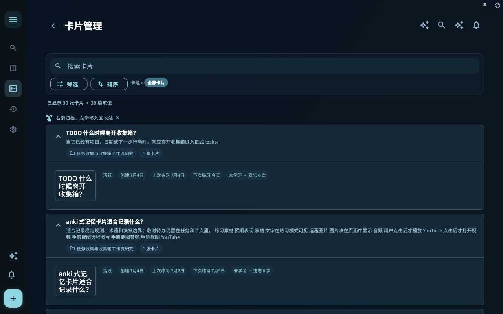
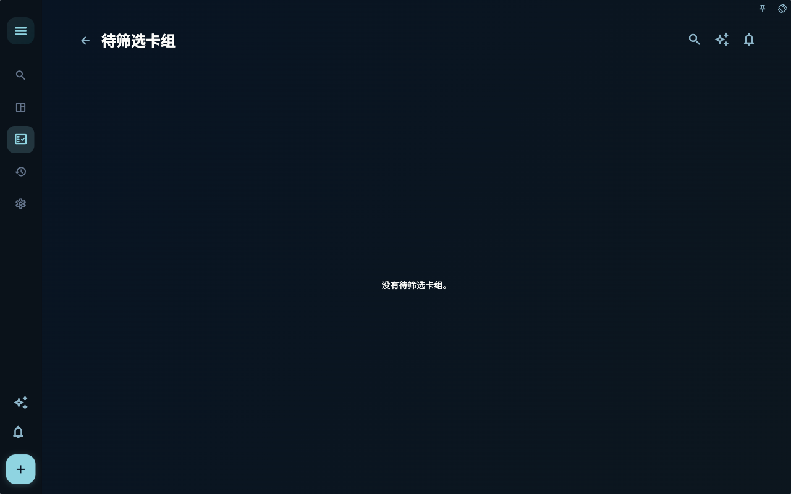
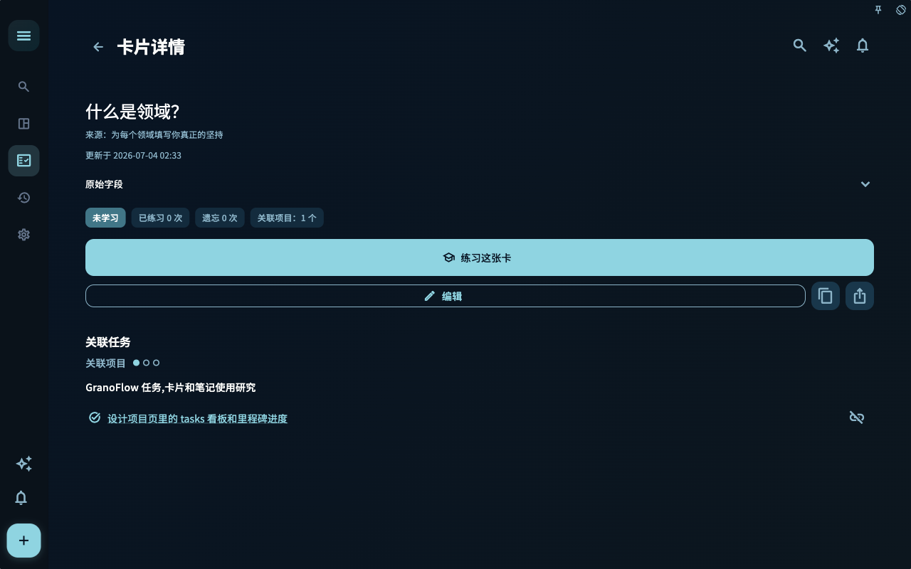

先看问题，再看答案，最后按真实熟悉程度评分；卡组和统计页用于整理与复查。

卡片练习页使用固定 seed 卡片“什么是领域？”，这样四种语言截图都指向同一张卡片的本地化版本。

## 怎么使用这一页
1. 先确认你要完成的目标，而不是从按钮名称开始记。
2. 对照截图确认当前页面、状态和入口是否一致。
3. 完成一步后看页面反馈，再决定是否进入下一页。

## 截图

用于确认页面入口、主要状态和可继续操作的位置。

用于确认页面入口、主要状态和可继续操作的位置。

用于确认页面入口、主要状态和可继续操作的位置。

用于确认页面入口、主要状态和可继续操作的位置。

用于确认页面入口、主要状态和可继续操作的位置。

用于确认页面入口、主要状态和可继续操作的位置。

用于确认页面入口、主要状态和可继续操作的位置。

用于确认页面入口、主要状态和可继续操作的位置。

用于确认页面入口、主要状态和可继续操作的位置。

用于确认页面入口、主要状态和可继续操作的位置。

用于确认页面入口、主要状态和可继续操作的位置。

用于确认页面入口、主要状态和可继续操作的位置。

用于确认页面入口、主要状态和可继续操作的位置。

用于确认页面入口、主要状态和可继续操作的位置。

用于确认页面入口、主要状态和可继续操作的位置。

用于确认页面入口、主要状态和可继续操作的位置。

## 边界
截图只证明当前 macOS、深色、横屏和手册 seed 下的可见状态。账号、订阅、同步、AI 和外部工具页面会随权限和本机状态变化。

## 下一步

[调整规则和提示词](../personalize-flow/)
