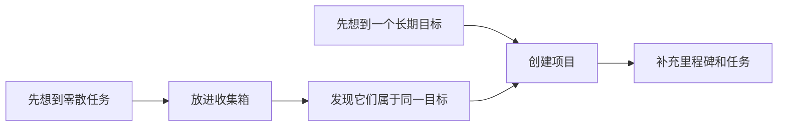

创建项目不是为了把事情写得更正式，而是为了给一组相关任务找一个稳定的地方。以前你可能会先问“我要不要建一个项目”，更好用的问法是：“这件事会不会反复回来，需要我记住背景和进度？”

如果答案是会，就可以创建项目。项目先把目标装起来，任务和里程碑可以之后慢慢补。

## 先判断要不要创建

| 场景 | 建议 | 例子 |
| --- | --- | --- |
| 一次性动作 | 直接建任务 | 今天交水费、回复一封邮件 |
| 一个持续目标 | 建项目 | 准备课程发布、搬家、写论文 |
| 还没想清楚，只是一个念头 | 先放进收集箱 | “也许要整理作品集” |
| 已经有一批相关任务散在各处 | 建项目后再归入 | 把发布、测试、文案任务放到同一项目 |

这里的关键不是项目名称好不好看，而是它能不能帮你下次回来时少花一点回忆成本。

## 创建入口和必填内容

进入项目页，点击右上角 **+**，填写项目名称和必要说明，然后创建。

创建时通常会遇到这些字段：

| 字段 | 怎么写 | 注意什么 |
| --- | --- | --- |
| 名称 | 写出要完成的目标 | “写完毕业论文”比“论文”更清楚 |
| 描述 | 记录背景、范围、约束或交付说明 | 不确定时可以先空着 |
| 领域 | 选择它属于哪个长期方向 | 适合把工作、学习、健康等大方向分开 |

::::tip[项目名尽量写成一句动作]
“上线课程第一版”“完成搬家准备”“整理 2026 作品集”都比“课程”“搬家”“作品集”更容易接上下一步。项目名不需要文学化，只要未来的你一眼看懂。
::::

## 先建空项目，还是先收集任务

两种顺序都可以。

如果你已经知道这是一个项目，比如“准备一次发布”，先建项目会更轻松。之后看到相关任务，就能直接归进去。

如果你只是陆续想到一些事，比如“买纸箱”“问物业”“查搬家公司”，先放进收集箱也没问题。等你发现它们其实都属于“搬家”，再创建项目并把任务连接进去。

这两条路最后会汇合到同一个地方：一个项目承接目标，任务负责真正推进。

## 创建后接着做什么

项目创建完成后，不必马上把它整理到完美。通常按这个顺序继续就够了：

| 下一步 | 什么时候做 | 会得到什么结果 |
| --- | --- | --- |
| 添加里程碑 | 目标有明显阶段 | 项目不再是一整串任务 |
| 连接已有任务 | 任务已经散在收集箱或任务列表 | 相关事项回到同一个项目 |
| 在项目里创建新任务 | 你已经知道下一步动作 | 新任务自动带上项目上下文 |

如果你暂时不知道后面要做什么，先关掉也可以。一个空项目不是失败，它只是先占住了一个目标位置。

## 常见误解

| 容易误解 | 更稳的理解 |
| --- | --- |
| 创建项目时必须把计划写完整 | 项目可以先粗后细 |
| 描述必须写得很正式 | 描述只要能帮你以后回忆背景 |
| 选了领域就等于排好了优先级 | 领域只是归属，优先级仍要结合任务和日期判断 |

## 下一步

如果这个项目已经能分出几个阶段，继续看“管理里程碑”。如果你已经有任务散在别处，可以直接看“把任务连接到项目”。
