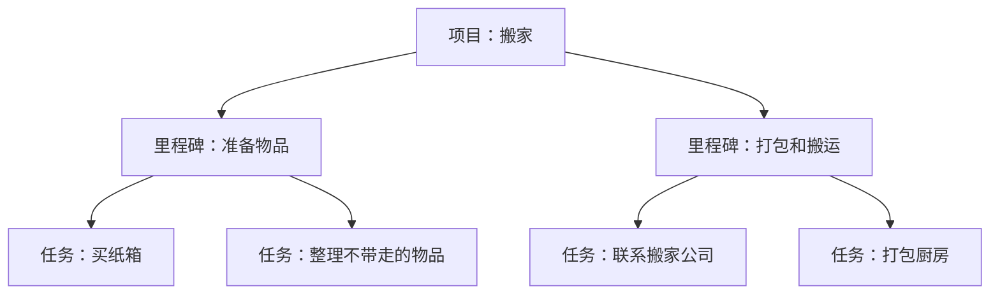

很多人一开始会把项目当成“更大的任务”。这样想也能用，但很快会遇到一个问题：一个项目通常不是做一次就结束，而是要在几天、几周甚至更久的时间里反复推进。

在 GranoFlow 里，更稳的理解是：任务回答“今天具体做什么”，项目回答“这些任务共同服务哪个目标”。里程碑夹在中间，帮你把一段长期推进拆成几个能判断进展的阶段。

## 一个真实场景

假设你准备搬家。“买纸箱”“打包厨房”“联系搬家公司”都是任务，因为它们可以被具体执行；“搬家”本身更适合做成项目，因为它会持续一段时间，也会产生一组相关任务。

把这些任务放进同一个项目后，你不需要靠记忆到处找它们。每次回来时，先看项目做到哪一段，再决定今天推进哪一步。

## 项目、里程碑和任务

这张关系图的重点不是层级越多越好，而是让不同问题放在合适的位置：目标放进项目，阶段放进里程碑，真正要动手的事写成任务。

## 项目和领域的关系

项目不是孤立存在的。很多项目背后都有一个更长期的方向，比如学习、工作、健康、家庭或个人作品。领域页面适合承接这种长期方向；项目则承接其中一段需要推进的目标。

可以把领域想成花园的分区，把项目想成其中一块正在整理的区域。分区不要求你每天都有大动作，但它能提醒你：这一组项目到底是在照顾哪个方向。

| 如果你在想... | 更适合放在哪里 |
| --- | --- |
| 我长期想持续照顾的方向是什么 | 领域 |
| 这个方向下最近要完成的一段目标是什么 | 项目 |
| 今天能推进的下一步是什么 | 任务 |

## 什么时候该建项目

| 你的情况 | 更适合的做法 | 原因 |
| --- | --- | --- |
| 只有一两步，今天或明天就能做完 | 直接创建任务 | 项目会让简单事情变重 |
| 会产生三项以上相关任务，并持续超过一周 | 创建项目 | 需要一个地方承接上下文和进度 |
| 有几个明显阶段，比如准备、执行、检查 | 项目里再加里程碑 | 阶段能帮助你判断下一步 |
| 只是同类任务的横向分类 | 使用标签或其他视图 | 项目更适合承接一个目标 |

::::tip[一个省事判断]
如果你每次看到这件事都要重新回忆背景，它多半值得建成项目；如果你一看任务标题就知道下一步，直接放在任务里通常够了。
::::

## 项目能做什么，不能替代什么

项目能把相关任务放在一起，用里程碑拆阶段，并展示整体进度。它适合承接“持续推进”的事情。

但项目不会替你决定哪天做哪件事。任务是否出现在今日视图或日历里，仍然取决于日期；跨项目的横向分类，通常还是靠标签；每天完成了什么，也要回到回顾里看。

| 容易误解 | 更稳的理解 |
| --- | --- |
| 项目越多越有条理 | 项目太多也会变成另一种收集箱 |
| 所有长期想法都要马上建项目 | 先等它产生明确任务，再建也来得及 |
| 建了项目，任务就会自动安排时间 | 项目负责归属，日期仍要在任务上处理 |

## 下一步

理解项目这层容器后，可以继续看“创建项目”。那一篇会讲从哪里创建、名称怎么写，以及先建空项目还是先收集任务。
