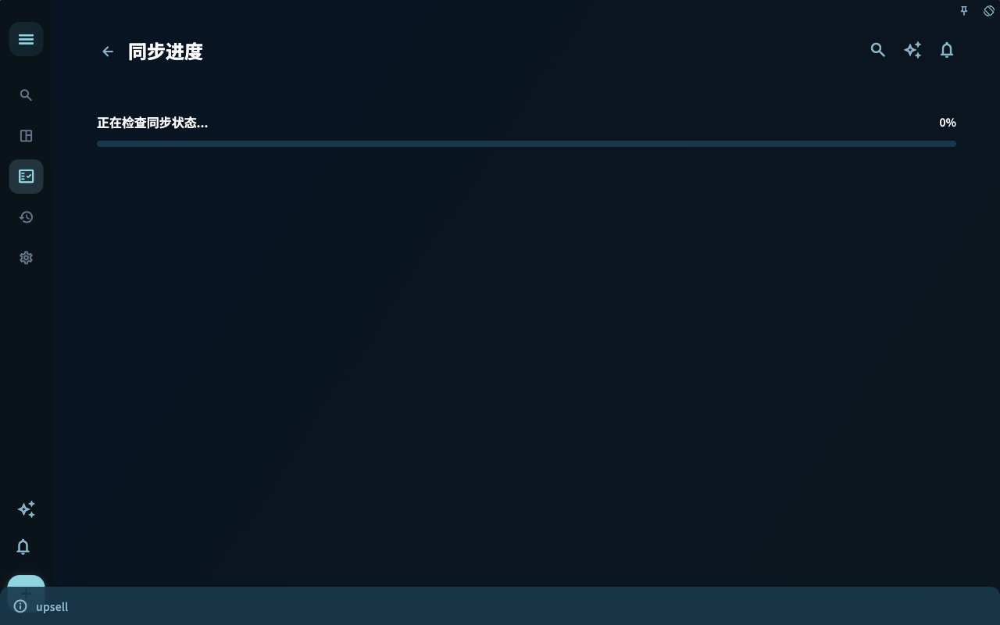
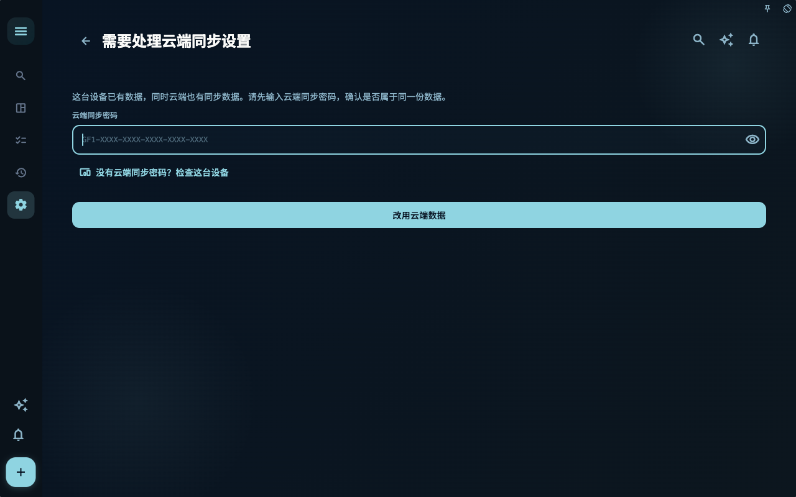
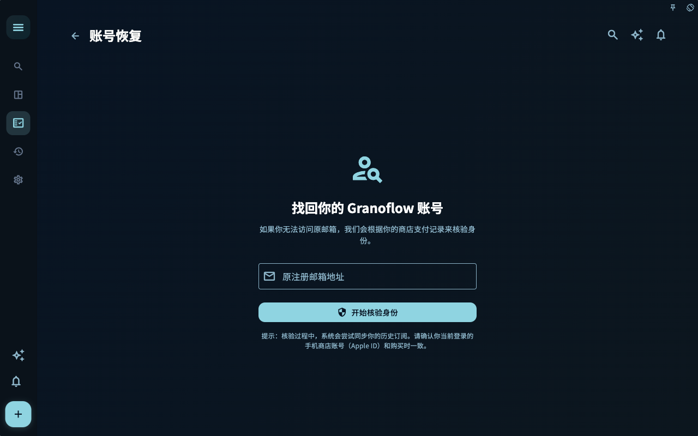

数据相关页面要按本地数据、备份、恢复、账号、同步的顺序理解。

## 怎么使用这一页
1. 先确认你要完成的目标，而不是从按钮名称开始记。
2. 对照截图确认当前页面、状态和入口是否一致。
3. 完成一步后看页面反馈，再决定是否进入下一页。

## 截图

用于确认页面入口、主要状态和可继续操作的位置。

用于确认页面入口、主要状态和可继续操作的位置。

用于确认页面入口、主要状态和可继续操作的位置。

用于确认页面入口、主要状态和可继续操作的位置。

用于确认页面入口、主要状态和可继续操作的位置。

用于确认页面入口、主要状态和可继续操作的位置。

用于确认页面入口、主要状态和可继续操作的位置。

用于确认页面入口、主要状态和可继续操作的位置。

用于确认页面入口、主要状态和可继续操作的位置。

## 边界
截图只证明当前 macOS、深色、横屏和手册 seed 下的可见状态。账号、订阅、同步、AI 和外部工具页面会随权限和本机状态变化。

## 下一步

[连接桌面端和本地接口](../connect-desktop/)
