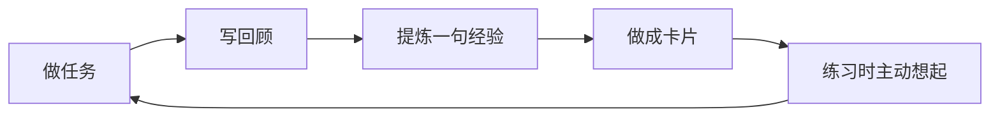

卡片不是拿来收藏金句的。它更像一个小提醒：你曾经在某件事里学到过什么，下一次遇到相似情况时，先把这句话拿出来想一想。

如果你只想记住一个原则：**卡片要从真实行动里长出来，再回到真实行动里去。**

::::tip[适合做成卡片的经验]
一句话能帮你下次少绕弯，就值得做成卡片。比如“进项目页前，先确认任务有没有明确下一步”，比“要更有计划”更适合练习。
::::

## 它解决的不是记忆问题

很多工具把卡片做成“背资料”的地方，Granoflow 里的卡片更偏向“复用判断”。你不是为了记住一个定义，而是为了在下一次开始任务、整理项目、写回顾时，能更快想起一个经过验证的做法。

可以把它想成厨房里的便签：不是菜谱全集，只贴那些你真的会忘、忘了就会影响结果的小提醒。

## 一张卡片从哪里来

这条线里最重要的是中间那一步：把经验压成一句能再次使用的话。不要把整段回顾搬进卡片里。整段文字留在回顾，卡片只留下下次行动前要想起的判断。

## 先看题面，再看答案

练习开始时，页面只显示问题。这样设计是为了让你先在脑子里找答案，而不是直接扫一眼解释就算读过。像图里的“什么是领域？”就不是让你背定义，而是让你先想：自己现在的任务到底属于工作、学习、关系、身体，还是休闲？

## 答案要能带回生活

显示答案后，页面下方会出现反馈按钮。你可以根据自己刚才的回忆质量选择“遗忘”“勉强”“记得”或“轻松”。这不是考试打分，只是告诉 Granoflow：这张卡片下次应该早点出现，还是可以晚一点再练。

图里的卡片把“领域”解释成几个花园。这个比喻有用，是因为它能帮你回到实际选择：今天的任务是在照顾哪一个花园？有没有一个花园被完全忽略了？

## 统计页看趋势，不看虚荣数字

统计页会显示总卡片数、已掌握、已内化、今日已练习，以及不同学习状态的分布。这里不要追求把数字刷得很好看。更实用的看法是：

| 你看到的情况 | 可以怎么理解 | 下一步 |
| --- | --- | --- |
| 未学习很多 | 有不少经验还没有进入练习 | 先从今天最相关的卡片开始 |
| 今日已练习很少 | 只是还没开始，不代表失败 | 做一轮短练习即可 |
| 已掌握很少 | 经验还没有稳定下来 | 不急着新增太多卡片 |
| 已内化变多 | 有些提醒已经比较自然 | 回到任务里观察是否真的用上了 |

## 什么内容适合放进卡片

| 内容 | 适合做成卡片吗 | 原因 |
| --- | --- | --- |
| “开始任务前，先写下一步动作” | 适合 | 下次做任务前能直接用 |
| “这周工作很累” | 不太适合 | 更像回顾原文，缺少可复用判断 |
| “项目延期时，先拆最小可交付结果” | 适合 | 能帮助类似场景里的决策 |
| “今天心情不好” | 不太适合 | 适合留在日记或回顾，不要变成练习题 |
| “同步失败先检查当前设备是否登录同一账号” | 适合 | 是明确的排查提醒 |

## 不要把卡片库做得太满

卡片越多，不一定越有用。真正有用的是那些你愿意反复碰、反复修正的卡片。每次回顾后，最多挑一两条最有复用价值的经验就够了。

一个简单判断是：**如果下周遇到类似任务，你希望自己先想起这句话吗？**如果答案是肯定的，就做成卡片；如果只是觉得这句话“好像也不错”，先留在回顾里。

## 下一步

- 想把任务里的经验做成卡片，读[创建与关联卡片](./create-and-link/)。
- 想知道练习按钮和状态怎么用，读[练习、掌握与内化](./study-and-internalize/)。
- 想导入、导出或整理卡组，读[卡组、导入与导出](./decks-import-export/)。
