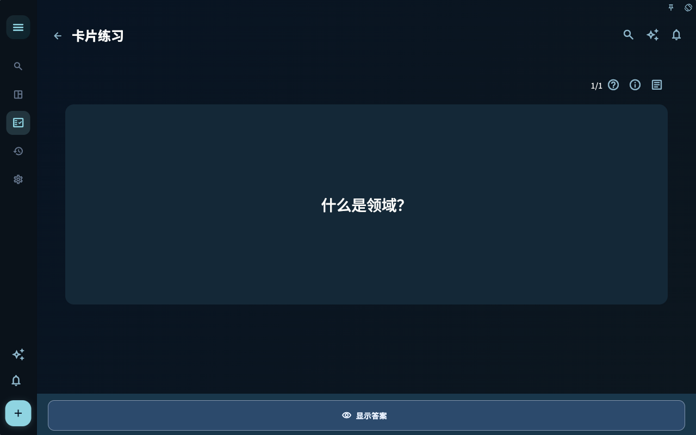
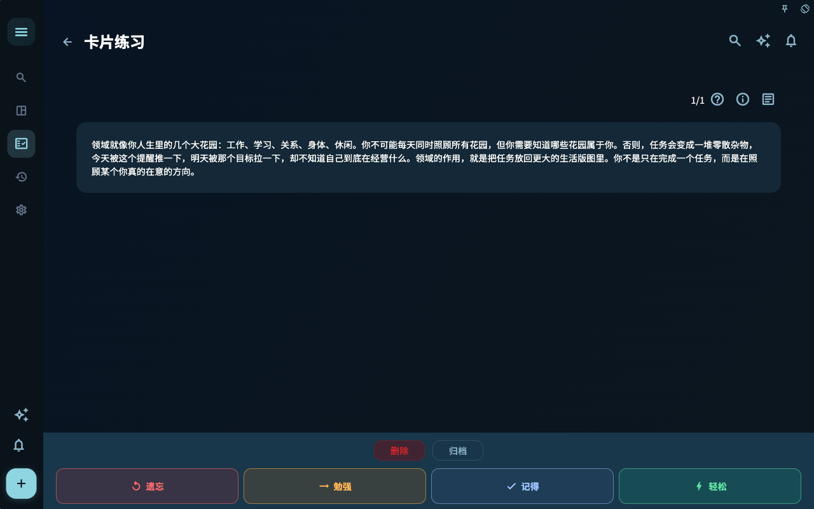
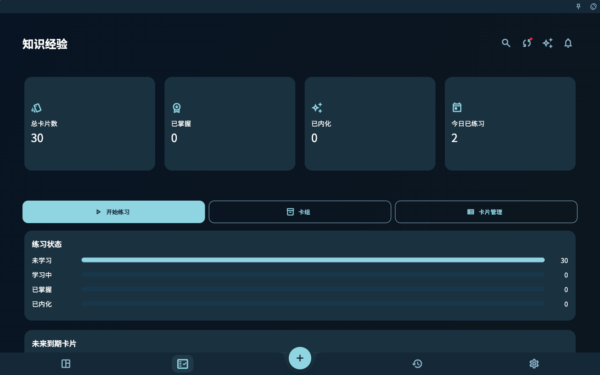
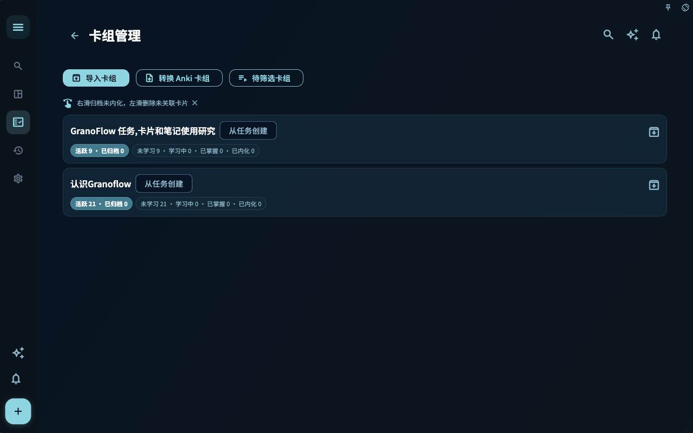
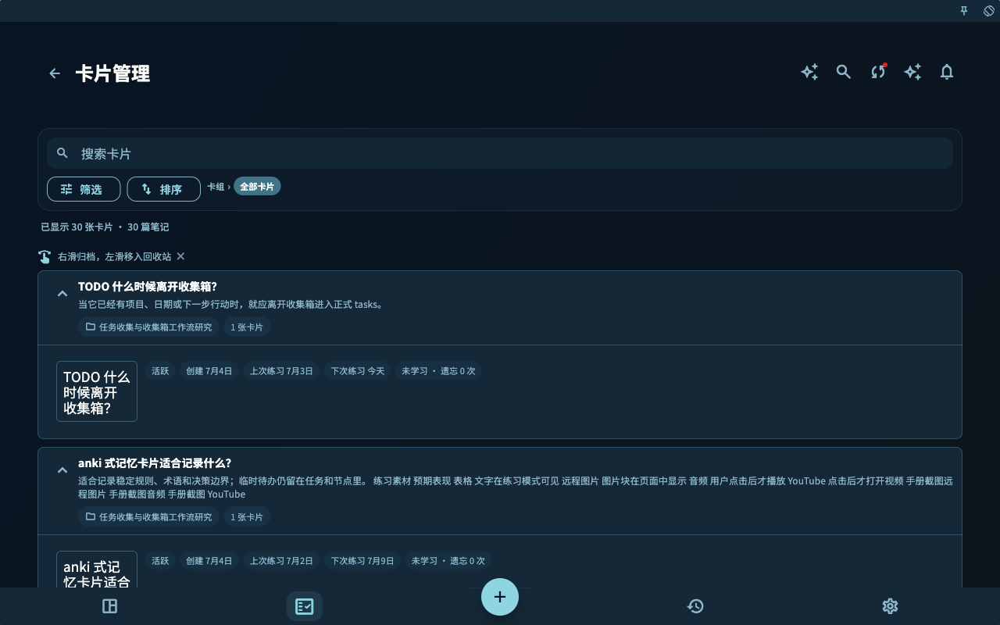
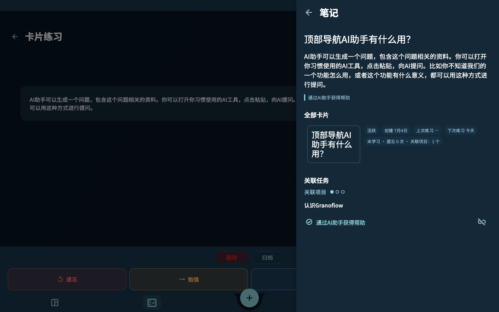

记忆卡片是 GranoFlow 里把经验带回未来行动的方式。它不要求你背诵每句话，而是让一个判断、问题或提醒在下一次工作时更容易被想起。

## 先完成一次卡片学习

下面这张示例卡片问的是“什么是领域？”。领域可以理解为你长期在照顾的生活或工作方向，例如工作、学习、关系、身体和休闲。

1. 打开卡片练习页面后，先只看问题。
2. 先用自己的话回答，不急着点开答案。
3. 点击 **显示答案**。

点击后，页面会从问题态进入答案态。你会看到卡片背面的解释，以及底部几个评分按钮。

评分记录的是这一次提取答案的感觉：

- **遗忘**：刚才想不起来。
- **勉强**：有印象，但还不稳定。
- **记得**：能顺利想起主要意思。
- **轻松**：不用费力就能说清楚。

## 查看统计和管理卡片

统计页适合判断卡片库是否还在正常运转。

卡组列表回答“这些卡片来自哪里、按什么集合组织”。

卡片管理页适合搜索、查看和整理具体卡片。

学习时如果想回到来源语境，可以打开笔记面板。

## 一个简单判断

- 想看整体数量和状态：去统计页。
- 想按集合整理：去卡组列表。
- 想找某一张卡：去卡片管理。
- 想回到来源语境：在学习页打开笔记面板。
