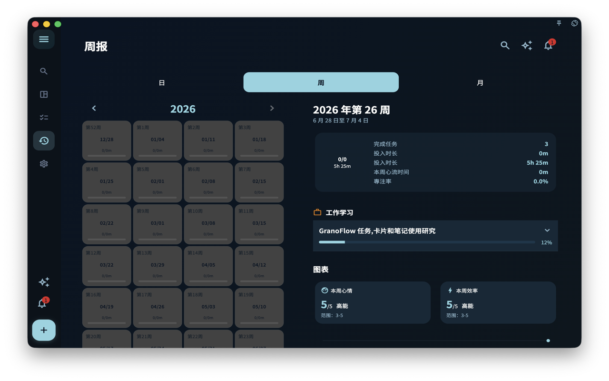

记录不是任务的附属品。更准确地说，它是某一天的注释：那天为什么这样安排，哪里卡住了，下一次看到同类情况时可以少摸索一点。

如果只把记录当成“今天写了什么”，它很快会变成流水账。把它当成给未来自己的索引，就会更容易决定写什么、写多长、以后从哪里找。

## 记录和任务的关系

| 项目 | 保存在哪里 | 改动会影响什么 |
| --- | --- | --- |
| 任务 | 任务本身 | 标题、状态、项目、时间记录 |
| 日记录 | 某一天 | 当天回顾里看到的文字 |
| 周回顾 | 某一周 | 一周范围里的总结和统计 |
| 月回顾 | 某个月 | 月度视角里的汇总和取舍 |

删除或修改任务不会自动删除某天的记录。反过来，修改某天记录，也不会改变任务标题、项目归属或完成状态。

::::note[记录按日期保存]
你在某天写下的内容，会跟着那一天走。以后切回那天，就能和当天的任务一起查看。
::::

## 周视角适合找模式

周回顾把这一周的完成情况、项目进度和图表放在一起。它适合回答“最近几天反复发生了什么”，而不是把七天重新讲一遍。

例如你连续几天都在处理同一个研究项目，但每天记录都很短。单独看某一天，可能只是一句“继续整理截图”。放到周回顾里，你会看到它其实是一条持续推进的线索。

## 记录适合写什么

记录没有固定格式。你可以写很短，也可以写多一点。关键是以后看得懂。

| 想留下的线索 | 可以怎么写 |
| --- | --- |
| 任务为什么卡住 | “资料还没准备好，明天先补截图清单。” |
| 哪个安排有效 | “上午先处理收集箱，比下午临时整理顺。” |
| 明天的入口 | “先打开项目规划案例，不要先改提示词。” |
| 值得沉淀的经验 | “截图失败时，先确认 seed，再怀疑路由。” |

写得短、具体，通常比写得完整但勉强更有用。你不需要把情绪、任务、计划都写齐。

## 怎么查看历史记录

| 动作 | 你会看到 | 如果找不到 |
| --- | --- | --- |
| 在日回顾切换日期 | 那一天的任务和记录 | 确认记录是不是写在别的日期 |
| 在周回顾查看一周 | 一周范围内的任务和统计 | 回到具体日期看文字细节 |
| 使用搜索 | 相关任务、日/周/月回顾结果 | 换成更具体的关键词 |

如果你记得大概时间，先用日回顾或周回顾找日期；如果只记得关键词，再用搜索。

## 一个真实场景

你记得之前处理过“卡片练习后的经验判断”，但忘了当时为什么要放进收集箱。可以先在周回顾里找到那一周，再切回具体日期。任务告诉你做了什么，记录告诉你当时为什么这么做。

这就是记录和任务分开的好处：任务负责事实，记录负责当时的判断。

## 边界

- 记录不是任务评论，不会跟着某一条任务移动。
- 记录不是日报提交，不需要固定格式。
- 记录不是备份。重要数据仍然要按数据安全章节处理。

## 下一步

如果你想让日记或周记由 AI 先整理一版，继续读[日记与周记生成方式](./note-templates)。如果你想调整 AI 整理时参考的方向，读[价值观与 AI 研究偏好](./values-and-prompts)。
