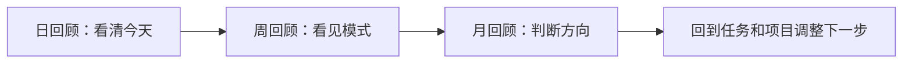
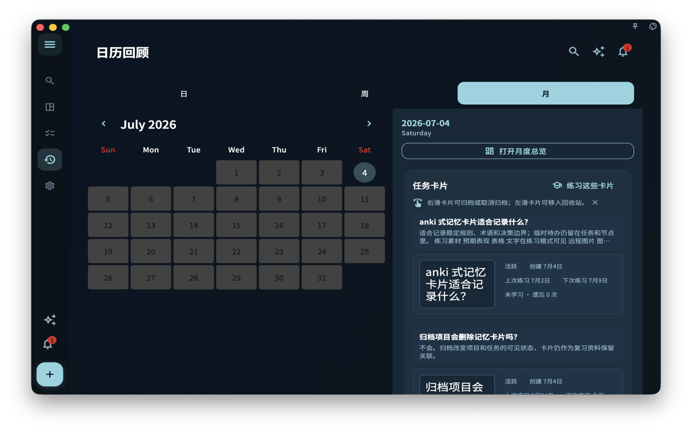

回顾很容易被误解成“给过去打分”。在 Granoflow 里，更好的理解是：把已经发生的事整理成下一次能用的线索。

一天结束时，你需要知道今天发生了什么；一周结束时，你需要看出哪些模式反复出现；一个月结束时，你更关心时间到底流向了哪些方向。日回顾、周回顾和月回顾就是这三种距离。

::::tip[先换一个角度]
不要急着把回顾写完整。先问一句：我现在需要看清今天、这一周，还是这个月？
::::

## 三种回顾的分工

这条线不是要求你每天都写长文。它只是提醒你：时间范围变大时，回顾的重点也会变。

| 你现在想知道 | 适合打开 | 重点看什么 |
| --- | --- | --- |
| 今天到底完成了什么 | 日回顾 | 已完成任务、投入时间、当天记录 |
| 最近几天总是卡在哪里 | 周回顾 | 一周任务分布、重复出现的阻力和顺手做法 |
| 这个月有没有把精力放到重要方向上 | 月回顾 | 日期分布、项目推进、哪些事反复占用时间 |

## 从一天到一周

周回顾适合把几天放在一起看。比如你发现某个项目总是拖到周末才推进，问题可能不是“某一天没努力”，而是这个项目在平日没有稳定入口。

图里的左侧按周列出一年里的时间段，右侧显示当前周的范围、完成任务、投入时长、心流时间和项目进度。读这张图时，不需要逐日复述；更值得看的，是哪些项目在这一周留下了清楚的进展，哪些只停在计划里。

::::note[心流时间是手工记录]
周回顾会累加每天手工填写的心流时间。它不是从任务时长自动推出来的，也不是对你状态的判断。
::::

## 从一周到一个月

月回顾更像一张日历。它不适合追究某一天为什么空着，而适合看这个月的注意力有没有持续落在同一批重要事情上。

图里可以看到月份日历和当天的任务卡片。月视角的价值在于承认取舍：一个月足够长，能看出哪些目标真的被反复照顾，哪些只是偶尔想起。

## 一个真实场景

假设你正在做“Granoflow 任务、卡片和笔记使用研究”。今天只完成了两条小任务，看起来不多。日回顾会告诉你这两条任务发生在今天；周回顾会告诉你这项研究在本周是不是持续推进；月回顾会提醒你，这类研究在整个月里是不是仍然占据重要位置。

这里的判断不是“我做得好不好”，而是“下一步该怎么安排才更真实”。如果某个方向长期只在月历里偶尔出现，你可能需要把它拆成更小的任务，或者承认它暂时不是优先事项。

## 怎么选择入口

| 场景 | 建议入口 | 下一步 |
| --- | --- | --- |
| 刚完成一批任务，想写几句话 | 日回顾 | 先看已完成任务，再写当天记录 |
| 想知道一周里哪些安排有效 | 周回顾 | 看项目进度和重复出现的任务类型 |
| 想重新分配长期精力 | 月回顾 | 看哪些日期、项目和卡片反复出现 |
| 只是想调整 AI 怎么写日记或周记 | 设置页 | 去改对应提示词，不必停在回顾页 |

## 回顾不是什么

- 不是打卡系统：没有连续记录，也不会让任务失效。
- 不是绩效报告：没有人在给你评分。
- 不是任务清单：它消化已经发生的事，不负责替你新增下一批任务。

::::note[边界]
Granoflow 可以整理任务、记录和时间范围；它不会判断你的生活状态，也不会替你决定某个目标值不值得继续。真正的取舍仍然要回到你的项目、任务和当下安排。
::::

## 下一步

如果你想先处理当天发生的事，继续读[日回顾](./daily-review)。如果你已经有一些记录，想知道它们以后怎么找回来，读[记录与历史](./journal-records)。
