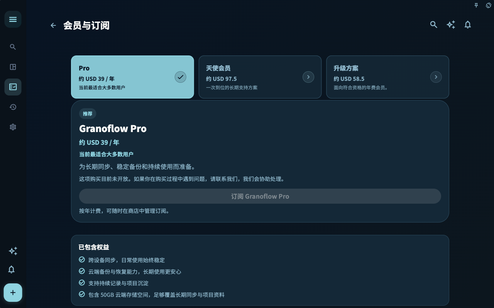
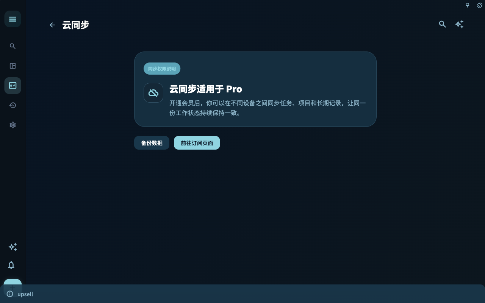

订阅页解决的是权益问题，不是账号本身。账号回答“你是谁”，订阅回答“这个账号现在能用哪些会员能力”。

## 一个真实场景

如果购买后权益没有出现，先确认登录账号和购买平台，再使用恢复购买或查看会员设置。

## 订阅要和账号一起看

订阅页面告诉你当前可购买或可查看的会员入口。它回答的是权益问题，不回答任务和数据是否已经同步。

会员设置页更像权益状态页。如果你已经购买，但这里没有显示对应状态，下一步应检查当前登录账号和购买平台。

同步权益提示说明某些能力需要会员。看到提示时，先判断自己是要开通权益，还是已经购买但需要恢复。

## 怎么判断下一步

| 你遇到的情况 | 先看什么 | 下一步 |
| --- | --- | --- |
| 不知道该从哪里开始 | 当前页面标题和主要入口 | 只选择和当前目标有关的一项 |
| 操作后结果不对 | 状态、空提示、访问记录或同步进度 | 回到上一层，按顺序排查 |
| 担心影响数据 | 备份、同步、账号或权限说明 | 先停下，确认范围后再继续 |

## 边界

订阅问题通常按账号、平台、恢复购买、权益显示这条线检查。

## 下一步

读完这一节后，回到你正在处理的任务，只选一个最小动作继续：记录一条输入、检查一个状态、或打开相关设置完成一次确认。
