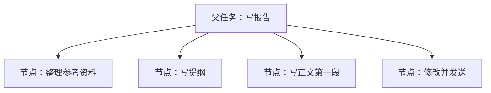

有些任务不是你不想做，而是标题太大，看一眼就不知道从哪里下手。比如“写完整个报告”会让人卡住；“整理参考资料”“写提纲”“写正文第一段”就更容易开始。

在 GranoFlow 里，拆解任务就是把一个大任务拆成节点。节点不是新的项目，也不是独立目标，它只是这条任务里的小步骤。

## 什么任务需要拆

| 任务标题 | 问题 | 拆成下一步 |
| --- | --- | --- |
| 写报告 | 太大，不知道先做什么 | 整理参考资料 |
| 准备发布 | 范围太宽 | 列出发布前检查项 |
| 学习新工具 | 结果不清楚 | 跑通第一个示例 |
| 整理资料 | 无法判断完成 | 把本周文件移到一个文件夹 |

一个好节点应该能直接执行。它不一定很小，但最好能在你坐下来以后马上知道怎么开始。

## 节点和父任务的关系

父任务回答“这一整件事是什么”，节点回答“下一步怎么做”。节点完成后，父任务的进度会更新；所有节点完成后，父任务才适合被标为完成。

如果你又给已完成的父任务加了新的未完成节点，父任务可能会回到待办。这不是错误，而是在提醒你：这件事又多了一个未完成步骤。

## 怎么拆解

打开任务详情，找到步骤或节点区域，添加第一个子步骤。先写最近能做的一两步就够了，不必一次把所有步骤想完。

| 操作 | 什么时候用 | 结果 |
| --- | --- | --- |
| 添加节点 | 任务太大，需要下一步 | 任务变得更容易开始 |
| 勾选节点 | 一个步骤做完 | 父任务进度更新 |
| 调整顺序 | 步骤先后不对 | 执行顺序更清楚 |
| 提级或缩进 | 步骤层级不对 | 结构更贴近实际 |
| 删除节点 | 这一步不再需要 | 节点移除；有子节点时先处理子节点 |

在桌面端，节点左侧的拖拽手柄可以调整顺序或层级；键盘焦点在节点列表上时，可以用 `Alt+↑` / `Alt+↓` 上下移动，用 `Alt+←` / `Alt+→` 提级或缩进。

::::tip[不要嵌套太深]
两层通常已经够用。超过两层还说不清，可能说明它不该只是一个任务，而应该拆成项目、里程碑或几条独立任务。
::::

## 拆任务，还是建里程碑

| 更适合用节点 | 更适合用里程碑 |
| --- | --- |
| 几小时到几天能完成 | 会持续几周或更久 |
| 步骤紧密依赖 | 阶段相对独立 |
| 只服务一条任务 | 需要统筹多条任务 |
| 目标还是同一件事 | 每个阶段都有独立结果 |

简单判断：节点回答“下一步怎么做”，里程碑回答“项目做到哪个阶段了”。

## 下一步

任务拆小以后，可以回到任务详情继续执行；如果这些步骤已经变成一段长期目标，就去项目章节，用项目和里程碑承接。
