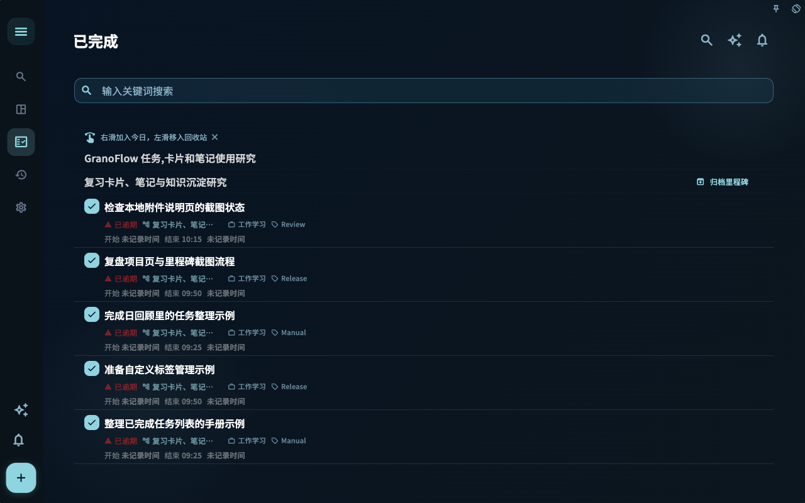
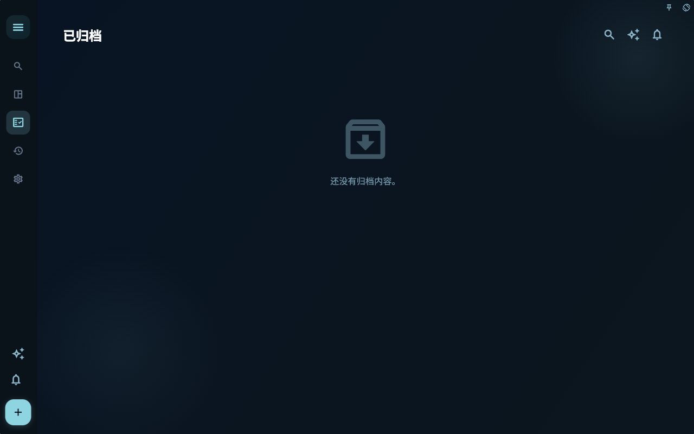
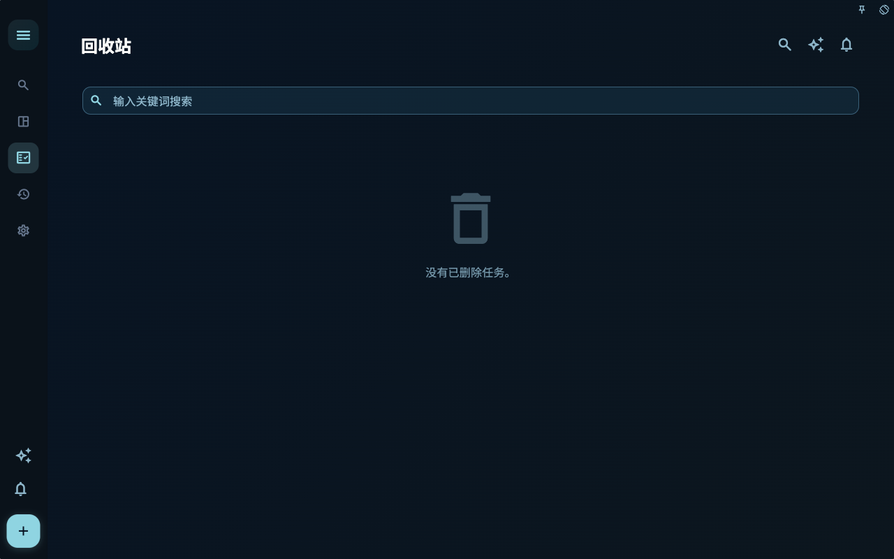

任务从当前列表里不见了，不一定是丢了。它可能只是完成了、归档了、被删除到回收站，或者因为日期和筛选条件换了位置。

这一章先把三个状态分清楚：完成表示事情做完，归档表示暂时收起来，回收站表示删除后还没有彻底清空。

## 已完成：保留完成记录

已完成列表保存已经做完的任务。它不是垃圾箱，而是你的完成记录：以后做日回顾、补任务回顾、查看某天做过什么，都会用到这些记录。

任务完成后通常会：

- 从当前待办列表中移开
- 记录完成时间
- 出现在已完成视图里
- 用于日回顾统计
- 在详情里显示任务回顾入口

在任务列表勾选核对框即可完成任务。如果任务正在专注中，完成动作会先结束当前专注会话，再把任务标为完成，并清掉当前任务。

::::tip[不要急着删完成记录]
如果你还想在日回顾里看到完成记录，不要把已完成任务当成无用内容删除。它们是回看一天行动的线索。
::::

## 完成后校准时间

任务刚完成时，系统会记录一个完成时间。这个时间能让任务进入已完成视图和日回顾，但不一定等于真实开始和结束时间。

如果你希望复盘更准确，可以打开已完成任务详情，进入时间记录，修改开始时间和完成时间。比如把记录改成“15:10 开始整理资料，16:05 结束”，而不是只保留点完成按钮的那一刻。

| 情况 | 是否值得校准 |
| --- | --- |
| 忘了点开始，但实际做了一段时间 | 值得 |
| 忘了及时点完成 | 值得 |
| 只是一个几分钟的小任务 | 可以不改 |
| 想让日回顾里的时间块更接近真实 | 值得 |

开始时间必须早于完成时间，完成时间也不能设在未来。日回顾会按任务时间块计算投入时间；如果两个任务时间重叠，重叠部分不会重复计算。

## 已归档：收起来但保留

归档适合暂时不想在当前列表里看到、但以后可能还需要知道它存在过的任务。比如旧项目里的任务、暂时搁置的事项、已经过期但仍有参考价值的内容。

归档和完成不是一回事：

| 操作 | 含义 | 是否进入完成统计 |
| --- | --- | --- |
| 完成 | 事情真的做完了 | 会 |
| 归档 | 暂时从当前视图收起来 | 不会 |

已归档视图只处理任务归档。卡片归档和任务归档不是同一件事；要查看已归档卡片，需要去卡片管理里的筛选状态。

## 回收站：删除后还能找回

删除任务后，它会进入回收站。只要回收站还没有被清空，你还可以查看或恢复它。

恢复任务时，如果它原来属于已经删除的项目或里程碑，GranoFlow 会让你选择：一并恢复原项目和里程碑，或只把任务恢复到收集箱。只恢复任务时，它会变成没有项目、没有里程碑、没有日期的普通收集箱任务，之后可以重新整理。

::::caution[清空回收站前先停一下]
手动清空回收站是不可逆的。如果任务曾经属于某个项目，或者还有回顾价值，清空后就不能再靠回收站找回。
::::

## 找不到任务时按这个顺序查

| 先查哪里 | 可能原因 |
| --- | --- |
| 当前筛选条件 | 只显示了今天、某标签或某项目 |
| 对应日期 | 任务被安排到了某一天 |
| 项目页面 | 任务被归入项目或里程碑 |
| 已完成 | 任务已经做完 |
| 已归档 | 任务被收起来 |
| 回收站 | 任务被删除但还没清空 |

大多数“找不到”，都不是丢失，而是任务去了另一个视图。

## 重新启用后的任务回顾

如果你完成任务后写了任务回顾，之后又取消完成或重新启用任务，已有回顾不会被清空。未完成时，任务详情不会显示任务回顾；任务再次完成或归档后，回顾会重新显示并可以编辑。

## 下一步

任务收尾后，如果有值得复用的经验，可以继续看回顾和卡片章节，把一次完成变成以后还能用的判断。
