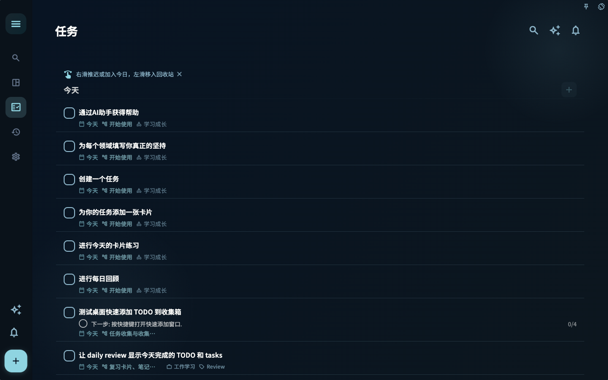
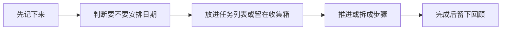

在 GranoFlow 里，任务不是一个必须一次写完整的小档案。更好用的方式是：先把要做的事放下来，再决定它要不要安排日期、归入项目、拆成步骤，或者完成后留下回顾。

很多任务工具会让你一开始就填很多字段。GranoFlow 的任务系统更像一张工作台：先把便签摊开，今天要做的拿到手边，做完的留下痕迹，不需要的收起来。

## 任务列表承接正在推进的事

任务列表适合看已经决定要推进的事。你会在这里看到按时间分区的任务，比如今天、明天、本周、本月或更晚。

这张图真正要看的不是按钮数量，而是任务进入列表后的状态：它已经不只是一个想法，而是有了日期、顺序或下一步。接下来你可以点开任务补字段，也可以直接开始专注或完成。

## 从想法到完成

这条线不用一次走完。很多时候，你只需要先完成第一步：把事情写下来。

## 任务、项目和领域怎么分工

| 你在问的问题 | 更适合放在哪里 | 例子 |
| --- | --- | --- |
| 现在具体要做什么 | 任务 | 写第三章初稿、联系搬家公司 |
| 这组任务服务哪个阶段目标 | 里程碑 | 录制完成、上线检查通过 |
| 这段时间要推进哪个目标 | 项目 | 发布课程、完成搬家 |
| 这个目标属于哪个长期方向 | 领域 | 学习、工作、健康 |

不是每个任务都需要往上连接。能直接完成的小事，写成任务就够了；会持续一段时间、产生多项任务的目标，再放进项目。

## 普通待办和项目任务的区别

普通待办解决的是“我下一步要做什么”。项目任务解决的是“这一步服务哪个阶段目标”。两者都重要，但不要互相替代。

| 任务类型 | 适合例子 | 通常怎么处理 |
| --- | --- | --- |
| 收集箱任务 | 买牙线、给朋友回消息、记录一个灵感 | 先放下，之后决定是否加日期或直接完成 |
| 今日任务 | 16:00 前发出会议纪要、晚上整理课程笔记 | 加日期，做完后进入日回顾 |
| 项目任务 | 完成课程第 3 讲脚本、验证同步恢复流程 | 连接项目和里程碑，必要时拆节点 |
| 历史补录任务 | 补记上周完成的发布检查 | 只在会影响回顾或项目记录时补录 |

如果一件事几分钟就能完成，不必为了“规范”给它建项目。如果一件事会反复产生后续动作，或者完成后需要复盘和交接，就更适合放进项目。

## 为什么只细排今天和明天

GranoFlow 不鼓励你把未来每一天都排满。未来会变，任务也会变；把下周和下个月排得太细，往往只是把计划维护成本提前搬到今天。

所以任务列表会把今天和明天放得更具体：今天决定现在先做什么，明天留一个清楚但不沉重的下一步。更远的任务可以先放在本周、本月、下个月或更晚，等时间靠近再细排。

::::tip[先让任务能被执行]
一个好任务通常能回答两个问题：我下一步做什么？做完后能看到什么变化？如果标题还只是“论文”“搬家”“复习”，先把它改成一个动作。
::::

## 任务的几种状态

| 状态 | 什么时候用 | 结果 |
| --- | --- | --- |
| 待办 | 还没开始 | 留在对应视图中等待处理 |
| 进行中 | 正在做 | 可以成为当前任务 |
| 已完成 | 已经做完 | 记录完成时间，可进入回顾 |
| 已归档 | 暂时不需要关注 | 保留记录，但不占当前列表 |
| 回收站 | 已删除但未清空 | 仍有机会恢复 |

任务详情负责补充任务信息，不提供“开始专注”和“完成任务”按钮。做完一件事时，回到任务列表勾选核对框；开始专注则使用应用当前提供的专注入口。

## 第一次使用怎么开始

点 **+**，写下今天最想推进的一件事，然后保存。先不要急着建项目、加标签、拆步骤。

等你发现这件事需要持续推进，再往上加项目；等你发现任务太大，再拆节点；等你完成了，再留下回顾。任务系统的价值不是让你一开始整理得很漂亮，而是让下一步更容易被拿起来。

## 下一步

如果你只是想先记下来，继续看“收集箱”。如果你已经知道要做什么，继续看“创建与编辑任务”。
