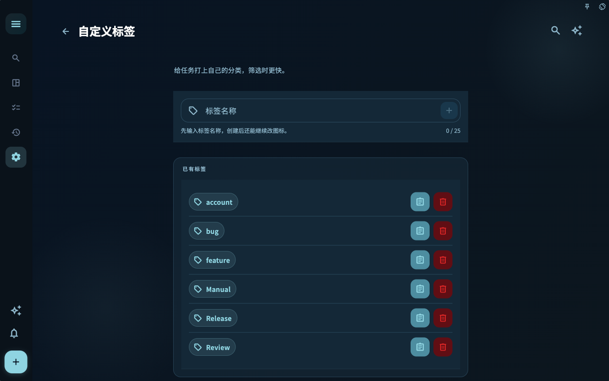

项目说明任务属于哪个目标，标签说明任务有什么共同特征。比如“健身 App 开发”是项目；“等待回复”“低精力”“设计稿”这类跨项目都会出现的状态或类型，更适合做标签。

标签不是越多越好。它的价值在于筛选时真的能帮你缩小范围。

## 标签管理适合做什么

标签管理页面适合处理全局标签：新增、编辑、删除，或给自定义标签配置模板。图里要注意的是列表关系：标签不是某一条任务的私有字段，而是可以被多条任务复用的分类。

如果你只是给当前任务加一个已有标签，在任务详情里操作就够了；如果要整理标签名称、模板或删除标签，再进入标签管理。

## 标签适合记什么

| 用途 | 标签示例 | 为什么适合 |
| --- | --- | --- |
| 精力或场景 | `低精力`、`深度工作`、`碎片时间` | 帮你按当前状态挑任务 |
| 等待状态 | `等待他人`、`待确认` | 跨项目追踪卡住的事 |
| 任务类型 | `电话`、`写作`、`设计` | 方便批量处理同类动作 |
| 临时重点 | `本周重点`、`稍后处理` | 短期筛选，不必建项目 |

不建议把项目名称复制成标签。任务已经属于项目时，再加同名标签通常只会让分类变乱。

## 自定义标签模板

自定义标签可以带描述模板和节点模板。之后任务选择这个标签时，如果任务还没有描述和节点，GranoFlow 会把模板内容复制到这条任务自己的描述和节点里。

模板是一次性复制。复制后，内容就属于任务本身；以后修改或删除标签模板，不会自动改写已经创建过的任务。

| 标签示例 | 模板适合放什么 |
| --- | --- |
| `account` | 平台名称、网址、邮箱、手机、第三方登录和备注 |
| `bug` | 复现步骤、预期结果、实际结果 |
| `feature` | 用户价值、使用场景、验收标准 |

如果任务已经有描述或节点，模板会跳过，避免覆盖已有内容。

## 删除标签的影响

删除标签不会删除任务。它只会把这个标签从使用它的任务上移除。

::::caution[删除前先确认]
删除标签是不可撤销的。确认这个分类不再需要，再删除。
::::

## 标签多了怎么办

标签太多时，筛选会变得和不筛选差不多。可以定期做三件事：

- 合并意思接近的标签
- 删除已经不用的标签
- 把项目名从标签里移出去，交给项目管理

## 下一步

如果你想在创建任务时快速加标签，回到“用自然语言写任务”，用 `#标签名` 直接输入。
