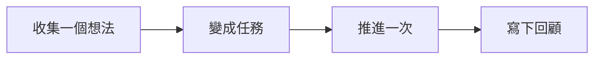

閱讀「GranoFlow 不是什麼」時，可以先把它放回「開始使用」這條線裡理解。重點不是背功能名，而是弄清它適合解決什麼問題、下一步該怎麼判斷。

::::tip[先抓住主線]
先跑通一個小閉環，再慢慢理解更多設置。

如果你正在處理類似問題，先讀下面的判斷表；真正操作時，再結合頁面裡的列表、狀態和提示來判斷下一步。
::::

## 先把它想成什麼

把它想成工作台上的便簽：先把想法放下來，再決定今天拿起哪一張。

## 一眼看懂流程

先把流程看成一條線：理解這些步驟的順序後，再到對應頁面處理具體操作。

## 一個真實場景

第一次打開 Granoflow 時，先找到收集箱、任務、項目和回顧，不急着配置所有設定。

## 操作前先判斷

| 如果你現在想... | 頁面裡通常看什麼 | 接下來做什麼 |
| --- | --- | --- |
| 進入「GranoFlow 不是什麼」相關頁面 | 側邊欄入口、頁面標題和主區域 | 先弄清當前列表或設定區在表達什麼 |
| 改一個設定或狀態 | 頁面提示、按鈕文字、當前列表 | 改完只觀察一個結果 |
| 結果和預期不同 | 空狀態、錯誤提示、訪問記錄或同步狀態 | 回到上一層，按排查順序處理 |

## 可複用判斷

先完成一個小閉環，比先理解所有概念更重要。

## 具體用法和邊界

如果你想知道 GranoFlow 適不適合你，先記住一句話：它不是逼你每天完成任務的工具，也不是替你做決定的 AI；它只是幫你把任務、項目和回顧整理得更有結構。

### 不是打卡 app

GranoFlow 沒有「連續打卡」這個東西。

很多打卡 app 會讓你每天都必須完成一件事。連續 30 天，就像贏了；斷了一天，就像前面都白做了。生活一亂，比如生病、出差、臨時有事，這種設計很容易讓人覺得「我又失敗了」。

GranoFlow 不這樣看待回顧。它不問「你今天打卡了嗎」，而是幫你看清楚：這段時間你在關注什麼、做了什麼、有什麼想法。中斷很正常，之後繼續用就可以。

### 不是習慣養成遊戲

GranoFlow 不會給你徽章、排行榜或連續天數數字，也不會用遊戲機制催你每天打開它。

如果你習慣靠積分、獎勵或排名來推動自己，這個 app 可能會顯得很安靜，甚至有點無聊。這不是漏做了什麼，而是設計選擇。GranoFlow 想幫你建立穩定的專注節奏，不想再製造一種新的壓力。

### 不是 AI 代替你做決定的工具

GranoFlow 裏的 AI 功能可以幫你整理回顧筆記、生成提示詞，但它不會替你掌控生活。

它不會：

- 靜默修改你的任務記錄
- 替你決定哪個項目最重要
- 替你設定價值觀

重要改動都需要你自己確認。AI 是助手，不是老闆。

### 不是企業管理工具

GranoFlow 是給個人用的，不是給團隊、領導或 HR 用來監控效率的。

你的任務和回顧只有你能看。這是產品邊界，不是缺少一個管理後台。

### 基本可以免費使用

GranoFlow 的核心功能可以長期免費使用，包括任務、項目、里程碑和日回顧。它們沒有數量限制，也不要求你先訂閱。

付費主要用於解鎖雲端同步和少數個人化功能。如果你只在一台裝置上使用，完全可以不付費。

::::tip[買還是不買？]
先免費使用一段時間。等你真的遇到「我想在手機和電腦上同步」這個需求時，再考慮付費就可以。
::::

## 常見誤解

| 容易誤解 | 更穩的理解 |
| --- | --- |
| 「GranoFlow 不是什麼」需要一次配置完 | 先完成當前這一步，後續再逐步補充 |
| 頁面裡所有入口都要立刻用上 | 只處理和你當前任務有關的入口 |
| 沒有馬上整理好就是失敗 | 只要下一步更清楚，就已經有用 |

::::note[決定仍要回到你的目標]
Granoflow 可以把資訊、狀態和下一步擺清楚；要不要繼續、是否改設定、是否刪除或恢復數據，仍要看你當前頁面和真實目標。
::::

## 下一步

下一步可以從任務章節開始，先跑通一個最小閉環。
