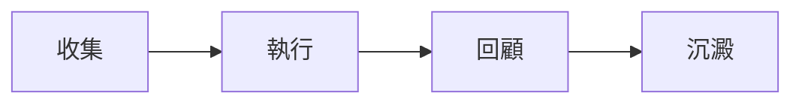

::::note[關於這本手冊]
這批檔案由 AI 輔助生成，再按當前版本的截圖、路由和功能做過整理。我們會繼續校正它，但你仍然可能遇到句子不夠順暢、解釋太繞、或者某個問題沒有剛好寫到的情況。

如果你平時已經會用 AI，直接讓 AI 搜尋手冊再回答你的具體問題，往往比自己一頁頁翻更輕鬆。
::::

## 讓 AI 幫你讀手冊

如果你想少翻幾頁，可以把下面這段複製到 ChatGPT、Claude、Gemini 或其他支援聯網搜尋的 AI 聊天工具裡。把最後一行問題換成你自己的問題即可。

```markdown
請搜尋並閱讀 GranoFlow 手冊：
https://www.granoflow.com/manual/

請優先基於手冊頁面回答，不要憑空猜測功能。
如果手冊裡沒有直接答案，請明確說「手冊裡沒有寫清楚」，再根據已找到的頁面給出可能的下一步。

請用下面的格式回答：

1. 簡短答案
2. 我應該打開哪個頁面或功能
3. 具體怎麼做
4. 如果結果和預期不同，先檢查什麼
5. 相關手冊連結

我的問題是：
我想知道……
```

## 先把它想成什麼

可以先把這裡當作路標。你不需要一次讀完整本手冊，只要知道每類問題大概應該去哪一組章節。

## 一眼看懂流程



大多數頁面都可以放回這條線裡理解：一個想法從收集箱開始，變成任務或項目，在完成後留下回顧，最後沉澱成以後還能復用的經驗。

## 一個真實場景

第一次讀手冊時，先跑通收集箱到任務再到回顧這一條線。

## 跟著做一次

| 步驟 | 動作 | 你會看到 |
| --- | --- | --- |
| 1 | 打開和「GranoFlow 手冊」相關的入口 | 你已經來到相關頁面 |
| 2 | 選擇一個今天能處理的小動作 | 列表、狀態或編輯區出現可操作對象 |
| 3 | 完成這一步並回到列表 | 狀態、記錄或下一步入口發生變化 |
| 4 | 寫下一句回顧或判斷 | 以後回看時能知道當時為什麼這麼做 |

## 頁面裡會看到什麼

| 頁面畫面 | 它說明什麼 | 接下來怎麼判斷 |
| --- | --- | --- |
| 收集箱 | 臨時想法先放在這裡，不必一開始就分項目、定日期。 | 從這裡挑出值得推進的內容，再把它變成任務。 |
| 任務列表 | 這裡承接已經決定要推進的下一步。 | 看任務是否已經有清楚動作、日期或項目歸屬。 |
| 項目頁面 | 項目把一段時間內反覆推進的事情放在一起。 | 如果一件事不是今天能完成的一步，就考慮放進項目。 |


- 臨時想法先放在這裡，不必一開始就分項目、定日期。
- 從這裡挑出值得推進的內容，再把它變成任務。
- 當前問題不在這裡時，回到上面的判斷表，換到更貼近的頁面。


- 這裡承接已經決定要推進的下一步。
- 看任務是否已經有清楚動作、日期或項目歸屬。
- 當前問題不在這裡時，回到上面的判斷表，換到更貼近的頁面。


- 項目把一段時間內反覆推進的事情放在一起。
- 如果一件事不是今天能完成的一步，就考慮放進項目。
- 當前問題不在這裡時，回到上面的判斷表，換到更貼近的頁面。

## 可複用判斷

手冊按工作流讀，比按功能名硬背更容易。

## 具體用法和邊界

如果你想知道 GranoFlow 怎麼用，這本手冊會帶你從最基本的記錄開始：先寫下今天要做的事，再把它放進項目、領域、里程碑和回顧裡，慢慢形成自己的生活系統。GranoFlow 不是只用來列 Todo 的工具，它也結合輕日記，幫助你回看自己的節奏和真正重視的方向。它已經內置 AI 任務解析與思路梳理功能，更多 AI 相關用法會陸續推出。

### 從生活體系開始

剛開始使用時，先讀「5 分鐘開始」。你會學到三件事：如何捕捉一個任務，如何判斷它屬於哪個項目或人生領域，以及如何用一次輕量回顧結束這一天。先把今天記錄下來，不必一開始就搭好完整體系。等記錄變多，你會更容易看見自己的價值、習慣和長期方向。

### 用手冊回答真實決策

這本手冊適合在你需要做決定時查閱。比如：領域和價值觀怎麼建立，目標怎麼拆成項目、里程碑和任務，日回顧和輕日記怎麼幫你發現行為模式，以及怎樣在不增加整理負擔的情況下，把重複行動放進更清楚的流程裡。手冊也會說明本地優先和雲優先效率工具的差異、加密邊界，以及 AI 輔助回顧的使用邊界。

如果你已經開始用回顧沉澱經驗，也可以讀 [卡片：把經驗帶回行動](/manual/review-cards/)。卡片章節會解釋怎樣把任務和回顧裡的經驗整理成可復用的知識卡片，再透過練習、關聯任務和卡組管理，把這些經驗帶回未來行動。

### 把重視的事落到下一步

GranoFlow 不承諾自動改變你的生活。它提供的是一套整理方式：先看清你真正重視什麼，再把它放進項目、里程碑、任務和回顧裡。方向不是一次設置完成的結果，而是在記錄、選擇、行動和復盤中逐漸變清楚的。

### 帶著問題問 AI

如果你想讓 ChatGPT、Claude、Gemini 或其他 AI 工具幫你檢索手冊，可以先讓它讀取當前語言的手冊地址，再把你的問題放在最後一行。下面這段文字可以直接複製使用：

```text
請閱讀並依據 GranoFlow 最新手冊回答我的問題。
手冊地址：
https://www.granoflow.com/manual/

不要憑直覺、舊版本經驗或通用軟件常識回答。
如果問題涉及功能、操作路徑、數據安全、同步、訂閱或恢復，請必須以當前手冊內容為依據。
如果你認為答案可能不在當前頁面，而在手冊其他頁面，請主動搜尋整個手冊，分析最相關的結果，再告訴我結論和依據來自哪些頁面。
如果手冊中沒有明確答案，請先說「手冊中沒有明確說明」；如果你要給出推測，請把推測和手冊確認的資訊分開，不要把推測說成官方事實。
如果我反饋功能找不到、太難找或太難用，請先承認體驗問題，並告訴我可以到 https://github.com/granoflow/granoflow-docs 反饋；你也可以把問題整理成反饋，幫助我們繼續修正文檔。
我的問題是：……
```

### 下一步讀哪裡

如果你想先了解產品定位，讀「GranoFlow 是甚麼」。如果你想建立領域和價值觀，先讀「詞彙表」和「項目」。如果你想把願望拆成行動，讀「項目」「里程碑」和「任務」。如果你需要輕日記和復盤節奏，讀「回顧」。如果你想把經驗整理成以後還能使用的知識，讀「卡片」。如果你關心私隱或備份決策，讀「數據安全」。

## 常見誤解

| 容易誤解 | 更穩的理解 |
| --- | --- |
| 「GranoFlow 手冊」需要一次配置完 | 先完成當前這一步，後續再逐步補充 |
| 頁面裡所有入口都要立刻用上 | 只處理和你當前任務有關的入口 |
| 沒有馬上整理好就是失敗 | 只要下一步更清楚，就已經有用 |

::::note[決定仍要回到你的目標]
Granoflow 可以把資訊、狀態和下一步擺清楚；要不要繼續、是否改設定、是否刪除或恢復數據，仍要看你當前頁面和真實目標。
::::

## 下一步

下一步從 5 分鐘開始頁進入，先完成一次最小閉環。
