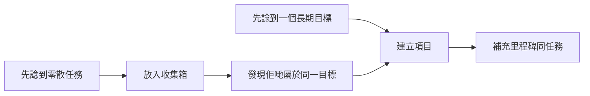

建立項目不係為咗將事情寫得更正式，而係為咗俾一組相關任務一個穩定的地方。以前你可能會先問「我要不要開個項目」，更好用的問法係：「呢件事會不會反覆返嚟，需要我記住背景同進度？」

如果答案係會，就可以開個項目。項目先將目標裝起，任務同里程碑可以之後慢慢補。

## 先判斷要不要開

| 情境 | 建議 | 例子 |
| --- | --- | --- |
| 一次性動作 | 直接開任務 | 今日交水費、回覆一封電郵 |
| 一個持續目標 | 開項目 | 準備課程發佈、搬家、寫論文 |
| 仲未諗清楚，只係一個念頭 | 先放入收集箱 | 「可能想整理作品集」 |
| 已經有一批相關任務散落各處 | 開咗項目再歸入 | 將發佈、測試、文案任務放到同一項目 |

呢度的關鍵不係項目名好不好睇，而係佢可不可以幫你下次返嚟時減低回憶成本。

## 建立入口同必填內容

進入項目頁，撳右上角 **+**，填寫項目名同必要說明，然後建立。

建立時通常會見到呢啲欄位：

| 欄位 | 點樣填寫 | 留意啲乜 |
| --- | --- | --- |
| 名稱 | 寫出要完成的目標 | 「寫完畢業論文」比「論文」更清楚 |
| 描述 | 記錄背景、範圍、約束或交付說明 | 不肯定的時候可以留空先 |
| 領域 | 揀佢屬於邊個長期方向 | 適合將工作、學習、健康等大方向分開 |

::::tip[項目名最好寫成一句行動]
「上線課程第一版」「完成搬家準備」「整理2026作品集」都比「課程」「搬家」「作品集」更容易接下一步。項目名不需要文學化，只要將來的你一眼睇得明。
::::

## 先開空項目，還是先收集任務

兩種順序都可以。

如果你已經知道呢個係一個項目，例如「準備一次發佈」，就先開項目會輕鬆啲。之後見到相關任務，就可以直接歸入去。

如果你只係陸續諗到啲嘢，例如「買紙箱」「問管理處」「查搬運公司」，先放入收集箱都冇問題。等你發現佢哋其實都屬於「搬家」，先開項目再將任務連過去。

呢兩條路最後會喺同一個地方會合：一個項目承接目標，任務負責實際推進。

## 建立之後跟住做啲乜

項目建立完成後，不使即刻整理到完美。通常跟呢個順序繼續就夠：

| 下一步 | 幾時做 | 會得到咩結果 |
| --- | --- | --- |
| 加入里程碑 | 目標有明顯階段 | 項目不再係一長串任務 |
| 連接現有任務 | 任務已經散落喺收集箱或任務列表 | 相關事項返到同一個項目 |
| 喺項目入面開新任務 | 你已經知道下一步動作 | 新任務自動帶上項目上下文 |

如果你暫時不知之後要做咩，關閉佢都得。一個空項目不係失敗，佢只係先霸住一個目標位置。

## 常見誤解

| 容易誤解 | 更穩陣的理解 |
| --- | --- |
| 開項目時一定要寫齊晒計劃 | 項目可以先粗後細 |
| 描述一定要寫得好正式 | 描述只要幫你第時回憶背景 |
| 揀咗領域就等於排好優先順序 | 領域只係歸屬，優先級仍然要靠任務同日期判斷 |

## 下一步

如果呢個項目已經可以分出幾個階段，繼續睇「管理里程碑」。如果你已經有任務散落喺其他地方，可以直接睇「將任務連接到項目」。
