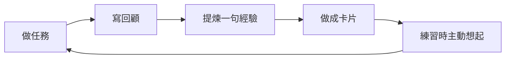

卡片不是拿來收藏金句的。它更像一個小提醒：你曾經在某件事裏學到過什麼，下一次遇到相似情況時，先把這句話拿出來想一想。

如果你只想記住一個原則：**卡片要從真實行動裏長出來，再回到真實行動裏去。**

::::tip[適合做成卡片的經驗]
一句話能幫你下次少繞彎，就值得做成卡片。比如「進項目頁前，先確認任務有沒有明確下一步」，比「要更有計劃」更適合練習。
::::

## 它解決的不是記憶問題

很多工具把卡片做成「背資料」的地方，Granoflow 裏的卡片更偏向「複用判斷」。你不是為了記住一個定義，而是為了在下一次開始任務、整理項目、寫回顧時，能更快想起一個經過驗證的做法。

可以把它想成廚房裏的便簽：不是菜譜全集，只貼那些你真的會忘、忘了就會影響結果的小提醒。

## 一張卡片從哪裡來

這條線裏最重要的是中間那一步：把經驗壓成一句能再次使用的話。不要把整段回顧搬進卡片裏。整段文字留在回顧，卡片只留下下次行動前要想起的判斷。

## 先看題面，再看答案

練習開始時，頁面只顯示問題。這樣設計是為了讓你先在腦子裏找答案，而不是直接掃一眼解釋就算讀過。像圖裏的「什麼是領域？」就不是讓你背定義，而是讓你先想：自己現在的任務到底屬於工作、學習、關係、身體，還是休閒？

## 答案要能帶回生活

顯示答案後，頁面下方會出現反饋按鈕。你可以根據自己剛才的回憶質量選擇「遺忘」「勉強」「記得」或「輕鬆」。這不是考試打分，只是告訴 Granoflow：這張卡片下次應該早點出現，還是可以晚一點再練。

圖裡的卡片把「領域」解釋成幾個花園。這個比喻有用，是因為它能幫你回到實際選擇：今天的任務是在照顧哪一個花園？有沒有哪個花園被完全忽略了？

## 統計頁看趨勢，不看虛榮數字

統計頁會顯示總卡片數、已掌握、已內化、今日已練習，以及不同學習狀態的分佈。這裡不要追求把數字刷得很好看。更實用的看法是：

| 你看到的情況 | 可以怎麼理解 | 下一步 |
| --- | --- | --- |
| 未學習很多 | 有不少經驗還沒有進入練習 | 先從今天最相關的卡片開始 |
| 今日已練習很少 | 只是還沒開始，不代表失敗 | 做一輪短練習即可 |
| 已掌握很少 | 經驗還沒有穩定下來 | 不急著新增太多卡片 |
| 已內化變多 | 有些提醒已經比較自然 | 回到任務裡觀察是否真的用上了 |

## 什麼內容適合放進卡片

| 內容 | 適合做成卡片嗎 | 原因 |
| --- | --- | --- |
| 「開始任務前，先寫下一步動作」 | 適合 | 下次做任務前能直接用 |
| 「這週工作很累」 | 不太適合 | 更像回顧原文，缺少可複用判斷 |
| 「項目延期時，先拆最小可交付結果」 | 適合 | 能幫助類似場景裏的決策 |
| 「今天心情不好」 | 不太適合 | 適合留在日記或回顧，不要變成練習題 |
| 「同步失敗先檢查當前設備是否登入同一帳號」 | 適合 | 是明確的排查提醒 |

## 不要把卡片庫做得太滿

卡片越多，不一定越有用。真正有用的是那些你願意反覆碰、反覆修正的卡片。每次回顧後，最多挑一兩條最有複用價值的經驗就夠了。

一個簡單判斷是：**如果下週遇到類似任務，你希望自己先想起這句話嗎？**如果答案是肯定的，就做成卡片；如果只是覺得這句話「好像也不錯」，先留在回顧裏。

## 下一步

- 想把任務裏的經驗做成卡片，讀[創建與關聯卡片](./create-and-link/)。
- 想知道練習按鈕和狀態怎麼用，讀[練習、掌握與內化](./study-and-internalize/)。
- 想導入、導出或整理卡組，讀[卡組、導入與導出](./decks-import-export/)。
