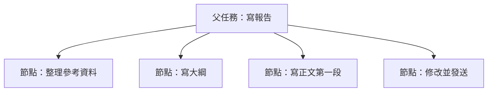

有些任務不係你不想做，而係標題太大，睇一眼就不知從邊度開始。例如「寫晒成個報告」會令人卡住；「整理參考資料」「寫大綱」「寫正文第一段」就更容易開始。

喺 GranoFlow 入面，拆解任務就係將一個大任務拆成節點。節點不係新的項目，亦都不係獨立目標，佢只係呢條任務入面的小步驟。

## 咩任務需要拆

| 任務標題 | 問題 | 拆成下一步 |
| --- | --- | --- |
| 寫報告 | 太大，不知先做咩 | 整理參考資料 |
| 準備發佈 | 範圍太闊 | 列出發佈前檢查項 |
| 學習新工具 | 結果不清晰 | 跑通第一個範例 |
| 整理資料 | 無法判斷完成 | 將本週檔案移到一個資料夾 |

一個好的節點應該可以直接執行。佢不一定好細，但最好係你坐低之後即刻知道點樣開始。

## 節點同父任務的關係

父任務回答「呢成件事係咩」，節點回答「下一步點樣做」。節點完成後，父任務的進度會更新；所有節點完成後，父任務先適合標記為完成。

如果你又喺已經完成的父任務度加咗新的未完成節點，父任務可能會返回待辦。呢個不係錯誤，而係提醒你：呢件事多咗一個未完成步驟。

## 點樣拆解

打開任務詳情，搵到步驟或節點區域，添加第一個子步驟。先寫最近可以做的一兩步就夠，不使一次諗晒所有步驟。

| 操作 | 幾時用 | 結果 |
| --- | --- | --- |
| 添加節點 | 任務太大，需要下一步 | 任務變得更容易開始 |
| 勾選節點 | 一個步驟做完 | 父任務進度更新 |
| 調整順序 | 步驟先後不啱 | 執行順序更清晰 |
| 升級或縮排 | 步驟層級不啱 | 結構更貼近實際 |
| 刪除節點 | 呢步不再需要 | 節點移除；有子節點時先處理子節點 |

喺桌面端，節點左側的拖曳手柄可以調整順序或層級；鍵盤焦點喺節點列表上時，可以用 `Alt+↑` / `Alt+↓` 上下移動，用 `Alt+←` / `Alt+→` 升級或縮排。

::::tip[不好嵌套得太深]
兩層通常已經夠用。超過兩層仲講不清楚，可能代表佢不應該淨係一個任務，而係應該拆成項目、里程碑或幾條獨立任務。
::::

## 拆任務，還是建里程碑

| 更適合用節點 | 更適合用里程碑 |
| --- | --- |
| 幾粒鐘到幾日可以完成 | 會持續幾星期或更耐 |
| 步驟緊密相依 | 階段相對獨立 |
| 只服務一條任務 | 需要統籌多條任務 |
| 目標仍然係同一件事 | 每個階段都有獨立結果 |

簡單判斷：節點回答「下一步點樣做」，里程碑回答「項目做到邊個階段」。

## 下一步

任務拆細之後，可以返去任務詳情繼續執行；如果呢啲步驟已經變成一段長期目標，就去項目章節，用項目同里程碑承接。
