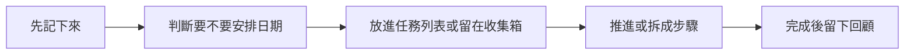

在 GranoFlow 裡，任務不是一個必須一次寫完整的小檔案。更好用的方式是：先把要做的事放下來，再決定它要不要安排日期、歸入項目、拆成步驟，或者完成後留下回顧。

很多任務工具會讓你一開始就填很多欄位。GranoFlow 的任務系統更像一張工作枱：先把便簽攤開，今天要做的拿到手邊，做完的留下痕跡，不需要的收起來。

## 任務列表承接正在推進的事

任務列表適合看已經決定要推進的事。你會在裡面看到按時間分區的任務，例如今天、明天、本週、本月或更晚。

這張圖真正要看的不是按鈕數量，而是任務進入列表後的狀態：它已經不只是一個想法，而是有了日期、順序或下一步。接下來你可以點開任務補欄位，也可以直接開始專注或完成。

## 從想法到完成

這條線不用一次走完。很多時候，你只需要先完成第一步：把事情寫下來。

## 任務、項目和領域怎麼分工

| 你在問的問題 | 更適合放在哪裡 | 例子 |
| --- | --- | --- |
| 現在具體要做甚麼 | 任務 | 寫第三章初稿、聯絡搬家公司 |
| 這組任務服務哪個階段目標 | 里程碑 | 錄製完成、上線檢查通過 |
| 這段時間要推進哪個目標 | 項目 | 發佈課程、完成搬家 |
| 這個目標屬於哪個長期方向 | 領域 | 學習、工作、健康 |

不是每個任務都需要往上連接。能直接完成的小事，寫成任務就夠了；會持續一段時間、產生多項任務的目標，再放進項目。

## 為甚麼只細排今天和明天

GranoFlow 不鼓勵你把未來每一天都排滿。未來會變，任務也會變；把下週和下個月排得太細，往往只是把計劃維護成本提前搬到今天。

所以任務列表會把今天和明天放更具體：今天決定現在先做甚麼，明天留一個清楚但不沉重的下一步。更遠的任務可以先放在本週、本月、下個月或更晚，等時間靠近再細排。

::::tip[先讓任務能被執行]
一個好任務通常能回答兩個問題：我下一步做甚麼？做完後能看到甚麼變化？如果標題還只是「論文」「搬家」「複習」，先把它改成一個動作。
::::

## 任務的幾種狀態

| 狀態 | 甚麼時候用 | 結果 |
| --- | --- | --- |
| 待辦 | 還沒開始 | 留在對應檢視中等待處理 |
| 進行中 | 正在做 | 可以成為目前任務 |
| 已完成 | 已經做完 | 記錄完成時間，可進入回顧 |
| 已歸檔 | 暫時不需要關注 | 保留記錄，但不佔目前列表 |
| 資源回收筒 | 已刪除但未清空 | 仍有機會還原 |

在任務詳情裡點「專注」，這條任務會成為目前正在做的任務，並開始一次專注記錄。如果已有另一條任務在專注中，GranoFlow 會提醒你先處理那條任務，避免同時把兩件事都當成目前重點。

## 第一次使用怎麼開始

點 **+**，寫下今天最想推進的一件事，然後儲存。先不要急着建項目、加標籤、拆步驟。

等你發現這件事需要持續推進，再往上加項目；等你發現任務太大，再拆節點；等你完成了，再留下回顧。任務系統的價值不是讓你一開始整理得很漂亮，而是讓下一步更容易被拿起來。

## 下一步

如果你只想先記下來，繼續看「收集箱」。如果你已經知道要做甚麼，繼續看「建立與編輯任務」。
