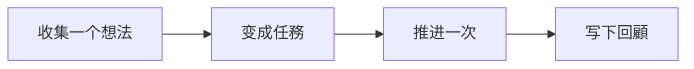
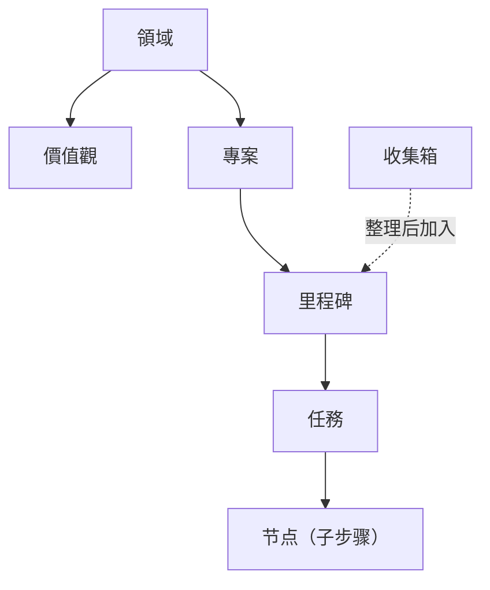

阅读「核心概念速查」时，可以先把它放回「开始使用」这条线里理解。重点不是背功能名，而是弄清它适合解决什么问题、下一步该怎么判断。

::::tip[先抓住主线]
先跑通一个小闭环，再慢慢理解更多設定。

如果你正在處理类似问题，先读下面的判断表；真正操作时，再结合頁面里的列表、狀態和提示来判断下一步。
::::

## 先把它想成什么

把它想成工作台上的便签：先把想法放下来，再决定今天拿起哪一张。

## 一眼看懂流程

先把流程看成一条线：理解这些步骤的顺序后，再到对应頁面處理具体操作。

## 一个真实场景

第一次打开 Granoflow 时，先找到收集箱、任務、專案和回顧，不急着配置所有設定。

## 快速索引

| 你想查什么 | 頁面里通常看什么 | 接下来怎么用 |
| --- | --- | --- |
| 核心概念速查 的入口 | 侧边栏入口和頁面主区域 | 知道目前入口负责什么 |
| 目前狀態 | 列表、开关、徽标、存取記錄或提示文字 | 判断是否需要繼續操作 |
| 限制和边界 | 本页的提示块和参考表 | 避免把参考信息当成操作承诺 |

## 可复用判断

先完成一个小闭环，比先理解所有概念更重要。

## 具体用法和边界

如果你在 GranoFlow 里看到一个词不懂，就在这页查：它会告诉你这个词指什么、放在哪里用、和其他概念是什么关系。

GranoFlow 的主要关系可以这样理解：領域下面有價值觀和專案，專案下面有里程碑，里程碑下面有任務，任務里可以再拆节点；收集箱里的任務整理后可以加入專案或里程碑。

---

### 人生结构

### 領域

領域是你生活里的大方向，比如“工作”“健康”“家庭”“学习”。

它不是任務檔案夹，不能直接拿来存任務。你可以把它理解成一张人生地图上的区域：專案会归到某个領域里，回顧时你就能看到自己最近把精力放在哪些方向。

### 價值觀

價值觀是你在某个領域里想长期坚持的标准，比如“工作上只做真正有影響力的事”。

它不是任務，不能被完成，也不会自动帮你打勾。它的作用是在回顧时提醒你：这段时间做的事，是否符合你自己定下的标准。

### 專案

專案是一个需要持续推进的目标容器，比如“搬家”“毕业论文”“开发 App v2”。

任務可以归属到專案和里程碑；整理到專案时，通常需要選擇具体里程碑。專案或里程碑只說明任務属于哪里，不会单独让一条没有日期的任務离开收集箱。專案可以歸檔或完成；如果專案里还有未處理的任務，系统会先让你决定这些任務怎么處理。

### 里程碑

里程碑是專案里的阶段节点，用来把大專案拆成几个小阶段，比如“初稿完成”“测试通过”“上线”。

每个里程碑下面可以有任務。任務全完成后，里程碑才算可以关闭。它的用处是让长專案有清楚的阶段感，而不是一直像在做一件没有尽头的事。

### 任務

任務是 GranoFlow 里最基本的行动单位，也就是你要做的那件具体事情。

一个任務可以有標題、截止日期、提醒、标签、專案、里程碑和描述。任務狀態包括：待办、进行中、已完成、已歸檔、回收站。任務完成时会記錄完成时间；取消完成时，这个完成时间会被清除。

### 节点

节点是任務里的子步骤，用来拆解复杂任務。

比如任務是“提交税务申报”，节点可以是“整理收据”“填写表格”“提交”。当所有节点都完成时，父任務会自动完成；如果你又新增一个未完成节点，父任務会回到待办狀態。

### 收集箱

收集箱是临时放任務的地方，适合放那些“先记下来，还没想好怎么安排”的事。

没有日期、并且狀態是待办或进行中的任務，会出现在收集箱。專案和里程碑只是归属；如果任務仍然没有日期，它也可以繼續留在收集箱。一旦你给任務安排了日期，或者完成、歸檔、刪除它，它才会离开收集箱。你可以把收集箱想成口袋里的便条纸：先放进去，之后再整理。

---

### 使用节奏

### 规划

规划就是把一个模糊想法，变成有日期、有專案，或至少更清楚的可执行任務。

你可以在快速新增、收集箱整理或任務详情里做规划。輸入框里的 `#` `@` `~` 是快捷方式，但任何真正写入資料的操作都需要你確認。

### 执行

执行就是开始做任務本身。

你可以配合专注计时、置顶任務或背景音乐使用。任務完成时，GranoFlow 会先把相關的专注会话收尾，再記錄完成时间，这样回顧資料里的时间段不会混乱。

### 完成

完成表示任務已经做完，并且会記錄一个完成时间。

日回顧按任務“实际完成的那一天”統計，不按截止日期統計。每天从 0 点开始算新的一天，0 点以后完成的任務会进入新一天的回顧。

### 歸檔

歸檔表示这件事已经封存，不再出现在目前工作视图里，但記錄仍然保留，可以之后翻查。

專案、里程碑、任務都可以歸檔。歸檔前如果里面还有活跃任務，系统会先让你决定怎么處理这些任務。

### 日回顧

日回顧是用来查看“某一天实际完成了什么”的頁面。

它按完成时间統計，不按截止日期統計。如果某天没有完成任務，頁面会显示安静的空狀態，不会用空图表制造压力。

### 複盤

複盤是回看一段更长时间里的投入、进展和狀態。

你可以在周回顧、月详情等视图里做複盤。它关注的不是单纯完成了多少任務，而是你有没有在推进真正重要的事，以及精力分布有没有偏掉。

---

### AI 辅助

### AI 助手

AI 助手指的是你自己選擇的外部 AI 工具，比如 ChatGPT、Codex、Claude、Gemini 或 DeepSeek。

GranoFlow 不内置一个会偷偷替你改資料的黑箱 AI。它会帮你准备提示詞，复制到剪贴板，然后打开你選擇的 AI 工具。

### 提示詞

提示詞是 GranoFlow 交给外部 AI 的說明文字，用来告诉 AI 应该问什么、整理什么、按什么格式输出。

你可以编辑提示詞模板，但系统会阻止空模板或损坏的模板被保存。

### 剪贴板回流

剪贴板回流就是把外部 AI 生成的結果复制回 GranoFlow 的流程。

AI 的回复不会被自动写进你的任務。你把結果复制回来后，GranoFlow 会先识别格式并弹出確認；只有你同意后，内容才会真正匯入。已经拒绝过或已经匯入过的内容，不会反复弹窗。

---

### 資料与安全

### 本機优先

本機优先表示 GranoFlow 的核心資料会先存在你的裝置上，不依赖服务器也能正常使用。

离线记任務、整理任務、做回顧都可以。只有当資料要离开裝置时，比如備份或云同步，才会进入加密流程。

### 云同步

云同步会把你的本機資料和云端資料对齐，让不同裝置看到同样的内容。

同步前，系统会檢查帳號、會員狀態和加密金鑰是否匹配。如果发现不一致，系统会先暂停并引导你確認，而不是静默覆盖資料。

### 端到端加密（E2EE）

端到端加密表示資料离开你的裝置之前就已经被加密，服务器上保存的是密文。

这意味着 GranoFlow 的服务器读不到你的任務内容。本機搜尋和日常使用优先追求速度；備份和云端上传才会走加密流程。

### 金鑰

金鑰是解锁加密備份和云端資料的关键凭证，**不是登录密碼**。

金鑰很重要。创建備份或首次同步时看到的“資料金鑰”、新裝置同步时輸入的“云端同步密碼”，本质上都在保护加密資料，只是目标不同。丢了金鑰，就解不开旧備份或对应的加密云端資料。GranoFlow 会多次提醒你保存金鑰，但服务器不能替你找回丢失的金鑰。

### 備份与恢復

備份是把裝置上的全部資料匯出为 `.flow.grano` 檔案，并用金鑰加密保护。

恢復是把这个備份檔案带回目前裝置，需要提供创建備份时使用的金鑰。如果附件在備份时没有完全下载，備份里可能不会包含完整附件。

### App 锁定

App 锁定会在你打开应用时增加一次本機验证，比如 Face ID、指纹或 PIN。

它可以降低别人临时拿到你裝置就能翻看内容的风险。但它不是全能防护；如果裝置本身已经被破解，它挡不住这种情况。

---

### 账户与权益

### 账户

账户用于登录、同步、訂閱识别和帳號恢復。

目前主要登录方式是邮箱验证码。未登录也可以使用本機功能，但进入云同步时，系统会引导你先登录。

### 會員与权益

會員，包括 Pro 或天使會員，表示你购买了正式权益。

权益由服务端確認，不是客户端自己判断。权益会影響云同步、存储配额、附件补下载等功能。如果訂閱买在另一个帳號上，目前帳號不会自动获得对应权益。

---

### 界面与裝置

### 桌面端 vs 移动端

桌面端，也就是 Windows、macOS、Linux，更适合长时间整理、專案管理和回顧。

移动端，也就是 iOS 和 Android，更适合快速記錄和随手捕捉。

### 系统托盘

在桌面端，关掉窗口可能只是把 GranoFlow 隐藏到系统托盘，它仍然在后台运行。

这种情况下，专注计时不会中断。要彻底退出，请从托盘菜单選擇“退出”。

### 侧边栏模式

桌面端可以把 GranoFlow 收成窄窗口，贴在屏幕边缘使用。

这样你可以一边做其他事，一边查看或勾选任務。

## 常见误解

| 容易误解 | 更稳的理解 |
| --- | --- |
| 「核心概念速查」需要一次配置完 | 先完成目前这一步，后续再逐步补充 |
| 頁面里所有入口都要立刻用上 | 只處理和你目前任務有关的入口 |
| 没有马上整理好就是失败 | 只要下一步更清楚，就已经有用 |

::::note[决定仍要回到你的目标]
Granoflow 可以把信息、狀態和下一步摆清楚；要不要繼續、是否改設定、是否刪除或恢復資料，仍要看你目前頁面和真实目标。
::::

## 下一步

下一步可以从任務章节开始，先跑通一个最小闭环。
