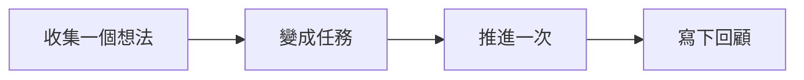
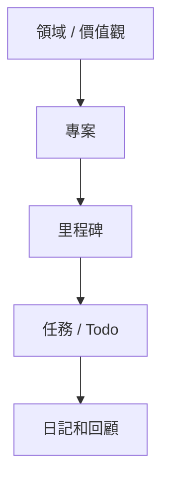

閱讀「GranoFlow 是什麼？」時，可以先把它放回「開始使用」這條線裡理解。重點不是背功能名，而是弄清它適合解決什麼問題、下一步該怎麼判斷。

::::tip[先抓住主線]
先跑通一個小閉環，再慢慢理解更多設定。

如果你正在處理類似問題，先讀下面的判斷表；真正操作時，再結合頁面裡的列表、狀態和提示來判斷下一步。
::::

## 先把它想成什麼

把它想成工作檯上的便籤：先把想法放下來，再決定今天拿起哪一張。

## 一眼看懂流程

先把流程看成一條線：理解這些步驟的順序後，再到對應頁面處理具體操作。

## 一個真實場景

第一次打開 GranoFlow 時，先找到收集箱、任務、專案和回顧，不急著配置所有設定。

## 操作前先判斷

| 如果你現在想... | 頁面裡通常看什麼 | 接下來做什麼 |
| --- | --- | --- |
| 進入「GranoFlow 是什麼？」相關頁面 | 側邊欄入口、頁面標題和主區域 | 先弄清當前列表或設定區在表達什麼 |
| 改一個設定或狀態 | 頁面提示、按鈕文字、當前列表 | 改完只觀察一個結果 |
| 結果和預期不同 | 空狀態、錯誤提示、存取記錄或同步狀態 | 回到上一層，按排查順序處理 |

## 可複用判斷

先完成一個小閉環，比先理解所有概念更重要。

## 具體用法和邊界

GranoFlow 是一個本機優先的個人規劃應用。你可以先把它當 Todo 用：記下任務、安排時間、完成後勾掉；之後再把任務連到專案、里程碑、價值觀和回顧裡，看自己每天做的事是否真的在推進重要目標。

### 任務只是入口

最簡單的用法是：想到一件事，就在 GranoFlow 裡新增一個任務。你不需要一開始就把所有內容整理完。

等你有時間時，可以再決定這個任務屬於哪個專案、和哪個里程碑有關、什麼時候處理。任務在 GranoFlow 裡不是孤立清單，而是一個入口，幫助你把日常事情放回更大的生活結構中。

### 不只是 Todo 清單

普通 Todo 工具通常只回答一個問題：今天要做什麼？

GranoFlow 還會幫你多看一層：這些任務屬於哪個專案？專案在推進哪個里程碑？這些事和你在意的方向有沒有關係？

下面是 GranoFlow 裡常見的關係：

這樣，即使一週只完成了幾件事，你也可以回頭看：它們只是讓你變忙，還是確實讓某個專案往前走了一點。

### 回顧不等於打卡

GranoFlow 也是覆盤工具。日回顧和每週價值觀記錄不是為了製造連續打卡壓力，也不是為了把暫停說成失敗。

你可以用它記錄發生了什麼、當時怎麼想、下一步準備怎麼調整。回顧的重點是看清事實，而不是責備自己。

### 保留私人的規劃空間

GranoFlow 採用本機優先產品思路。核心記錄先在裝置上；同步、備份和加密各有明確邊界。

AI 輔助回顧可以幫你整理思考，但它只是輔助。要不要採納、怎麼調整、下一步做什麼，仍然由你決定。

::::note[剛開始用？]
第一次打開 GranoFlow，只需要記住一件事：點 **+** 可以新增任務。其他功能可以等真正需要時再探索。
::::

## 常見誤解

| 容易誤解 | 更穩的理解 |
| --- | --- |
| 「GranoFlow 是什麼？」需要一次配置完 | 先完成當前這一步，後續再逐步補充 |
| 頁面裡所有入口都要立刻用上 | 只處理和你當前任務有關的入口 |
| 沒有馬上整理好就是失敗 | 只要下一步更清楚，就已經有用 |

::::note[決定仍要回到你的目標]
GranoFlow 可以把資訊、狀態和下一步擺清楚；要不要繼續、是否改設定、是否刪除或還原資料，仍要看你當前頁面和真實目標。
::::

## 下一步

下一步可以從任務章節開始，先跑通一個最小閉環。
