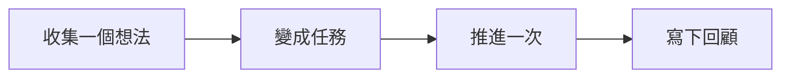

閱讀「GranoFlow 適合誰」時，可以先把它放回「開始使用」這條線裡理解。重點不是背功能名，而是弄清它適合解決什麼問題、下一步該怎麼判斷。

::::tip[先抓住主線]
先跑通一個小閉環，再慢慢理解更多設定。

如果你正在處理類似問題，先讀下面的判斷表；真正操作時，再結合頁面裡的列表、狀態和提示來判斷下一步。
::::

## 先把它想成什麼

把它想成工作檯上的便簽：先把想法放下來，再決定今天拿起哪一張。

## 一眼看懂流程

先把流程看成一條線：理解這些步驟的順序後，再到對應頁面處理具體操作。

## 一個真實場景

第一次打開 Granoflow 時，先找到收集箱、任務、專案和回顧，不急著配置所有設定。

## 操作前先判斷

| 如果你現在想... | 頁面裡通常看什麼 | 接下來做什麼 |
| --- | --- | --- |
| 進入「GranoFlow 適合誰」相關頁面 | 側邊欄入口、頁面標題和主區域 | 先弄清當前列表或設置區在表達什麼 |
| 改一個設置或狀態 | 頁面提示、按鈕文字、當前列表 | 改完只觀察一個結果 |
| 結果和預期不同 | 空狀態、錯誤提示、訪問記錄或同步狀態 | 回到上一層，按排查順序處理 |

## 可複用判斷

先完成一個小閉環，比先理解所有概念更重要。

## 具體用法與邊界

如果你的任務不是孤立的小事，而是屬於某個專案、階段或長期目標，GranoFlow 就適合你。它不是只幫你記住「今天要做什麼」，而是幫你看清這些任務到底在推進哪件更重要的事。

一句話版本：**GranoFlow 適合那些「任務背後有更大目標」的人**。

如果你只是想記一個購物清單、臨時提醒或幾件零散小事，手機自帶的備忘錄或普通清單工具可能已經夠用。GranoFlow 更適合這樣的情況：你手上有好幾個專案，每個專案都有階段和目標，你希望下次打開時能快速想起來「我現在應該繼續推進什麼」。

### 專案型工作者

如果你是獨立開發者、設計師、研究者、創作者、創業者，或者經常同時處理好幾條工作線，GranoFlow 會比較適合。

這類工作的難點通常不是「有沒有任務」，而是任務太多之後，很難判斷哪件事更重要。普通 Todo 清單會越寫越長，最後只剩下一堆待辦事項。

GranoFlow 讓你把任務放到專案和里程碑下面。這樣你看到的不只是一個任務名稱，也能看到它屬於哪個專案、正在服務哪個階段目標。中斷後再回來，也更容易接上。

### 正在長期累積的人

如果你正在準備考試、轉行、學語言、練技能、寫書，或者做任何需要長期投入的事情，GranoFlow 也適合你。

這類事情的特點是：今天做一點，可能看不出變化；但持續幾週、幾個月之後，才會看到累積。問題是，人很容易在中間失去方向感。

GranoFlow 的回顧功能可以幫你定期停下來看看：這段時間有沒有真的在累積？方向有沒有偏？你不需要把它當成評分工具，它更像是一個提醒你抬頭看路的地方。

### 容易被打斷的人

如果你經常被會議、家庭、客戶、臨時問題打斷，GranoFlow 會有幫助。

很多人被打斷之後，最麻煩的不是重新開始工作，而是想不起來「我剛才做到哪了」「這件事為什麼重要」。如果所有內容都只放在一個普通清單裡，恢復狀態會更費力。

GranoFlow 用專案和里程碑把任務組織起來。即使你中斷了一週，再打開時也能看到任務和目標之間的關係，不需要從頭整理一遍。

### 重視回顧和復盤的人

如果你已經有定期復盤的習慣，GranoFlow 可以作為一個更清楚的記錄容器。

日回顧不只是用來劃掉任務。你可以用它記錄今天做了什麼、有什麼感受、發現了什麼問題。時間久了，它能幫助你理解自己這段時間到底在推進什麼，而不是只看到一串完成或未完成的清單。

::::note[什麼時候普通 Todo 就夠了]
如果你主要只是記錄「買牛奶」「記得取快遞」這類事項，一個簡單的清單工具可能更輕便。GranoFlow 在任務背後有專案、階段、目標或回顧需求時，才更能發揮價值。
::::

## 常見誤解

| 容易誤解 | 更穩的理解 |
| --- | --- |
| 「GranoFlow 適合誰」需要一次配置完 | 先完成當前這一步，後續再逐步補充 |
| 頁面裡所有入口都要立刻用上 | 只處理和你當前任務有關的入口 |
| 沒有馬上整理好就是失敗 | 只要下一步更清楚，就已經有用 |

::::note[決定仍要回到你的目標]
Granoflow 可以把資訊、狀態和下一步擺清楚；要不要繼續、是否改設定、是否刪除或恢復資料，仍要看你當前頁面和真實目標。
::::

## 下一步

下一步可以從任務章節開始，先跑通一個最小閉環。
