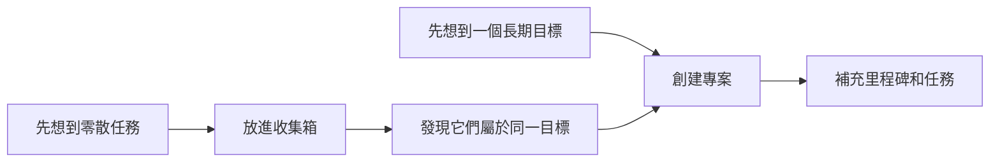

建立專案不是為了把事情寫得更正式，而是為了給一組相關任務找一個穩定的地方。以前你可能會先問「我要不要建一個專案」，更好用的問法是：「這件事會不會反覆回來，需要我記住背景和進度？」

如果答案是會，就可以建立專案。專案先把目標裝起來，任務和里程碑可以之後慢慢補。

## 先判斷要不要建立

| 場景 | 建議 | 例子 |
| --- | --- | --- |
| 一次性動作 | 直接建任務 | 今天交水費、回覆一封郵件 |
| 一個持續目標 | 建專案 | 準備課程發布、搬家、寫論文 |
| 還沒想清楚，只是一個念頭 | 先放進收集箱 | 「也許要整理作品集」 |
| 已經有一批相關任務散在各處 | 建專案後再歸入 | 把發布、測試、文案任務放到同一專案 |

這裡的關鍵不是專案名稱好不好看，而是它能不能幫你下次回來時少花一點回憶成本。

## 建立入口與必填內容

進入專案頁，點擊右上角 **+**，填寫專案名稱和必要說明，然後建立。

建立時通常會遇到這些欄位：

| 欄位 | 怎麼寫 | 注意什麼 |
| --- | --- | --- |
| 名稱 | 寫出要完成的目標 | 「寫完畢業論文」比「論文」更清楚 |
| 描述 | 記錄背景、範圍、約束或交付說明 | 不確定時可以先留空 |
| 領域 | 選擇它屬於哪個長期方向 | 適合把工作、學習、健康等大方向分開 |

::::tip[專案名稱盡量寫成一句動作]
「上線課程第一版」「完成搬家準備」「整理 2026 作品集」都比「課程」「搬家」「作品集」更容易接下一步。專案名稱不需要文學化，只要將來的你一眼看懂。
::::

## 先建空專案，還是先收集任務

兩種順序都可以。

如果你已經知道這是一個專案，比如「準備一次發布」，先建專案會更輕鬆。之後看到相關任務，就能直接歸進去。

如果你只是陸續想到一些事，比如「買紙箱」「問物業」「查搬家公司」，先放進收集箱也沒問題。等你發現它們其實都屬於「搬家」，再創建專案並把任務連接進去。

這兩條路最後會匯合到同一個地方：一個專案承接目標，任務負責真正推進。

## 創建後接著做什麼

專案創建完成後，不必馬上把它整理到完美。通常按這個順序繼續就夠了：

| 下一步 | 什麼時候做 | 會得到什麼結果 |
| --- | --- | --- |
| 添加里程碑 | 目標有明顯階段 | 專案不再是一整串任務 |
| 連接已有任務 | 任務已經散在收集箱或任務列表 | 相關事項回到同一個專案 |
| 在專案裡創建新任務 | 你已經知道下一步動作 | 新任務自動帶上專案上下文 |

如果你暫時不知道後面要做什麼，先關掉也可以。一個空專案不是失敗，它只是先佔住了一個目標位置。

## 常見誤解

| 容易誤解 | 更穩的理解 |
| --- | --- |
| 創建專案時必須把計畫寫完整 | 專案可以先粗後細 |
| 描述必須寫得很正式 | 描述只要能幫你以後回憶背景 |
| 選了領域就等於排好了優先級 | 領域只是歸屬，優先級仍要結合任務和日期判斷 |

## 下一步

如果這個專案已經能分出幾個階段，繼續看「管理里程碑」。如果你已經有任務散在別處，可以直接看「把任務連接到專案」。
